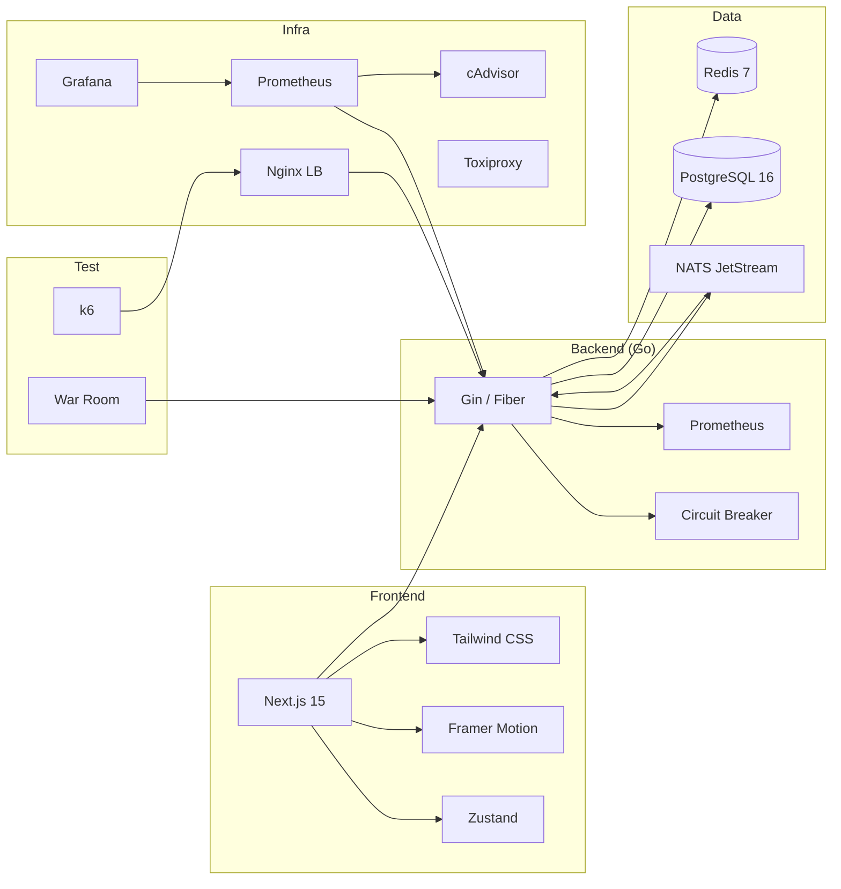
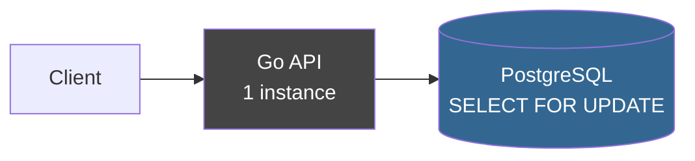
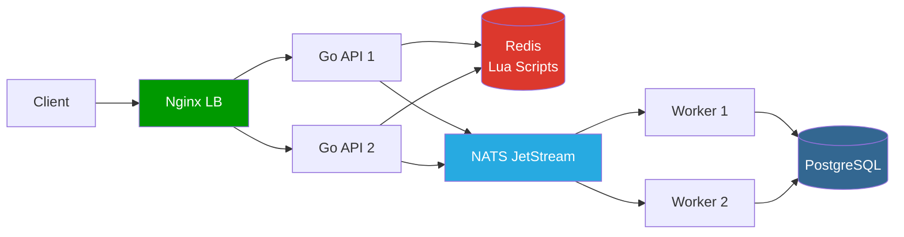
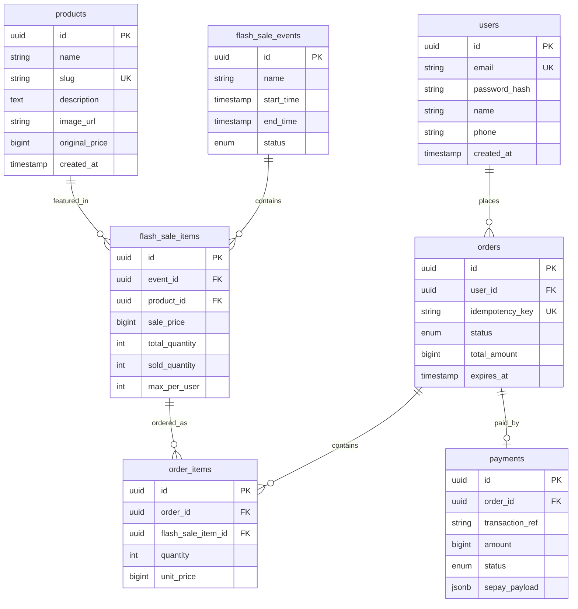

# Software Design Document – ApexStock

> **Dự án:** ApexStock – Hệ thống bán hàng flash sale hiệu năng cao  
> **Phiên bản:** 1.0  
> **Ngày:** 2026-10-22  
> **Trạng thái:** Draft – chờ phê duyệt trước khi triển khai

---

## Mục lục

1. [Tổng quan dự án](#1-tổng-quan-dự-án)
2. [Mục tiêu & Phạm vi](#2-mục-tiêu--phạm-vi)
3. [Techstack](#3-techstack)
4. [Kiến trúc hệ thống](#4-kiến-trúc-hệ-thống)
5. [Database & Dữ liệu](#5-database--dữ-liệu)
6. [API & Luồng dữ liệu](#6-api--luồng-dữ-liệu)
7. [Giao diện người dùng](#7-giao-diện-người-dùng)
8. [War Room Dashboard](#8-war-room-dashboard)
9. [Kiểm thử tải](#9-kiểm-thử-tải)
10. [Bảo mật](#10-bảo-mật)
11. [Triển khai (Docker Compose)](#11-triển-khai-docker-compose)
12. [Kịch bản demo hội đồng](#12-kịch-bản-demo-hội-đồng)

---

## 1. Tổng quan dự án

**ApexStock** là hệ thống bán hàng online được thiết kế để chịu tải cực cao trong kịch bản flash sale. Dự án được xây dựng với **hai kiến trúc song song** để so sánh khách quan:

- **Baseline:** Kiến trúc đơn giản, đồng bộ – Go API → PostgreSQL trực tiếp
- **Optimized:** Kiến trúc tối ưu – Go API → Redis (Lua) → NATS JetStream → PostgreSQL

Hệ thống cũng bao gồm:
- **Giao diện người dùng** đầy đủ tính năng (đăng nhập, giỏ hàng, thanh toán thật qua SePay)
- **War Room Dashboard** để trình bày trực quan cho hội đồng
- **Bộ kiểm thử tải** với k6, Prometheus, Grafana

---

## 2. Mục tiêu & Phạm vi

### 2.1 Mục tiêu

> **Lưu ý quan trọng:** Các con số RPS/latency dưới đây là **hypothesis/target**, không phải kết quả nghiệm thu. UI/README chỉ hiển thị measured artifact sau khi chạy benchmark thực tế (theo D0.10).

| # | Mục tiêu | Đo bằng |
|---|----------|---------|
| M1 | Kiến trúc tối ưu đạt >3,000 RPS bền vững trên 1 máy **(hypothesis)** | k6 max throughput scenario |
| M2 | Zero oversell – không bán vượt tồn kho | `stock_oversold_total == 0` |
| M3 | Phục hồi trong <10s khi 1 API instance bị kill **(hypothesis)** | Đo RPS dip + recovery |
| M4 | Kiến trúc Baseline đạt <500 RPS (để so sánh rõ) **(hypothesis)** | k6 |
| M5 | Giao diện có thể thanh toán thật qua SePay | Demo thực tế |

### 2.2 Phạm vi trong (In-scope)

- Flash sale order flow (đặt hàng, giữ kho, thanh toán, restock)
- **Mỗi order flash sale chỉ mua đúng 1 sản phẩm** (D0.4 — có thể mở rộng nhiều món trong tương lai)
- Đăng nhập / đăng ký người dùng (JWT)
- Thanh toán SePay webhook (simulator trước, integration thật sau — D0.6)
- Bộ so sánh Baseline vs Optimized
- War Room Dashboard (WebSocket — D0.14)
- Bộ kiểm thử tải đầy đủ (chạy tuần tự — D0.11)

### 2.3 Phạm vi ngoài (Out-of-scope)

- Vận chuyển, giao hàng
- Hệ thống đánh giá sản phẩm
- Đa ngôn ngữ
- Mobile app
- Multi-tenant

### 2.4 Ràng buộc

- Chạy trên **1 máy duy nhất** (i5-10500H, 16GB RAM, NVMe SSD)
- Mọi service chạy trong **Docker Compose**
- Tổng RAM sử dụng < 14GB (để OS và load test tool chia sẻ)
- Backend: **Go**; Frontend: **Next.js**

---

## 3. Techstack



| Layer | Công nghệ | Phiên bản | Lý do chọn |
|-------|-----------|-----------|------------|
| Frontend | Next.js | 15 | App Router, Server Components, tích hợp tốt với Tailwind |
| Styling | Tailwind CSS | 4 | Utility-first, nhất quán với design system |
| Animation | Framer Motion | 12 | Aurora, spotlight, spring animation |
| State | Zustand | 5 | Nhẹ hơn Redux, đủ cho scope này |
| Backend | Go + Fiber | 1.27 / v3 | Goroutine nhẹ, throughput cao, phù hợp concurrency |
| Cache + Inventory | Redis | 7 | Lua scripting, atomic ops, Sorted Set cho reservation |
| Message Queue | NATS JetStream | 2.10 | Nhẹ hơn Kafka/Redpanda (~60MB RAM), đủ tính năng |
| Database | PostgreSQL | 16 | ACID, JSON support, ecosystem tốt |
| Load Balancer | Nginx | 1.26 | Proven, config đơn giản cho Docker Compose |
| Monitoring | Prometheus + Grafana | — | Chuẩn ngành, tích hợp tốt với Go |
| Load Testing | k6 | 0.55 | Scriptable, Prometheus export, nhẹ |
| Payment | SePay | — | Hỗ trợ VN, webhook, QR VietQR |

---

## 4. Kiến trúc hệ thống

> Chi tiết: [`docs/design/01-system-architecture.md`](./01-system-architecture.md)

### 4.1 Baseline Architecture



**Đặc điểm:** Mỗi request đặt hàng = 1 database transaction với `SELECT ... FOR UPDATE`. Row lock giữ trong suốt thời gian tạo đơn → serialized, throughput thấp (~350 RPS), latency cao.

### 4.2 Optimized Architecture



**Đặc điểm:**
- Kiểm tra và trừ kho **nguyên tử trong Redis** bằng Lua script (không cần DB lock)
- Order tạo xong → **publish queue** ngay, trả lời client (<5ms)
- Worker ghi DB **bất đồng bộ**, có retry
- **Idempotency** ngăn đơn trùng lặp
- **Circuit Breaker** shared qua Redis: khi Redis/DB gặp sự cố, tất cả API instance biết ngay

### 4.3 Các Pattern quan trọng

| Pattern | Mô tả ngắn | Triển khai |
|---------|-----------|------------|
| **Idempotency** | Cùng request, cùng kết quả | Redis HASH NX + TTL 24h |
| **Circuit Breaker** | Khi service lỗi, fail fast thay vì chờ timeout | 3 state: CLOSED/HALF-OPEN/OPEN, shared qua Redis |
| **Rate Limiting** | Giới hạn request per user và global | 3 tầng: Nginx IP → App user → Global event |
| **Distributed Lock** | Ngăn race condition khi init event | Redis SET NX PX với owner verification |
| **Retry + Backoff** | Worker retry khi ghi DB thất bại | 5 lần, base 500ms, factor 2, max 8s, +jitter |
| **Graceful Degradation** | Hệ thống vẫn hoạt động một phần khi có sự cố | Ma trận failure/response cho từng component |

---

## 5. Database & Dữ liệu

> Chi tiết: [`docs/design/02-database-and-data.md`](./02-database-and-data.md)

### 5.1 PostgreSQL – Sơ đồ ER



### 5.2 Redis – Key Schema

| Key Pattern | Type | Mục đích | TTL |
|------------|------|---------|-----|
| `flash_item:{id}:stock` | String | Tồn kho realtime | Không (xoá khi event kết thúc) |
| `flash_item:{id}:reserved` | Sorted Set | Đơn đang giữ kho (score=expiry) | Không |
| `flash_item:{id}:user:{uid}` | String | Số lượng user đã mua | Không |
| `idempotency:{key}` | Hash | Cache kết quả request | 86400s |
| `rate_limit:{uid}:{endpoint}` | String | Sliding window counter | 60s |
| `session:{token}` | Hash | JWT session cache | 900s |
| `cb:state:{service}` | String | Circuit breaker state | Không |

### 5.3 Lua Scripts chính

- **`reserve_stock.lua`**: Kiểm tra tồn kho + giới hạn user + trừ kho nguyên tử
- **`release_stock.lua`**: Hoàn kho khi thanh toán thất bại/hết hạn
- **`confirm_stock.lua`**: Xác nhận kho khi thanh toán thành công
- **`cleanup_expired.lua`**: Quét ZRANGEBYSCORE tìm đơn hết hạn, release hàng loạt

### 5.4 NATS JetStream – Topics

| Subject | Publisher | Consumer | Mô tả |
|---------|-----------|----------|-------|
| `orders.created` | API | Worker | Đơn mới cần ghi DB |
| `orders.payment.confirmed` | API (webhook) | Worker | Thanh toán thành công |
| `orders.payment.failed` | API (webhook) | Worker | Thanh toán thất bại |
| `orders.expired` | Cron | Worker | Đơn hết hạn cần restock |
| `stock.released` | Worker | Notifier | Kho vừa được hoàn, có thể bán lại |

---

## 6. API & Luồng dữ liệu

> Chi tiết: [`docs/design/03-api-and-data-flow.md`](./03-api-and-data-flow.md)

### 6.1 Luồng đặt hàng tối ưu (tóm tắt 7 bước)

```
1. Client gửi POST /flash-sale/order kèm idempotency_key
2. API kiểm tra Redis: key đã tồn tại? → Trả cached response
3. API chạy Lua script: Kiểm tra stock > 0, user chưa vượt giới hạn → Trừ kho nguyên tử
4. API SET idempotency key NX (ngăn race condition)
5. API PUBLISH "orders.created" vào NATS queue
6. API trả 201 cho client (<5ms)
7. [Bất đồng bộ] Worker ghi đơn vào PostgreSQL, có retry
```

### 6.2 Luồng restock

```
Cron 10s → Lua cleanup_expired → PUBLISH orders.expired →
Worker → UPDATE order status=expired → Lua release_stock → stock tăng lại
```

### 6.3 Idempotency race condition

Khi 2 request cùng key đến đồng thời: Redis `SET NX` đảm bảo chỉ 1 request thắng. Request thua nhận 202 + retry sau khi request thắng hoàn tất.

---

## 7. Giao diện người dùng

### 7.1 Design System

- **Nền tảng:** Tối giản kỹ thuật (Vercel/Linear style) – nền đen, lưới mỏng, viền 1px, font mono cho số liệu
- **Animation:**
  - **Aurora:** Dải cực quang xoay chậm ở đầu trang
  - **Spotlight:** Đèn rọi màu tím theo con chuột trên toàn trang
  - **Spin border:** Viền gradient hồng-tím-xanh chạy vòng quanh sản phẩm hot
  - **Fill button:** Nút Mua được đổ màu gradient khi hover
- **Theme:** Hỗ trợ Dark / Light, chuyển đổi mượt

### 7.2 Các trang chính

| Trang | Route | Mô tả |
|-------|-------|-------|
| Trang chủ | `/` | Hero section + sản phẩm nổi bật |
| Flash Sale | `/flash-sale/:id` | Đồng hồ đếm ngược + sản phẩm + nút mua |
| Đăng nhập | `/auth/login` | JWT auth |
| Đăng ký | `/auth/register` | |
| Giỏ hàng | `/cart` | Xem + sửa giỏ hàng |
| Đặt hàng | `/checkout` | Xác nhận + thanh toán SePay QR |
| Đơn hàng | `/orders` | Danh sách đơn |
| Chi tiết đơn | `/orders/:id` | Trạng thái + QR thanh toán |
| War Room | `/war-room` | Dashboard demo (nội bộ) |

### 7.3 Realtime

- Tồn kho cập nhật realtime qua WebSocket (giảm số trong khi hàng đang bán)
- Trạng thái thanh toán poll 3s hoặc WebSocket push
- Đồng hồ đếm ngược flash sale

---

## 8. War Room Dashboard

> Chi tiết: [`docs/design/04-war-room-dashboard.md`](./04-war-room-dashboard.md)

### 8.1 Layout tổng quan

```
┌─────────────────────────────────────────────────────────────────────┐
│  🌌 AURORA HEADER  │  ApexStock War Room  │  [🕐 00:02:34]  [☾/☀]  │
├──────────────────────────────────────────────────────────────────────┤
│  [▶ BẮT ĐẦU] │ Load: [500▾] │ Chaos: [API-1▾] [Kill] [Pause]       │
├────────────────────────────┬─────────────────────────────────────────┤
│   BASELINE                 │   OPTIMIZED                             │
│  [🔴 API] [🟢 DB]         │  [🟢 API-1] [🟢 API-2] [🟢 Redis]      │
│                            │  [🟢 Queue] [🟢 DB]                     │
│  RPS: 312  ▁▂▃▄▅▄▃        │  RPS: 4,821  ▁▃▅▇▇▇▇                  │
│  p50: 420ms p95: 1,240ms  │  p50: 18ms  p95: 62ms                  │
│  Error: 3.2%               │  Error: 0.1%                            │
│  [Stock: ████████░░ 7821]  │  [Stock: ████░░░░░░ 5124]              │
│  Orders: 2,179             │  Orders: 4,876                          │
│  Oversell: [✅ 0]          │  Oversell: [✅ 0]                       │
│                            │                                         │
│   [Latency chart 60s]      │   [Latency chart 60s]                  │
├────────────────────────────┴─────────────────────────────────────────┤
│  Activity Log:                                                        │
│  [19:05:32] ▶ Test bắt đầu – 500 VU                                 │
│  [19:06:01] ⚡ CHAOS: docker kill apexstock-api-1                    │
│  [19:06:06] 🔴 API-1 offline – Nginx rerouting                      │
│  [19:06:09] 🟢 Optimized RPS ổn định @ 4,600                        │
└──────────────────────────────────────────────────────────────────────┘
```

### 8.2 Chaos Controls

| Nút | Hành động | An toàn |
|-----|-----------|---------|
| Kill API-1 | `docker kill apexstock-api-1` | Confirm dialog + auto-resume 30s |
| Kill API-2 | `docker kill apexstock-api-2` | Như trên |
| Kill Redis | `docker kill apexstock-redis` | Cảnh báo nghiêm trọng |
| Kill DB | `docker kill apexstock-postgres` | Cảnh báo nghiêm trọng |
| Pause/Resume | `docker pause/unpause` | Confirm dialog |

---

## 9. Kiểm thử tải

> Chi tiết: [`docs/design/05-load-testing-strategy.md`](./05-load-testing-strategy.md)

### 9.1 Kịch bản chính

| Kịch bản | Mô tả | Thời lượng |
|---------|-------|------------|
| Max RPS | Ramp up đến 3,000 VU, tìm ngưỡng | 4 phút |
| Flash Sale | 1,000 VU shock wave + payment simulation + restock | 90 giây |
| Stress | 5,000 VU, quan sát graceful degradation | 3.5 phút |
| **Resilience** | Kill API trong lúc tải cao ← **Demo chính** | 2 phút |
| Soak | 200 VU ổn định 10 phút, kiểm tra memory leak | 10 phút |

### 9.2 Thresholds bắt buộc

```javascript
thresholds: {
  'stock_oversold_total': ['count==0'],    // HARD: không được phá vỡ
  'http_req_duration': ['p(95)<500'],      // SLA target
  'http_req_failed': ['rate<0.05'],        // Error budget
}
```

### 9.3 Phương pháp so sánh công bằng

- Cùng tổng RAM, cùng k6 script, chạy tuần tự
- Warm up 30s trước khi đo
- 3 lần/kiến trúc, báo cáo median

---

## 10. Bảo mật

| Hạng mục | Biện pháp |
|---------|----------|
| Auth | JWT (access 15 phút) + Refresh token (7 ngày) |
| Password | bcrypt, cost=12 |
| SePay webhook | HMAC-SHA256 signature verify |
| Rate limiting | 3 tầng: Nginx IP, App user, Global event |
| SQL Injection | Prepared statements (pgx driver) |
| War Room | Basic auth hoặc chỉ localhost access |
| Redis | Bind localhost only, no requirepass trong Docker network |
| CORS | Whitelist origin cụ thể |

---

## 11. Triển khai (Docker Compose)

### 11.1 Danh sách services

```yaml
# docker-compose.optimized.yml – tóm tắt
services:
  nginx:         # Load balancer, port 80/443
  api-1:         # Go API instance 1, port 8081
  api-2:         # Go API instance 2, port 8082
  worker-1:      # NATS consumer 1
  worker-2:      # NATS consumer 2
  redis:         # Redis 7, port 6379
  nats:          # NATS JetStream, port 4222
  postgres:      # PostgreSQL 16, port 5432
  cron:          # Cleanup expired orders
  prometheus:    # Metrics, port 9090
  grafana:       # Dashboard, port 3001
  cadvisor:      # Container metrics
  frontend:      # Next.js, port 3000
```

### 11.2 Resource allocation

| Service | CPU limit | RAM limit |
|---------|-----------|-----------|
| nginx | 0.5 | 128MB |
| api-1 | 2.0 | 512MB |
| api-2 | 2.0 | 512MB |
| worker-1 | 0.5 | 256MB |
| worker-2 | 0.5 | 256MB |
| redis | 1.0 | 512MB |
| nats | 0.5 | 256MB |
| postgres | 1.5 | 1.5GB |
| prometheus | 0.5 | 512MB |
| grafana | 0.5 | 256MB |
| cadvisor | 0.2 | 128MB |
| frontend | 0.5 | 256MB |
| **Tổng** | **10.2 CPU** | **~5.1GB** |

> Còn ~3GB RAM cho OS, load test tools (k6), và buffer.

---

## 12. Kịch bản demo hội đồng

### Bước 1 – Giới thiệu (2 phút)
Trình bày slide: Bài toán flash sale, vấn đề của kiến trúc đơn giản, giải pháp.

### Bước 2 – Mở War Room (1 phút)
Mở browser, giải thích layout 50/50, các panel metrics.

### Bước 3 – Chạy Baseline (3 phút)
- Bắt đầu test với 1,000 VU trên Baseline
- Hội đồng thấy: RPS ~350, latency ~1s, error rate tăng, tồn kho giảm chậm
- Sau ~20s hàng bán hết

### Bước 4 – Chạy Optimized (3 phút)
- Reset kho, bắt đầu test với 1,000 VU trên Optimized
- Hội đồng thấy: RPS ~4,500, latency ~18ms, hàng hết sau ~2.5s
- Oversell = 0 trên cả hai

### Bước 5 – Chaos (3 phút) ← **Điểm nhấn**
- Đang chạy test tải cao → bấm Kill API-1
- Hội đồng thấy: RPS dip ~1s, rồi tự phục hồi
- Activity log hiển thị sự kiện realtime
- Sau test: Orders lost = 0, Oversell = 0

### Bước 6 – Demo giao diện (2 phút)
- Mở trang flash sale, đặt hàng thật, quét QR SePay
- Hội đồng thấy giao diện đẹp, animation mượt, thanh toán thật

### Bước 7 – Tổng kết (2 phút)
- Bảng so sánh kết quả xuất hiện trong War Room
- Highlight: +1,186% throughput, -95% latency, zero oversell, tự phục hồi

---

## Phụ lục: Tài liệu liên quan

| File | Nội dung |
|------|---------|
| [`01-system-architecture.md`](./01-system-architecture.md) | Kiến trúc chi tiết, patterns, Docker Compose |
| [`02-database-and-data.md`](./02-database-and-data.md) | Schema, Lua scripts, Redis keys, NATS topics |
| [`03-api-and-data-flow.md`](./03-api-and-data-flow.md) | API endpoints, sequence diagrams |
| [`04-war-room-dashboard.md`](./04-war-room-dashboard.md) | Layout, chaos controls, animation |
| [`05-load-testing-strategy.md`](./05-load-testing-strategy.md) | k6 scripts, metrics, benchmark methodology |
