# Thiết kế Kiến trúc Hệ thống — ApexStock

> **Phiên bản:** 1.0  
> **Ngày:** 2024-10-22  
> **Tác giả:** ApexStock Architecture Team  
> **Trạng thái:** Draft

---

## Mục lục

1. [Tổng quan kiến trúc](#1-tổng-quan-kiến-trúc)
2. [Kiến trúc Baseline (đơn giản)](#2-kiến-trúc-baseline-đơn-giản)
3. [Kiến trúc Optimized (tối ưu)](#3-kiến-trúc-optimized-tối-ưu)
4. [Các pattern quan trọng](#4-các-pattern-quan-trọng)
5. [Resilience & Fault Tolerance](#5-resilience--fault-tolerance)
6. [Docker Compose Deployment Strategy](#6-docker-compose-deployment-strategy)
7. [So sánh hai kiến trúc](#7-so-sánh-hai-kiến-trúc)

---

## 1. Tổng quan kiến trúc

### 1.1. Triết lý thiết kế

ApexStock được xây dựng với mục tiêu **so sánh trực tiếp** hai cách tiếp cận kiến trúc cho bài toán flash sale — một bài toán đặc trưng bởi:

- **Đột biến lưu lượng cực cao** trong khoảng thời gian ngắn (hàng nghìn request/giây trong vài phút)
- **Ràng buộc tồn kho tuyệt đối** — không bao giờ được bán vượt số lượng tồn kho (overselling)
- **Yêu cầu công bằng** — ai đến trước được phục vụ trước (FIFO)
- **Trải nghiệm người dùng** — phản hồi nhanh, thông báo rõ ràng

### 1.2. Sơ đồ tổng thể hai kiến trúc

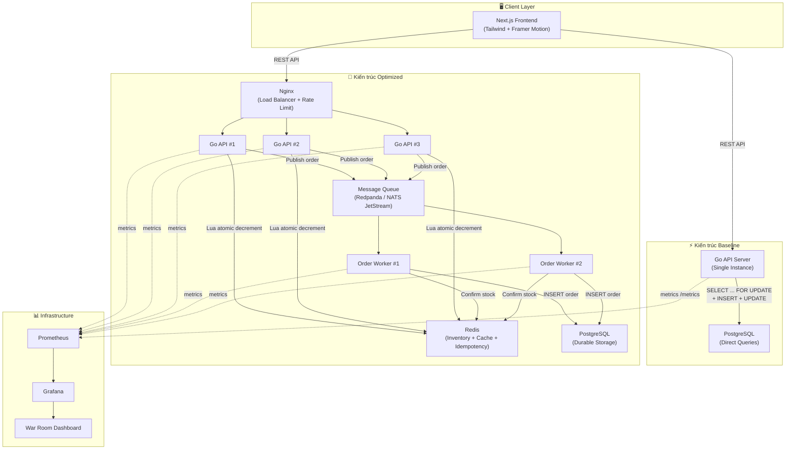

### 1.3. Vai trò từng thành phần

| Thành phần | Vai trò | Lý do tồn tại |
|---|---|---|
| **Next.js Frontend** | Giao diện người dùng, War Room dashboard | SPA với SSR cho SEO, Framer Motion cho UX mượt mà |
| **Nginx** | Load balancer, rate limiting, SSL termination | Phân tải giữa nhiều API instance, chặn request thừa ở tầng edge |
| **Go API Server** | Xử lý HTTP request, business logic | Go có goroutine nhẹ, GC nhanh, phù hợp high-concurrency |
| **Redis** | Cache tồn kho, idempotency keys, rate limit counters | `noeviction`; không eviction inventory keys; atomic operations qua Lua scripts |
| **Message Queue** | **NATS JetStream persistent on disk** | Buffer đơn hàng durable, không mất order khi crash |
| **Order Workers** | Consumer xử lý đơn hàng từ JetStream | Tách tốc độ nhận request và tốc độ ghi DB |
| **PostgreSQL** | Lưu trữ bền vững: users, products, orders, payments, webhook_logs | ACID compliance, dữ liệu quan trọng cần durability |
| **Prometheus** | Thu thập metrics | Time-series DB tối ưu cho monitoring |
| **Grafana** | Hiển thị metrics, alerting | Dashboard linh hoạt, tích hợp sẵn với Prometheus |
| **War Room Dashboard** | So sánh hai kiến trúc real-time qua WebSocket | Custom UI hiển thị side-by-side; operator kill container trực tiếp |

---

## 2. Kiến trúc Baseline (đơn giản)

### 2.1. Tổng quan

Kiến trúc Baseline đại diện cho cách tiếp cận **truyền thống nhất** để xây dựng hệ thống e-commerce: một API server duy nhất kết nối trực tiếp tới PostgreSQL. Mọi thao tác đều đồng bộ, mọi ràng buộc đều do database đảm nhận.

- Baseline API lắng nghe `:8081`
- Optimized API lắng nghe `:8082`
- Cả hai expose chung `POST /api/v1/flash-sale/orders`, chung schema và validation
- Benchmark chạy tuần tự với CPU/RAM budget đã khóa

Cả hai implementation dùng cùng public contract:

```text
POST /api/v1/flash-sale/orders
```

- Baseline: `http://localhost:8081`
- Optimized: `http://localhost:8082`
- Schema/validation giống nhau; chỉ khác implementation phía sau.

### 2.2. Luồng xử lý đặt hàng

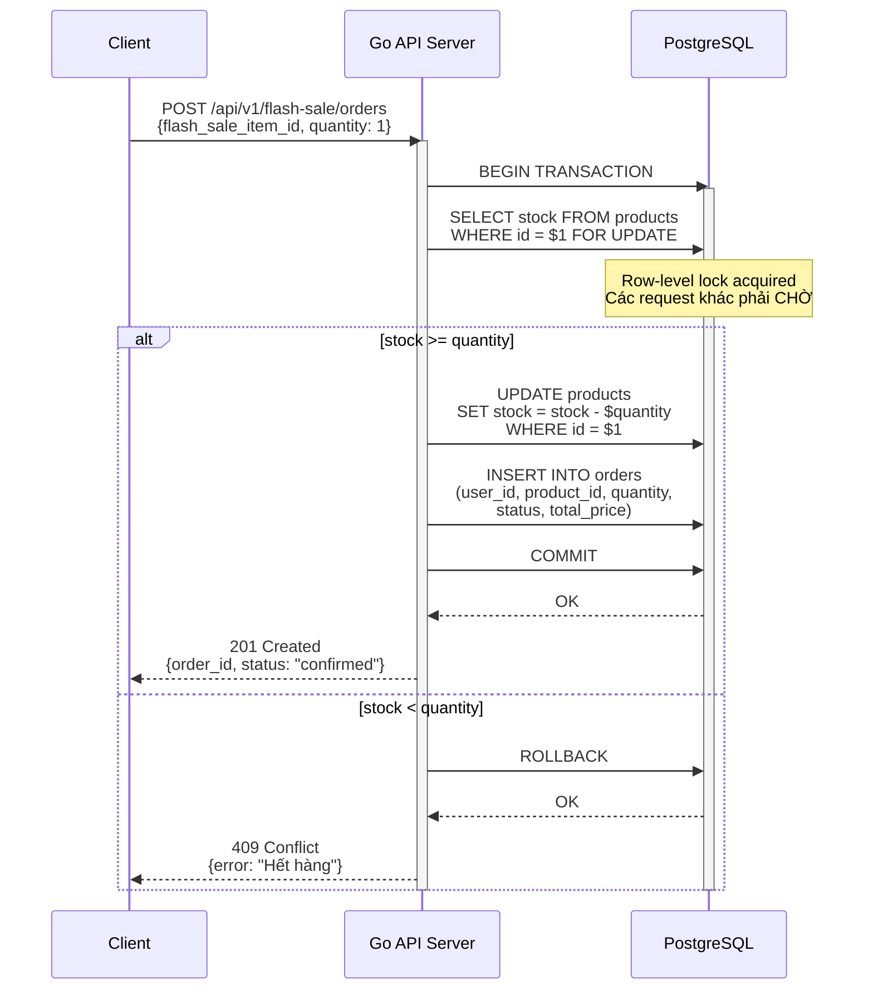

### 2.3. Đặc điểm kỹ thuật

#### Database Schema sử dụng

```sql
-- Baseline sử dụng trực tiếp PostgreSQL cho mọi thao tác
-- Mỗi request purchase tạo một transaction:

BEGIN;
  -- Step 1: Lock row sản phẩm (pessimistic locking)
  SELECT stock, price FROM products WHERE id = $1 FOR UPDATE;

  -- Step 2: Kiểm tra tồn kho trong application code
  -- if stock < quantity → ROLLBACK

  -- Step 3: Trừ tồn kho
  UPDATE products SET stock = stock - $quantity, updated_at = NOW()
  WHERE id = $1;

  -- Step 4: Tạo đơn hàng
  INSERT INTO orders (id, user_id, product_id, quantity, unit_price, total_price, status, created_at)
  VALUES (gen_random_uuid(), $2, $1, $quantity, $price, $price * $quantity, 'confirmed', NOW());
COMMIT;
```

#### Cấu hình PostgreSQL cho Baseline

```ini
# postgresql.conf - tối ưu cho single-connection workload
max_connections = 200
shared_buffers = 512MB
effective_cache_size = 1GB
work_mem = 4MB
maintenance_work_mem = 128MB

# WAL settings
wal_level = minimal
synchronous_commit = on          # Đảm bảo durability
checkpoint_timeout = 10min

# Connection pooling handled by Go's sql.DB
# MaxOpenConns = 50
# MaxIdleConns = 25
# ConnMaxLifetime = 5m
```

### 2.4. Điểm nghẽn (bottlenecks)

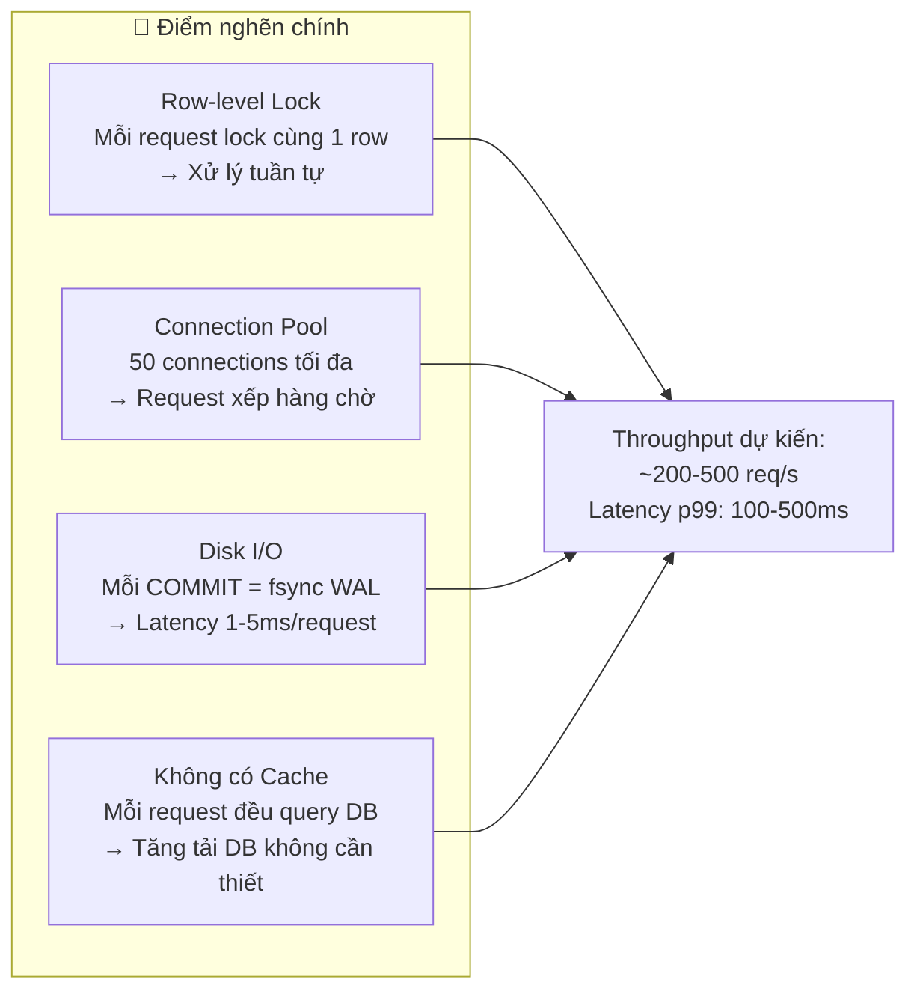

**Phân tích chi tiết:**

1. **Row-level locking serialization**: Khi 1000 request đồng thời mua cùng 1 sản phẩm, `SELECT ... FOR UPDATE` buộc tất cả phải xếp hàng. Chỉ 1 request giữ lock tại mỗi thời điểm, các request còn lại block trên lock wait. Thời gian giữ lock = thời gian hoàn thành toàn bộ transaction (~2-10ms/request).

2. **Connection pool exhaustion**: Với 50 connections và mỗi transaction mất 5ms, throughput tối đa lý thuyết = 50 / 0.005 = 10,000 req/s. Nhưng thực tế lock contention khiến thời gian transaction tăng lên 20-50ms → throughput giảm còn ~200-500 req/s.

3. **Tail latency**: Request cuối trong hàng đợi lock phải chờ tất cả request trước hoàn thành. Với 1000 concurrent requests, request cuối có thể chờ 2-5 giây.

### 2.5. Khi nào Baseline đủ tốt?

- Quy mô nhỏ: < 100 concurrent users
- Sản phẩm không "hot": traffic phân tán đều giữa nhiều sản phẩm (lock contention thấp)
- Yêu cầu đơn giản, không cần high-availability
- Team nhỏ, cần triển khai nhanh

---

## 3. Kiến trúc Optimized (tối ưu)

### 3.1. Tổng quan

Kiến trúc Optimized giải quyết mọi điểm nghẽn của Baseline bằng cách **tách biệt các concerns**:

1. **Tầng nhận request** (API) — nhanh nhất có thể, trả lời ngay
2. **Tầng kiểm tra tồn kho** (Redis) — atomic, in-memory, ~0.1ms
3. **Tầng xử lý đơn hàng** (Queue + Workers) — bất đồng bộ, có thể retry
4. **Tầng lưu trữ** (PostgreSQL) — chỉ ghi khi đã chắc chắn

### 3.2. Sơ đồ kiến trúc chi tiết

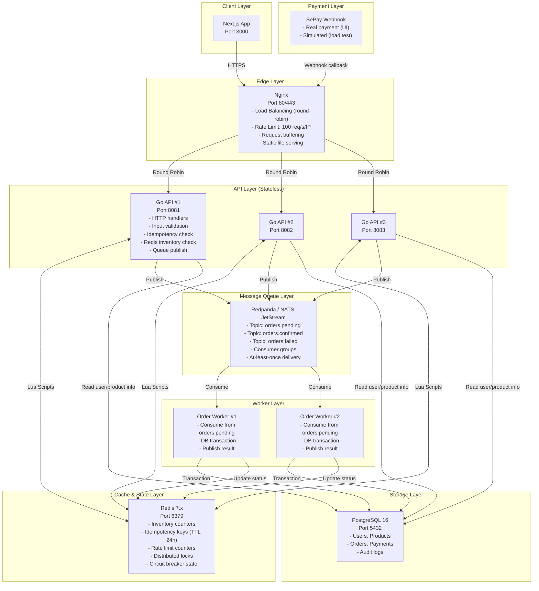

### 3.3. Luồng xử lý đặt hàng chi tiết

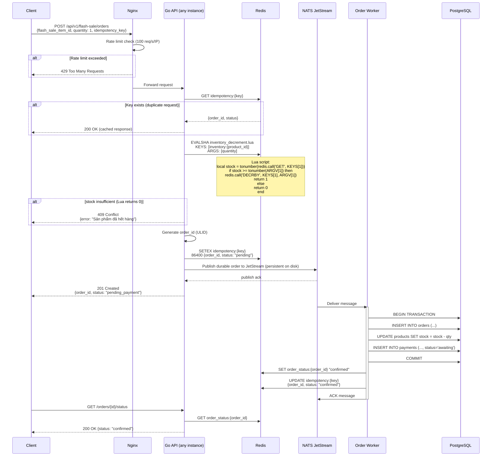

### 3.4. Redis Lua Scripts

#### 3.4.1. Atomic Inventory Decrement

```lua
-- inventory_decrement.lua
-- KEYS[1] = inventory:{product_id}
-- ARGV[1] = quantity requested
-- Returns: 1 = success, 0 = insufficient stock, -1 = product not found

local key = KEYS[1]
local requested = tonumber(ARGV[1])

if requested <= 0 then
    return redis.error_reply("INVALID_QUANTITY")
end

local stock = redis.call('GET', key)
if stock == false then
    return -1  -- Product not found in cache
end

stock = tonumber(stock)
if stock >= requested then
    redis.call('DECRBY', key, requested)
    return 1  -- Success
else
    return 0  -- Insufficient stock
end
```

#### 3.4.2. Inventory Rollback (khi worker thất bại)

```lua
-- inventory_rollback.lua
-- KEYS[1] = inventory:{product_id}
-- ARGV[1] = quantity to restore

local key = KEYS[1]
local quantity = tonumber(ARGV[1])

redis.call('INCRBY', key, quantity)
return redis.call('GET', key)
```

#### 3.4.3. Rate Limiting (Sliding Window)

```lua
-- rate_limit.lua
-- KEYS[1] = ratelimit:{client_ip}
-- ARGV[1] = window_size_ms (e.g., 1000 for 1 second)
-- ARGV[2] = max_requests
-- ARGV[3] = current_timestamp_ms

local key = KEYS[1]
local window = tonumber(ARGV[1])
local limit = tonumber(ARGV[2])
local now = tonumber(ARGV[3])

-- Remove expired entries
redis.call('ZREMRANGEBYSCORE', key, 0, now - window)

-- Count current entries
local count = redis.call('ZCARD', key)

if count < limit then
    redis.call('ZADD', key, now, now .. '-' .. math.random(1000000))
    redis.call('PEXPIRE', key, window)
    return 1  -- Allowed
else
    return 0  -- Rate limited
end
```

### 3.5. Cấu trúc dữ liệu Redis

```
# Inventory counters
inventory:{product_id}          → integer (current stock)

# Idempotency store
idempotency:{key}               → JSON {order_id, status, response} (TTL: 86400s)

# Order status (fast lookup)
order_status:{order_id}         → string "pending" | "confirmed" | "failed" (TTL: 3600s)

# Rate limiting
ratelimit:{client_ip}           → sorted set (timestamps) (TTL: tự động)

# Circuit breaker state
circuit:{service_name}          → JSON {state, failure_count, last_failure, next_retry}

# Distributed locks
lock:{resource_name}            → string (lock_owner_id) (TTL: 30s)

# Flash sale metadata cache
flash_sale:{sale_id}            → JSON {product_id, start_time, end_time, original_stock}
```

### 3.6. Message Queue Design

#### Topic Structure

| Topic | Producer | Consumer | Mục đích |
|---|---|---|---|
| `orders.pending` | API servers | Order Workers | Đơn hàng chờ xử lý |
| `orders.result` | Order Workers | API servers (optional) | Kết quả xử lý để cập nhật cache |
| `orders.dlq` | Order Workers | Admin/Manual | Dead letter queue cho đơn thất bại sau max retry |
| `payments.webhook` | Payment handler | Payment Workers | Xử lý callback từ SePay |

#### Message Schema (`orders.pending`)

```json
{
  "message_id": "01HQXYZ...",
  "order_id": "01HQABC...",
  "idempotency_key": "user123_prod456_1698012345",
  "user_id": "usr_abc123",
  "product_id": "prod_456",
  "quantity": 1,
  "unit_price": 299000,
  "total_price": 299000,
  "flash_sale_id": "sale_789",
  "created_at": "2024-10-22T10:30:00Z",
  "retry_count": 0,
  "max_retries": 5
}
```

### 3.7. Lựa chọn Message Queue: Redpanda vs NATS JetStream

| Tiêu chí | Redpanda | NATS JetStream |
|---|---|---|
| **Giao thức** | Kafka API compatible | NATS native |
| **RAM usage** | ~300-500MB | ~50-100MB |
| **Latency** | ~2-5ms p99 | ~1-2ms p99 |
| **Durability** | Raft-based, disk-backed | File-based storage |
| **Ops complexity** | Thấp (single binary, no JVM) | Rất thấp |
| **Go client** | franz-go, confluent-kafka-go | nats.go (official) |
| **Consumer groups** | Có (Kafka protocol) | Có (durable consumers) |
| **Monitoring** | Prometheus metrics built-in | Prometheus metrics built-in |
| **Phù hợp ApexStock** | ✅ Tốt cho dữ liệu lớn, replay | ✅ Tốt cho low-latency, RAM ít |

> [!TIP]
> **Khuyến nghị:** Sử dụng **NATS JetStream** cho ApexStock vì:
> 1. RAM footprint nhỏ hơn nhiều (~50MB vs ~400MB) — quan trọng khi chạy trên 16GB RAM
> 2. Latency thấp hơn — phù hợp flash sale cần phản hồi nhanh
> 3. Go client chính thức, API đơn giản
> 4. Đủ tính năng cần thiết: at-least-once delivery, consumer groups, durable subscriptions

---

## 4. Các pattern quan trọng

### 4.1. Idempotency (Tính lũy đẳng)

#### Vấn đề
Trong flash sale, client có thể gửi lại request do:
- Timeout → retry tự động
- Double-click nút mua
- Network hiccup → TCP retransmit

Nếu không có idempotency, một user có thể tạo nhiều đơn hàng cho cùng một lần mua.

#### Giải pháp

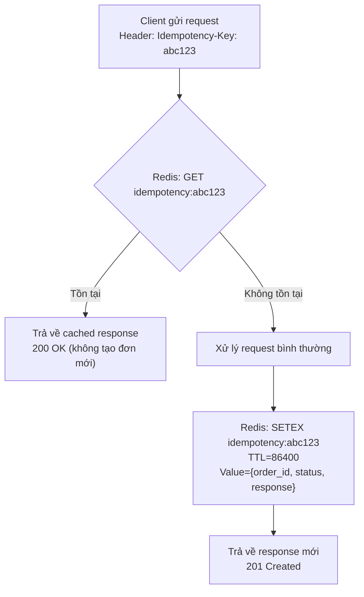

#### Cách tạo Idempotency Key

```
// Client-side generation
idempotency_key = SHA256(user_id + product_id + flash_sale_id + timestamp_minute)

// Hoặc đơn giản hơn (frontend generate UUID v4 khi user click)
idempotency_key = UUID_v4  // lưu trong localStorage để retry
```

#### Redis Storage

```
Key:   idempotency:{idempotency_key}
Value: {
  "order_id": "01HQABC...",
  "status": "pending" | "confirmed" | "failed",
  "http_status": 201,
  "response_body": "{...}",
  "created_at": "2024-10-22T10:30:00Z"
}
TTL:   86400 seconds (24 giờ)
```

#### Quy trình chi tiết

1. **Client** gửi request với header `Idempotency-Key`
2. **API** kiểm tra Redis: `GET idempotency:{key}`
3. Nếu **tồn tại**: trả về cached response, HTTP status giữ nguyên
4. Nếu **không tồn tại**:
   - Dùng `SET idempotency:{key} {initial_data} NX EX 86400` (NX = chỉ set nếu chưa tồn tại)
   - Nếu SET trả về `nil` → concurrent duplicate → GET lại và trả cached response
   - Nếu SET thành công → xử lý request → cập nhật value với response cuối cùng
5. **Worker** sau khi xử lý xong → cập nhật idempotency record với status final

### 4.2. Circuit Breaker

#### Vấn đề
Khi PostgreSQL hoặc Message Queue gặp sự cố, API servers tiếp tục gửi request → timeout hàng loạt → cascade failure.

#### State Machine

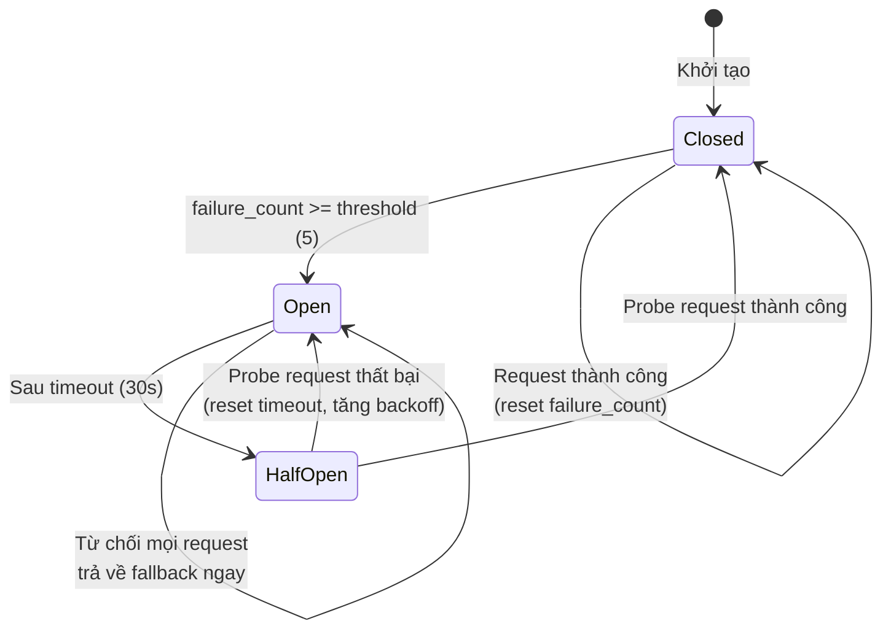

#### Cấu hình

```go
// Circuit breaker config cho từng dependency
type CircuitBreakerConfig struct {
    Name             string        // "postgresql", "message_queue", "redis"
    FailureThreshold int           // Số lần thất bại liên tiếp để mở circuit (5)
    SuccessThreshold int           // Số lần thành công liên tiếp để đóng circuit (3)
    Timeout          time.Duration // Thời gian ở trạng thái Open trước khi thử lại (30s)
    MaxTimeout       time.Duration // Timeout tối đa sau exponential backoff (5m)
    BackoffMultiplier float64      // Hệ số tăng timeout (2.0)
}

// Các circuit breaker cần thiết:
// 1. cb_postgresql  — cho DB writes trong worker
// 2. cb_queue       — cho queue publish trong API
// 3. cb_redis       — cho Redis operations (hiếm khi cần)
```

#### Lưu trạng thái Circuit Breaker trong Redis

```json
// Key: circuit:{service_name}
{
  "state": "closed",
  "failure_count": 0,
  "success_count": 0,
  "last_failure_at": null,
  "next_retry_at": null,
  "current_timeout_seconds": 30
}
```

> [!IMPORTANT]
> Circuit breaker state được lưu trong Redis để **tất cả API instances chia sẻ cùng một state**. Nếu instance #1 phát hiện DB chết, instance #2 và #3 cũng sẽ biết ngay lập tức mà không cần tự phát hiện.

### 4.3. Rate Limiting

#### Chiến lược đa tầng

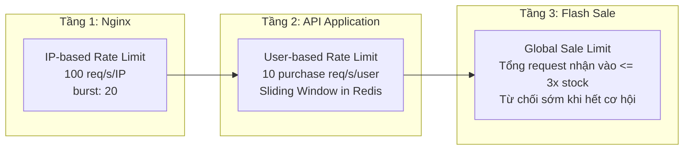

**Tầng 1 — Nginx (IP-based):**
```nginx
# Giới hạn 100 request/giây cho mỗi IP
limit_req_zone $binary_remote_addr zone=api_limit:10m rate=100r/s;

server {
    location /api/ {
        limit_req zone=api_limit burst=20 nodelay;
        limit_req_status 429;
        proxy_pass http://api_upstream;
    }
}
```

**Tầng 2 — Application (User-based):**
- Sử dụng Lua script `rate_limit.lua` (mục 3.4.3)
- Sliding window 1 giây, tối đa 10 request mua hàng/user

**Tầng 3 — Flash Sale (Global):**
- Khi Redis inventory counter = 0, từ chối tức thì → không cần chạy Lua script
- Khi tổng request đã vượt `3 × stock` → xác suất hết hàng rất cao → có thể từ chối sớm

### 4.4. Graceful Degradation

#### Ma trận lỗi và phản hồi

| Component Down | Hành vi hệ thống | Phản hồi cho user |
|---|---|---|
| **Redis** | Circuit breaker mở → API trả lời ngay, không thử mua | `503 Service Temporarily Unavailable` — "Hệ thống đang bận, vui lòng thử lại sau" |
| **Message Queue** | Circuit breaker mở → Không thể đặt hàng, tồn kho không bị trừ (chưa ghi Redis) | `503` — "Hệ thống đang bận" |
| **PostgreSQL** | Workers tạm dừng → Đơn hàng tồn trong NATS JetStream queue → Tự xử lý khi DB phục hồi | `201 Created` đã được trả sau khi message durable trong queue |
| **1 API instance** | Nginx tự phát hiện qua health check → Chuyển traffic sang instance còn lại | Không ảnh hưởng (transparent failover) |
| **1 Worker instance** | Worker còn lại tiếp tục consume → Throughput giảm 50% | Đơn hàng xử lý chậm hơn nhưng không mất |

#### Quy tắc an toàn tồn kho

> [!CAUTION]
> **Quy tắc vàng: Không bao giờ trừ tồn kho PostgreSQL trước khi trừ Redis.**
>
> Redis là "gate keeper" — nếu Redis trừ thành công, đơn hàng **đã được đặt chỗ** (reserved). Nếu worker không thể ghi DB, worker phải **hoàn trả Redis** (inventory rollback). Điều này đảm bảo:
> - Không overselling (Redis atomic decrement)
> - Không mất đơn (queue persistence)
> - Có thể slight underselling nếu rollback thất bại (chấp nhận được — sell 99 thay vì 100)

### 4.5. Retry with Exponential Backoff

#### Áp dụng cho Order Workers

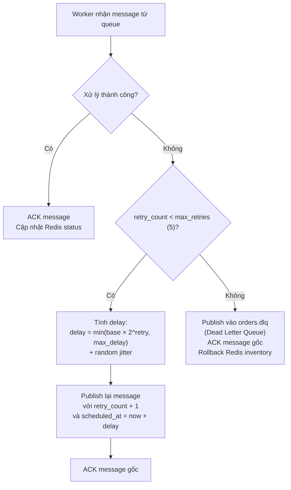

#### Cấu hình Retry

```go
type RetryConfig struct {
    MaxRetries     int           // 5
    BaseDelay      time.Duration // 500ms
    MaxDelay       time.Duration // 30s
    BackoffFactor  float64       // 2.0
    JitterFraction float64       // 0.1 (±10%)
}

// Delay calculation:
// retry 1: 500ms × 2^0 = 500ms  ± 50ms
// retry 2: 500ms × 2^1 = 1s     ± 100ms
// retry 3: 500ms × 2^2 = 2s     ± 200ms
// retry 4: 500ms × 2^3 = 4s     ± 400ms
// retry 5: 500ms × 2^4 = 8s     ± 800ms
// Tổng thời gian thử tối đa: ~15.5s
```

### 4.6. Distributed Locking

#### Vấn đề
Một số thao tác cần mutual exclusion giữa nhiều API instances:
- Khởi tạo flash sale (sync stock từ DB → Redis)
- Admin thay đổi giá sản phẩm đang bán
- Chạy batch job reconciliation

#### Giải pháp: Redis-based Lock (Simplified Redlock cho single-node)

```lua
-- acquire_lock.lua
-- KEYS[1] = lock:{resource}
-- ARGV[1] = lock_owner_id (unique per caller, e.g., instance_id + goroutine_id)
-- ARGV[2] = ttl_ms

local acquired = redis.call('SET', KEYS[1], ARGV[1], 'NX', 'PX', ARGV[2])
if acquired then
    return 1
else
    return 0
end
```

```lua
-- release_lock.lua
-- KEYS[1] = lock:{resource}
-- ARGV[1] = lock_owner_id (phải match owner hiện tại)

if redis.call('GET', KEYS[1]) == ARGV[1] then
    return redis.call('DEL', KEYS[1])
else
    return 0  -- Lock đã bị người khác giữ hoặc đã hết hạn
end
```

#### Quy trình sử dụng

```go
// Pseudo-code
lockID := fmt.Sprintf("%s:%d", instanceID, goroutineID)
acquired := redis.AcquireLock("lock:init_sale_789", lockID, 30*time.Second)
if !acquired {
    return ErrResourceLocked
}
defer redis.ReleaseLock("lock:init_sale_789", lockID)

// Thực hiện critical section...
```

> [!WARNING]
> **Single Redis node = không có Redlock.** Vì ApexStock chạy trên 1 máy với 1 Redis instance, ta chỉ cần lock đơn giản bằng `SET NX PX`. Redlock (multi-node) chỉ cần khi chạy Redis cluster trên nhiều máy chủ.

---

## 5. Resilience & Fault Tolerance

### 5.1. Kịch bản 1: API Instance bị kill trong lúc traffic cao

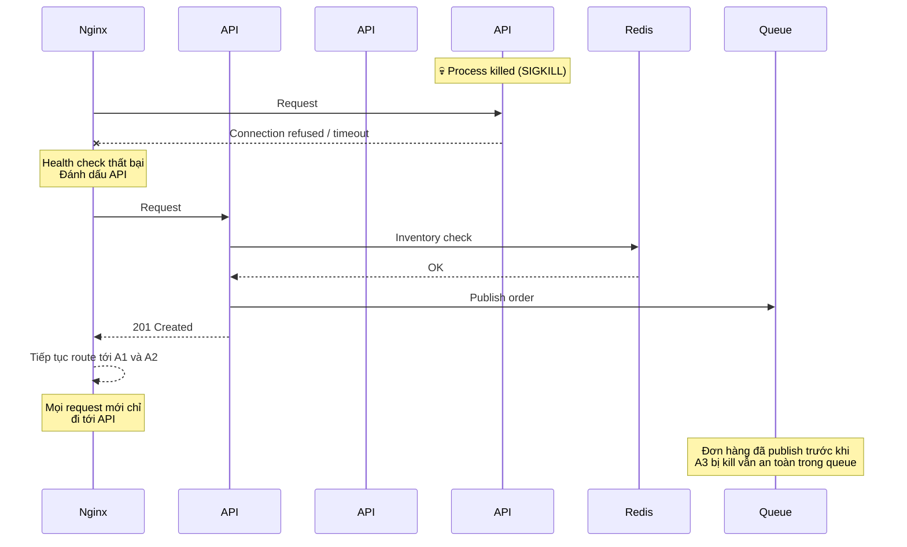

**Phân tích chi tiết:**

1. **Request đang xử lý tại thời điểm kill:**
   - Nếu đã publish vào queue → đơn hàng an toàn, worker sẽ xử lý
   - Nếu đã trừ Redis inventory nhưng chưa publish queue → **inventory leak** (mất tồn kho ảo)
   - Giải pháp: Cron job reconciliation mỗi 5 phút so sánh Redis inventory vs PostgreSQL thực tế

2. **Recovery:**
   - Docker restart policy: `restart: unless-stopped`
   - Sau khi container restart → Nginx health check thành công → route traffic trở lại
   - Thời gian downtime: ~10-30 giây

3. **Nginx config cho fault tolerance:**

```nginx
upstream api_backend {
    server api1:8080 max_fails=2 fail_timeout=10s;
    server api2:8080 max_fails=2 fail_timeout=10s;
    server api3:8080 max_fails=2 fail_timeout=10s;
}

server {
    location /api/ {
        proxy_pass http://api_backend;
        proxy_next_upstream error timeout http_502 http_503;
        proxy_next_upstream_tries 2;
        proxy_next_upstream_timeout 5s;
        proxy_connect_timeout 2s;
        proxy_read_timeout 10s;
    }
}
```

### 5.2. Kịch bản 2: Redis bị kill

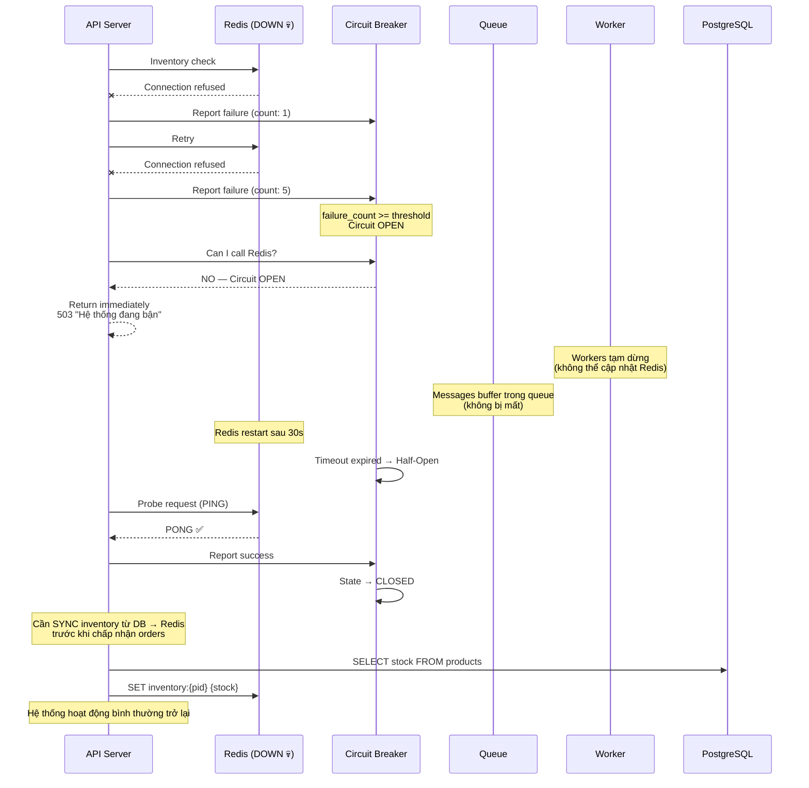

**Tại sao không overselling khi Redis down?**

1. API **không thể trừ tồn kho** Redis → không chấp nhận đơn hàng mới
2. Đơn hàng đã trừ Redis trước khi crash → đã nằm trong queue → worker xử lý bình thường
3. Nếu Redis restart nhưng **mất dữ liệu** (no persistence) → phải sync lại từ DB
4. Trong thời gian sync, API tiếp tục từ chối → **underselling** nhỏ (chấp nhận được)

**Recovery procedure:**

1. Redis container restart (auto bởi Docker)
2. Health check service detect Redis up → Trigger inventory sync
3. Sync flow: `SELECT product_id, stock FROM products WHERE flash_sale_active = true`
4. Trừ đi số đơn hàng "pending" trong queue (chưa ghi DB): `SELECT COUNT(*) FROM pending_orders WHERE product_id = ?`
5. SET Redis counters = DB stock - pending_count
6. Mở circuit breaker → Resume normal operations

### 5.3. Kịch bản 3: PostgreSQL chậm/quá tải

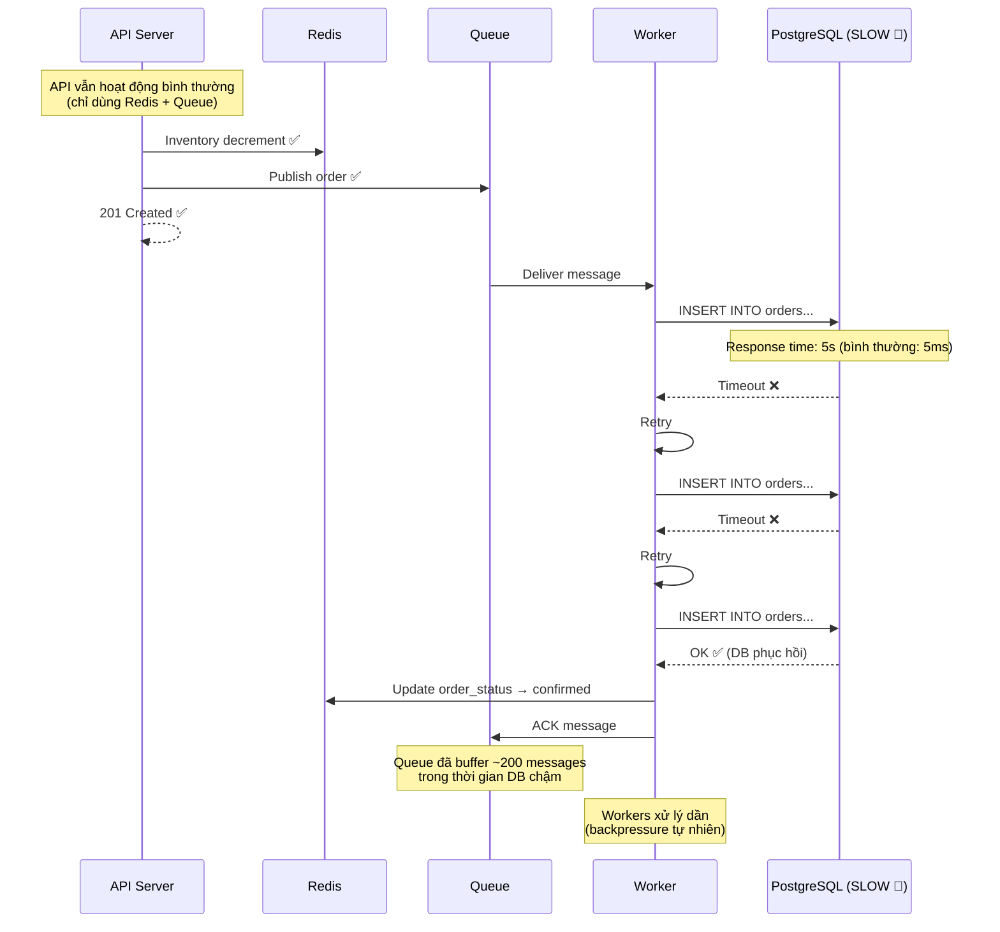

**Lợi ích của kiến trúc async:**

| Metric | Baseline khi DB chậm | Optimized khi DB chậm |
|---|---|---|
| User response | Timeout 30s → 504 | 201 Created trong <10ms (hypothesis: <5ms) |
| Đơn hàng bị mất | Có (timeout = mất) | Không (NATS JetStream giữ) |
| Recovery | Cần restart, user retry thủ công | Tự động, worker retry |
| Overselling risk | Có (lock timeout → release sớm) | Không (Redis đã reserve) |

### 5.4. Bảng tóm tắt Recovery

| Kịch bản | Thời gian phát hiện | Thời gian recovery | Dữ liệu bị mất | Hành động cần thiết |
|---|---|---|---|---|
| API instance killed | ~10s (Nginx health check) | ~20-30s (container restart) | 0 (queue persistence) | Tự động |
| Redis killed | ~1s (circuit breaker) | ~15-30s (restart + sync) | Tồn kho tạm sai → sync | Auto restart + sync script |
| PostgreSQL killed | ~5s (worker timeout) | ~30-60s (restart + recovery) | 0 (WAL recovery) | Tự động (queue buffer) |
| Queue killed | ~2s (publish timeout) | ~20s (restart) | 0 (disk persistence) | Auto restart, workers reconnect |
| Network partition | ~10s (timeout) | Tùy thuộc vào partition heal | 0 (at-least-once delivery) | Monitor + alert |

---

## 6. Docker Compose Deployment Strategy

### 6.1. Tổng quan tài nguyên

**Phần cứng máy chủ:**
- CPU: Intel i5-10500H — 6 cores / 12 threads
- RAM: 16 GB
- Storage: SSD (quan trọng cho DB và queue performance)

**Budget phân bổ:**
- Hệ thống ApexStock: ~12 GB RAM, ~10 CPU threads
- OS + overhead: ~1.5 GB RAM
- k6 load testing: ~2 GB RAM, ~2 CPU threads
- Buffer: ~0.5 GB RAM

### 6.2. Bảng phân bổ tài nguyên

| Container | CPU Limit | Memory Limit | Memory Reserve | Replicas | Ports |
|---|---|---|---|---|---|
| **nginx** | 0.5 CPU | 256 MB | 128 MB | 1 | 80, 443 |
| **api-baseline** | 1.0 CPU | 512 MB | 256 MB | 1 | 8080 |
| **api-optimized-1** | 0.75 CPU | 384 MB | 192 MB | 1 | 8081 |
| **api-optimized-2** | 0.75 CPU | 384 MB | 192 MB | 1 | 8082 |
| **api-optimized-3** | 0.75 CPU | 384 MB | 192 MB | 1 | 8083 |
| **redis** | 1.0 CPU | 1 GB | 512 MB | 1 | 6379 |
| **nats** | 0.5 CPU | 256 MB | 128 MB | 1 | 4222, 8222 |
| **postgresql** | 2.0 CPU | 2 GB | 1 GB | 1 | 5432 |
| **worker-1** | 0.5 CPU | 256 MB | 128 MB | 1 | — |
| **worker-2** | 0.5 CPU | 256 MB | 128 MB | 1 | — |
| **prometheus** | 0.5 CPU | 512 MB | 256 MB | 1 | 9090 |
| **grafana** | 0.5 CPU | 256 MB | 128 MB | 1 | 3001 |
| **frontend** | 0.5 CPU | 512 MB | 256 MB | 1 | 3000 |
| **Tổng** | **~9.75 CPU** | **~6.6 GB** | **~3.5 GB** | **13** | — |

> [!NOTE]
> CPU limits có thể vượt tổng số cores vì Docker CPU limits sử dụng CFS scheduler — các container chia sẻ CPU time, không cần hard partition. Memory limits là hard caps — container bị OOM killed nếu vượt.

### 6.3. Network Topology

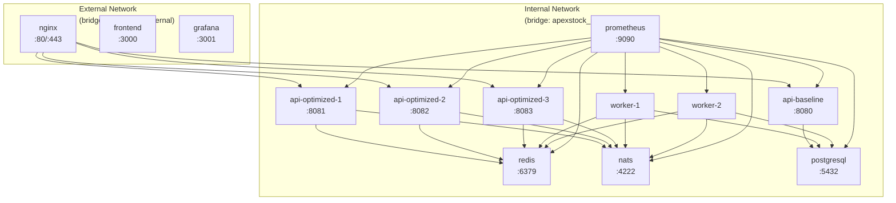

**Thiết kế mạng:**
- **`apexstock_external`**: Chỉ expose Nginx (reverse proxy), Frontend, và Grafana ra ngoài
- **`apexstock_internal`**: Mọi service nội bộ giao tiếp qua bridge network riêng
- Nginx được attach vào **cả hai** networks để làm cầu nối
- PostgreSQL, Redis, NATS **không** expose port ra ngoài (trừ khi debug)

### 6.4. Health Checks & Restart Policies

```yaml
# Ví dụ cấu hình cho từng service

# PostgreSQL
postgresql:
  healthcheck:
    test: ["CMD-SHELL", "pg_isready -U apexstock -d apexstock"]
    interval: 5s
    timeout: 3s
    retries: 5
    start_period: 30s
  restart: unless-stopped
  deploy:
    resources:
      limits:
        cpus: "2.0"
        memory: 2G
      reservations:
        memory: 1G

# Redis
redis:
  healthcheck:
    test: ["CMD", "redis-cli", "ping"]
    interval: 3s
    timeout: 2s
    retries: 3
    start_period: 5s
  restart: unless-stopped

# NATS
nats:
  healthcheck:
    test: ["CMD-SHELL", "wget --spider -q http://localhost:8222/healthz || exit 1"]
    interval: 5s
    timeout: 3s
    retries: 3
    start_period: 10s
  restart: unless-stopped

# Go API servers
api-optimized:
  healthcheck:
    test: ["CMD-SHELL", "wget --spider -q http://localhost:8080/healthz || exit 1"]
    interval: 5s
    timeout: 3s
    retries: 3
    start_period: 10s
  restart: unless-stopped
  depends_on:
    postgresql:
      condition: service_healthy
    redis:
      condition: service_healthy
    nats:
      condition: service_healthy

# Workers
worker:
  healthcheck:
    test: ["CMD-SHELL", "pgrep -f worker || exit 1"]
    interval: 10s
    timeout: 5s
    retries: 3
    start_period: 15s
  restart: unless-stopped
  depends_on:
    postgresql:
      condition: service_healthy
    redis:
      condition: service_healthy
    nats:
      condition: service_healthy
```

### 6.5. Thứ tự khởi động (Dependency Graph)

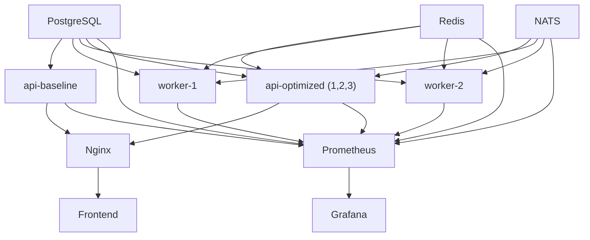

### 6.6. Volume Mounts

| Container | Volume | Mount Point | Mục đích |
|---|---|---|---|
| postgresql | `pg_data` | `/var/lib/postgresql/data` | Data persistence |
| postgresql | `./config/postgresql.conf` | `/etc/postgresql/postgresql.conf` | Custom config |
| redis | `redis_data` | `/data` | RDB/AOF persistence |
| redis | `./config/redis.conf` | `/usr/local/etc/redis/redis.conf` | Custom config |
| nats | `nats_data` | `/data/jetstream` | JetStream storage |
| prometheus | `prom_data` | `/prometheus` | Metrics storage |
| prometheus | `./config/prometheus.yml` | `/etc/prometheus/prometheus.yml` | Config |
| grafana | `grafana_data` | `/var/lib/grafana` | Dashboards + settings |
| nginx | `./config/nginx.conf` | `/etc/nginx/nginx.conf` | Config |
| nginx | `./config/nginx-certs/` | `/etc/nginx/certs/` | SSL certificates (optional) |

---

## 7. So sánh hai kiến trúc

### 7.1. Bảng so sánh tổng thể

| Tiêu chí | Baseline | Optimized | Ghi chú |
|---|---|---|---|
| **Throughput (req/s)** | Hypothesis: 200–500 | Hypothesis: 3.000–8.000 | Phụ thuộc vào product contention; cần benchmark xác minh |
| **Latency p50** | Hypothesis: 10–30 ms | Hypothesis: 2–5 ms | Optimized trả 201 ngay sau NATS JetStream ack (persistent) |
| **Latency p95** | Hypothesis: 80–200 ms | Hypothesis: 5–15 ms | |
| **Latency p99** | Hypothesis: 200–1.000 ms | Hypothesis: 10–30 ms | Baseline tệ nhất khi lock contention cao |
| **Overselling risk** | Thấp (DB lock) | Rất thấp (Redis atomic) | Cả hai đều an toàn, nhưng Redis nhanh hơn |
| **Fault tolerance** | Thấp (SPOF) | Cao (multi-instance, NATS JetStream buffer) | |
| **Data consistency** | Strong (synchronous) | Eventual (async processing) | Optimized: đơn hàng "pending" → "confirmed" sau ~50-200ms |
| **Complexity** | ⭐ Đơn giản | ⭐⭐⭐⭐ Phức tạp | Nhiều component, nhiều failure mode |
| **Lines of code (est.)** | ~2.000 LOC | ~6.000 LOC | Bao gồm Lua scripts, workers, circuit breakers |
| **RAM usage** | ~800 MB | ~4.5 GB | Nhiều container hơn |
| **CPU usage (idle)** | ~0.5 cores | ~1.5 cores | |
| **CPU usage (peak)** | ~2 cores | ~8 cores | Tận dụng tốt hơn phần cứng đa nhân |
| **Recovery time** | ~30-60s (restart) | ~10-30s (failover + restart) | |
| **Horizontal scaling** | Không thể | Dễ dàng (thêm API/Worker instances) | |
| **Debugging** | Dễ (1 process, 1 DB) | Khó (distributed tracing cần thiết) | |
| **Phù hợp cho** | PoC, MVP, < 100 CCU | Production, > 1000 CCU | CCU = Concurrent Users |

### 7.2. Performance Targets trên phần cứng mục tiêu

**Phần cứng:** i5-10500H, 16GB RAM, SSD, Docker Compose

#### Baseline Targets

| Metric | Target | Điều kiện |
|---|---|---|
| Max throughput | 300 – 500 req/s | 1 sản phẩm, 1000 VUs |
| p50 latency | < 30 ms | Steady state |
| p99 latency | < 500 ms | Steady state |
| Error rate | < 1% | Không tính 409 (hết hàng) |
| Thời gian bán 1000 items | ~3-5 giây | 1000 VUs đồng thời |
| Overselling | 0 items | Hard requirement |

#### Optimized Targets (Hypothesis)

| Metric | Target Hypothesis | Điều kiện |
|---|---|---|
| Max throughput | 3.000–5.000 req/s | 1 sản phẩm, 5000 VUs; cần benchmark xác minh |
| p50 latency | < 5 ms | API response (201 Created) |
| p99 latency | < 20 ms | API response |
| Error rate | < 0.5% | Không tính 409/422 (business logic) |
| Thời gian bán 1000 items | ~0.5-1 giây | 5000 VUs đồng thời |
| Order processing time (end-to-end) | < 500 ms | Từ request → confirmed |
| Overselling | 0 items | Hard requirement |
| Recovery after instance kill | < 30 giây | Chaos test |

### 7.3. Biểu đồ so sánh throughput dự kiến

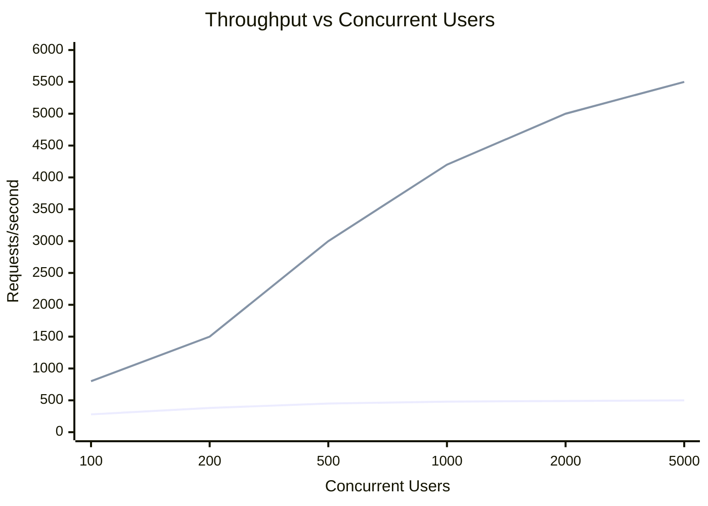

### 7.4. Biểu đồ so sánh latency dự kiến

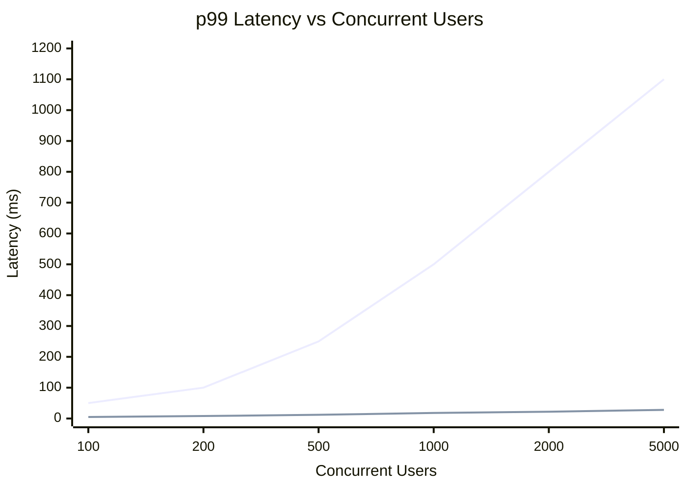

### 7.5. Tổng kết

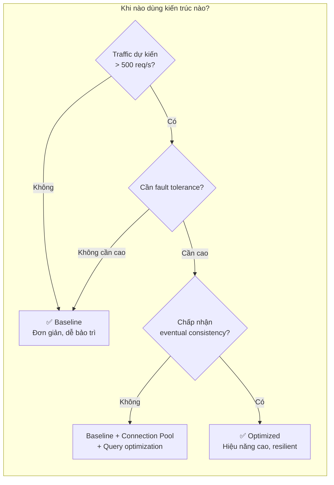

> [!IMPORTANT]
> **Mục tiêu của ApexStock không phải chứng minh "Optimized tốt hơn Baseline" — mà là đo lường chính xác trade-off giữa complexity và performance.** War Room dashboard sẽ hiển thị hai kiến trúc với benchmark chạy tuần tự, cùng workload, cùng phần cứng, để người xem tự đánh giá khi nào cần nâng cấp kiến trúc.

---

## Phụ lục

### A. Glossary

| Thuật ngữ | Giải thích |
|---|---|
| **Flash Sale** | Sự kiện bán hàng giới hạn thời gian và số lượng, tạo đột biến traffic |
| **Overselling** | Bán vượt quá số lượng tồn kho thực tế |
| **SPOF** | Single Point of Failure — điểm lỗi duy nhất gây sập toàn hệ thống |
| **CCU** | Concurrent Users — số người dùng đồng thời |
| **VU** | Virtual Users — user ảo trong load test (k6) |
| **CFS** | Completely Fair Scheduler — Linux CPU scheduler |
| **WAL** | Write-Ahead Log — cơ chế PostgreSQL đảm bảo durability |
| **DLQ** | Dead Letter Queue — hàng đợi chứa message không xử lý được |
| **Idempotency** | Tính chất đảm bảo gọi nhiều lần cho cùng kết quả như gọi 1 lần |
| **Circuit Breaker** | Pattern ngắt kết nối tới service lỗi để tránh cascade failure |

### B. Tài liệu tham khảo

- [Redis Lua Scripting](https://redis.io/docs/manual/programmability/eval-intro/)
- [NATS JetStream Documentation](https://docs.nats.io/nats-concepts/jetstream)
- [PostgreSQL Lock Management](https://www.postgresql.org/docs/16/explicit-locking.html)
- [Circuit Breaker Pattern (Martin Fowler)](https://martinfowler.com/bliki/CircuitBreaker.html)
- [Designing Data-Intensive Applications (Martin Kleppmann)](https://dataintensive.net/)
