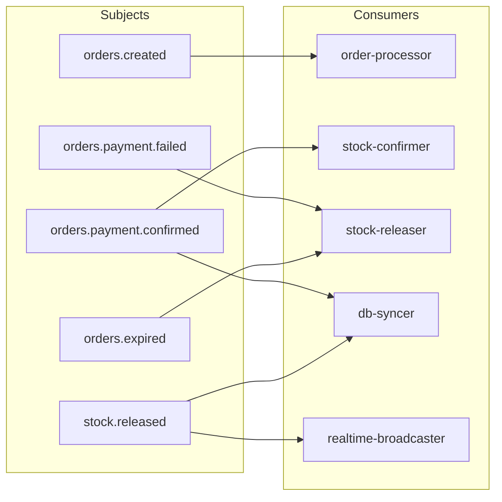
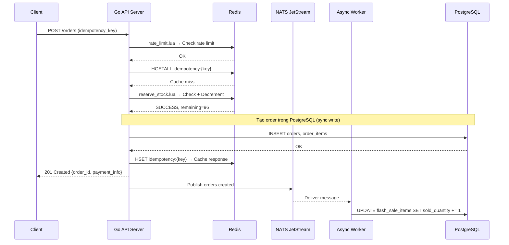
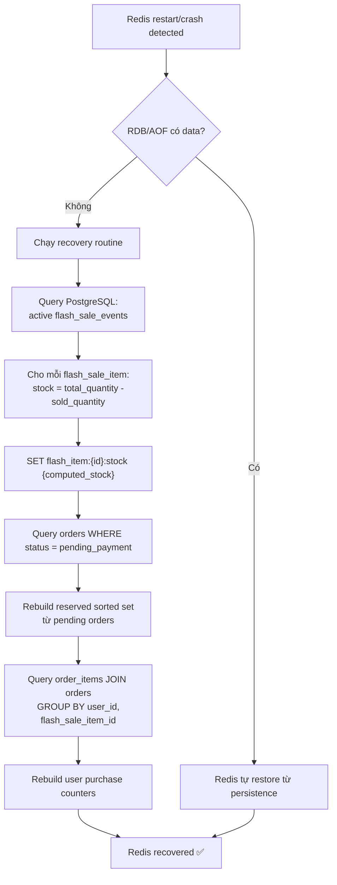
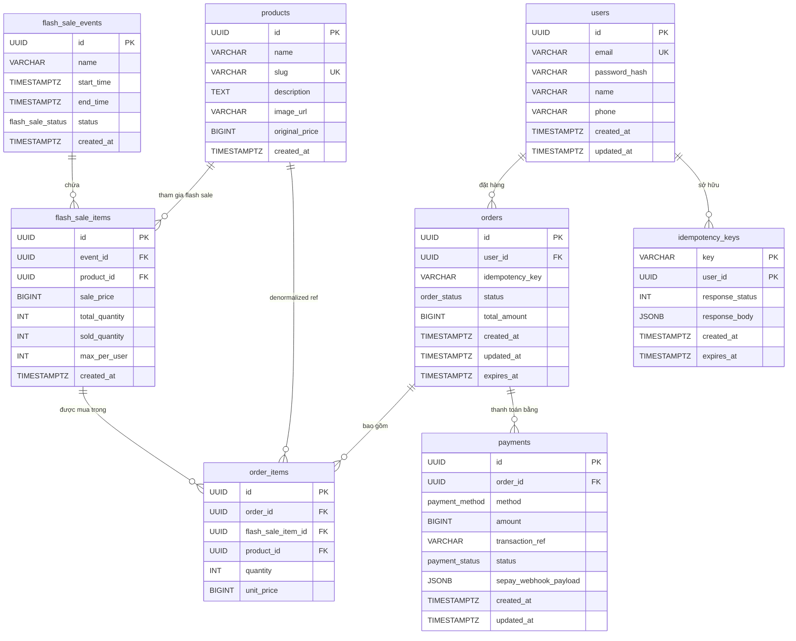
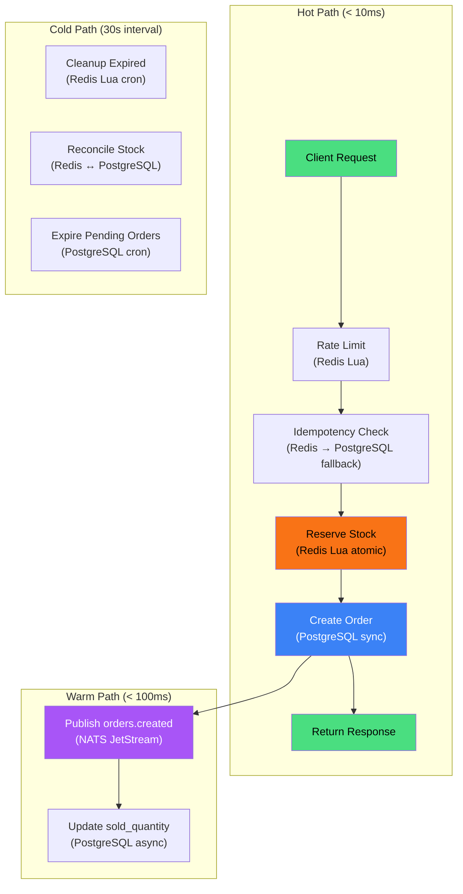

# 02 — Database & Data Design

> Tài liệu thiết kế chi tiết lớp dữ liệu của hệ thống ApexStock: PostgreSQL schema, Redis data structures, Lua scripts, message queue topics, và chiến lược đồng bộ dữ liệu.

---

## Mục lục

1. [PostgreSQL Schema](#1-postgresql-schema)
2. [Redis Data Structures](#2-redis-data-structures)
3. [Lua Scripts chi tiết](#3-lua-scripts-chi-tiết)
4. [Message Queue Topics / Subjects](#4-message-queue-topics--subjects)
5. [Data Consistency Strategy](#5-data-consistency-strategy)
6. [ER Diagram](#6-er-diagram)

---

## 1. PostgreSQL Schema

### 1.1. Tổng quan thiết kế

Toàn bộ schema sử dụng các quy ước sau:

| Quy ước | Mô tả |
|---|---|
| **Primary key** | `id UUID DEFAULT gen_random_uuid()` — dùng UUIDv4 để tránh sequential scan attack và hỗ trợ distributed ID generation |
| **Timestamps** | `created_at TIMESTAMPTZ NOT NULL DEFAULT now()`, `updated_at TIMESTAMPTZ` cập nhật qua trigger |
| **Soft delete** | Không sử dụng — flash sale là dữ liệu immutable, đơn hàng hết hạn chuyển status |
| **Naming** | snake_case cho tất cả tables và columns |
| **Charset** | UTF-8 mặc định của PostgreSQL |

### 1.2. Extension cần thiết

```sql
-- UUID generation
CREATE EXTENSION IF NOT EXISTS "pgcrypto";

-- Hỗ trợ full-text search nếu cần sau này
CREATE EXTENSION IF NOT EXISTS "pg_trgm";
```

### 1.3. Enum Types

```sql
-- Trạng thái flash sale event
CREATE TYPE flash_sale_status AS ENUM (
    'draft',        -- Đang soạn, chưa public
    'scheduled',    -- Đã lên lịch, chờ start_time
    'active',       -- Đang diễn ra
    'ended'         -- Đã kết thúc (tự động hoặc thủ công)
);

-- Trạng thái đơn hàng
CREATE TYPE order_status AS ENUM (
    'pending_payment',  -- Đã tạo, chờ thanh toán
    'paid',             -- Đã thanh toán thành công
    'payment_failed',   -- Thanh toán thất bại
    'expired',          -- Hết hạn thanh toán (quá expires_at)
    'cancelled'         -- Người dùng huỷ
);

-- Trạng thái thanh toán
CREATE TYPE payment_status AS ENUM (
    'pending',      -- Chờ xác nhận từ SePay
    'success',      -- SePay webhook xác nhận thành công
    'failed'        -- SePay webhook xác nhận thất bại hoặc timeout
);

-- Phương thức thanh toán
CREATE TYPE payment_method AS ENUM (
    'bank_transfer',    -- Chuyển khoản ngân hàng qua SePay
    'simulated'         -- Giả lập cho load test
);
```

### 1.4. Bảng `users`

```sql
CREATE TABLE users (
    id              UUID PRIMARY KEY DEFAULT gen_random_uuid(),
    email           VARCHAR(255) NOT NULL,
    password_hash   VARCHAR(255) NOT NULL,   -- bcrypt hash, ~60 chars
    name            VARCHAR(100) NOT NULL,
    phone           VARCHAR(20),
    created_at      TIMESTAMPTZ NOT NULL DEFAULT now(),
    updated_at      TIMESTAMPTZ,

    CONSTRAINT uq_users_email UNIQUE (email)
);

-- Index cho login lookup
-- uq_users_email đã tạo unique index trên email, không cần thêm

-- Index cho phone search (nếu cần)
CREATE INDEX idx_users_phone ON users (phone) WHERE phone IS NOT NULL;

-- Trigger cập nhật updated_at
CREATE OR REPLACE FUNCTION trigger_set_updated_at()
RETURNS TRIGGER AS $$
BEGIN
    NEW.updated_at = now();
    RETURN NEW;
END;
$$ LANGUAGE plpgsql;

CREATE TRIGGER set_users_updated_at
    BEFORE UPDATE ON users
    FOR EACH ROW
    EXECUTE FUNCTION trigger_set_updated_at();
```

**Giải thích index:**
- `uq_users_email`: Unique index tự động tạo từ constraint — phục vụ login, đăng ký (kiểm tra trùng email). Đây là truy vấn nóng nhất trên bảng users.
- `idx_users_phone`: Partial index chỉ index những row có phone, tiết kiệm dung lượng.

### 1.5. Bảng `products`

```sql
CREATE TABLE products (
    id              UUID PRIMARY KEY DEFAULT gen_random_uuid(),
    name            VARCHAR(255) NOT NULL,
    slug            VARCHAR(255) NOT NULL,
    description     TEXT,
    image_url       VARCHAR(500),
    original_price  BIGINT NOT NULL CHECK (original_price > 0),  -- Đơn vị: VNĐ (đồng)
    created_at      TIMESTAMPTZ NOT NULL DEFAULT now(),

    CONSTRAINT uq_products_slug UNIQUE (slug)
);

-- Slug lookup cho SEO-friendly URLs
-- uq_products_slug đã tạo unique index
```

> [!NOTE]
> **Tại sao dùng `BIGINT` cho giá?** VNĐ không có đơn vị nhỏ hơn đồng, nên lưu nguyên số đồng dưới dạng integer. Tránh hoàn toàn lỗi floating-point. Giá trị tối đa `9.2 × 10^18` đồng — quá đủ cho mọi sản phẩm.

### 1.6. Bảng `flash_sale_events`

```sql
CREATE TABLE flash_sale_events (
    id          UUID PRIMARY KEY DEFAULT gen_random_uuid(),
    name        VARCHAR(255) NOT NULL,
    start_time  TIMESTAMPTZ NOT NULL,
    end_time    TIMESTAMPTZ NOT NULL,
    status      flash_sale_status NOT NULL DEFAULT 'draft',
    created_at  TIMESTAMPTZ NOT NULL DEFAULT now(),

    CONSTRAINT chk_flash_sale_time CHECK (end_time > start_time)
);

-- Partial index: chỉ index các event đang active hoặc scheduled
-- Đây là truy vấn nóng nhất: "lấy flash sale đang/sắp diễn ra"
CREATE INDEX idx_flash_sale_events_active
    ON flash_sale_events (start_time, end_time)
    WHERE status IN ('scheduled', 'active');

-- Index cho admin listing (sắp xếp theo thời gian)
CREATE INDEX idx_flash_sale_events_created
    ON flash_sale_events (created_at DESC);
```

**Giải thích index:**
- `idx_flash_sale_events_active`: **Partial index** — chỉ index ~2-5 event active/scheduled tại một thời điểm (thay vì hàng nghìn event cũ). Kích thước cực nhỏ, truy vấn cực nhanh.
- `idx_flash_sale_events_created`: Phục vụ trang admin liệt kê event, sắp xếp mới nhất.

### 1.7. Bảng `flash_sale_items`

```sql
CREATE TABLE flash_sale_items (
    id              UUID PRIMARY KEY DEFAULT gen_random_uuid(),
    event_id        UUID NOT NULL,
    product_id      UUID NOT NULL,
    sale_price      BIGINT NOT NULL CHECK (sale_price > 0),
    total_quantity  INT NOT NULL CHECK (total_quantity > 0),
    sold_quantity   INT NOT NULL DEFAULT 0 CHECK (sold_quantity >= 0),
    max_per_user    INT NOT NULL DEFAULT 1 CHECK (max_per_user > 0),
    created_at      TIMESTAMPTZ NOT NULL DEFAULT now(),

    CONSTRAINT fk_flash_sale_items_event
        FOREIGN KEY (event_id) REFERENCES flash_sale_events(id) ON DELETE CASCADE,
    CONSTRAINT fk_flash_sale_items_product
        FOREIGN KEY (product_id) REFERENCES products(id) ON DELETE RESTRICT,
    CONSTRAINT chk_sold_lte_total
        CHECK (sold_quantity <= total_quantity),
    CONSTRAINT uq_flash_sale_items_event_product
        UNIQUE (event_id, product_id)  -- Mỗi sản phẩm chỉ xuất hiện 1 lần trong 1 event
);

-- Lookup tất cả items của một event (trang flash sale)
CREATE INDEX idx_flash_sale_items_event
    ON flash_sale_items (event_id);

-- Lookup lịch sử flash sale của một product
CREATE INDEX idx_flash_sale_items_product
    ON flash_sale_items (product_id);
```

> [!IMPORTANT]
> `sold_quantity` trong PostgreSQL là **source of truth** cuối cùng, nhưng trong flow optimized, nó được cập nhật **bất đồng bộ** từ message queue. Redis giữ con số real-time. Xem [phần 5: Data Consistency](#5-data-consistency-strategy) để hiểu cách đồng bộ.

### 1.8. Bảng `orders`

```sql
CREATE TABLE orders (
    id              UUID PRIMARY KEY DEFAULT gen_random_uuid(),
    user_id         UUID NOT NULL,
    idempotency_key VARCHAR(255) NOT NULL,
    status          order_status NOT NULL DEFAULT 'pending_payment',
    total_amount    BIGINT NOT NULL CHECK (total_amount > 0),
    created_at      TIMESTAMPTZ NOT NULL DEFAULT now(),
    updated_at      TIMESTAMPTZ,
    expires_at      TIMESTAMPTZ NOT NULL,  -- Thời điểm hết hạn thanh toán

    CONSTRAINT fk_orders_user
        FOREIGN KEY (user_id) REFERENCES users(id) ON DELETE RESTRICT,
    CONSTRAINT uq_orders_idempotency
        UNIQUE (user_id, idempotency_key)
);

-- Trigger cập nhật updated_at
CREATE TRIGGER set_orders_updated_at
    BEFORE UPDATE ON orders
    FOR EACH ROW
    EXECUTE FUNCTION trigger_set_updated_at();

-- Đơn hàng của một user (trang "Đơn hàng của tôi")
CREATE INDEX idx_orders_user_created
    ON orders (user_id, created_at DESC);

-- Đơn hàng đang chờ thanh toán + sắp hết hạn (cho cron job expire)
-- Partial index chỉ index đơn pending — tránh scan toàn bộ bảng
CREATE INDEX idx_orders_pending_expires
    ON orders (expires_at)
    WHERE status = 'pending_payment';

-- Lookup theo idempotency key (đã covered bởi uq_orders_idempotency)
```

**Giải thích index:**
- `uq_orders_idempotency`: Composite unique index `(user_id, idempotency_key)` — đảm bảo mỗi user không thể tạo đơn trùng lặp. Đây là tuyến phòng thủ cuối cùng cho idempotency.
- `idx_orders_user_created`: Covering index cho query lấy danh sách đơn hàng theo user, sắp xếp mới nhất.
- `idx_orders_pending_expires`: **Partial index quan trọng** — cron job chạy mỗi 30 giây quét đơn hết hạn. Chỉ index đơn `pending_payment`, nên kích thước index rất nhỏ (thường < 1000 rows), scan cực nhanh.

### 1.9. Bảng `order_items`

```sql
CREATE TABLE order_items (
    id                  UUID PRIMARY KEY DEFAULT gen_random_uuid(),
    order_id            UUID NOT NULL,
    flash_sale_item_id  UUID NOT NULL,
    product_id          UUID NOT NULL,   -- Denormalized để tránh join khi hiển thị
    quantity            INT NOT NULL CHECK (quantity > 0),
    unit_price          BIGINT NOT NULL CHECK (unit_price > 0),  -- Giá tại thời điểm mua

    CONSTRAINT fk_order_items_order
        FOREIGN KEY (order_id) REFERENCES orders(id) ON DELETE CASCADE,
    CONSTRAINT fk_order_items_flash_sale_item
        FOREIGN KEY (flash_sale_item_id) REFERENCES flash_sale_items(id) ON DELETE RESTRICT,
    CONSTRAINT fk_order_items_product
        FOREIGN KEY (product_id) REFERENCES products(id) ON DELETE RESTRICT
);

-- Tất cả items của một đơn hàng
CREATE INDEX idx_order_items_order
    ON order_items (order_id);

-- Kiểm tra user đã mua item này chưa (kết hợp join orders)
CREATE INDEX idx_order_items_flash_sale_item
    ON order_items (flash_sale_item_id);
```

> [!NOTE]
> `unit_price` được lưu snapshot tại thời điểm mua. Nếu admin thay đổi `sale_price` trong `flash_sale_items`, các đơn hàng cũ không bị ảnh hưởng. Đây là pattern **price snapshotting** tiêu chuẩn trong e-commerce.

### 1.10. Bảng `payments`

```sql
CREATE TABLE payments (
    id                      UUID PRIMARY KEY DEFAULT gen_random_uuid(),
    order_id                UUID NOT NULL,
    method                  payment_method NOT NULL DEFAULT 'bank_transfer',
    amount                  BIGINT NOT NULL CHECK (amount > 0),
    transaction_ref         VARCHAR(255),       -- Mã giao dịch từ SePay
    status                  payment_status NOT NULL DEFAULT 'pending',
    sepay_webhook_payload   JSONB,              -- Raw payload từ SePay webhook
    created_at              TIMESTAMPTZ NOT NULL DEFAULT now(),
    updated_at              TIMESTAMPTZ,

    CONSTRAINT fk_payments_order
        FOREIGN KEY (order_id) REFERENCES orders(id) ON DELETE RESTRICT
);

-- Trigger cập nhật updated_at
CREATE TRIGGER set_payments_updated_at
    BEFORE UPDATE ON payments
    FOR EACH ROW
    EXECUTE FUNCTION trigger_set_updated_at();

-- Lookup payment theo order
CREATE INDEX idx_payments_order
    ON payments (order_id);

-- Lookup theo transaction_ref (SePay webhook gửi ref để match)
CREATE UNIQUE INDEX idx_payments_transaction_ref
    ON payments (transaction_ref)
    WHERE transaction_ref IS NOT NULL;

-- Pending payments cho monitoring
CREATE INDEX idx_payments_pending
    ON payments (created_at)
    WHERE status = 'pending';
```

**Giải thích index:**
- `idx_payments_transaction_ref`: **Unique partial index** — khi SePay gửi webhook với `transaction_ref`, ta cần tìm payment tương ứng trong O(1). Partial vì ban đầu payment chưa có ref (chờ user chuyển khoản).
- `idx_payments_pending`: Partial index cho dashboard monitoring — hiển thị payment đang chờ xử lý.

### 1.11. Bảng `idempotency_keys`

```sql
CREATE TABLE idempotency_keys (
    key             VARCHAR(255) NOT NULL,
    user_id         UUID NOT NULL,
    response_status INT NOT NULL,            -- HTTP status code đã trả về
    response_body   JSONB NOT NULL,          -- Response body đã trả về
    created_at      TIMESTAMPTZ NOT NULL DEFAULT now(),
    expires_at      TIMESTAMPTZ NOT NULL,    -- Thường created_at + 24h

    CONSTRAINT pk_idempotency_keys PRIMARY KEY (key, user_id),
    CONSTRAINT fk_idempotency_keys_user
        FOREIGN KEY (user_id) REFERENCES users(id) ON DELETE CASCADE
);

-- Cleanup expired keys (cron job)
CREATE INDEX idx_idempotency_keys_expires
    ON idempotency_keys (expires_at)
    WHERE expires_at < now();  -- Không dùng partial index ở đây vì điều kiện thay đổi
```

> [!TIP]
> Bảng `idempotency_keys` là **fallback** khi Redis cache miss. Flow: kiểm tra Redis trước → nếu miss, kiểm tra PostgreSQL → nếu miss, xử lý request mới và ghi cả Redis lẫn PostgreSQL.

### 1.12. Tổng hợp chiến lược Index

| Index | Loại | Bảng | Mục đích | Kích thước ước tính |
|---|---|---|---|---|
| `uq_users_email` | Unique B-tree | users | Login, đăng ký | Nhỏ (< 10K users) |
| `idx_flash_sale_events_active` | Partial B-tree | flash_sale_events | Lấy event đang diễn ra | Cực nhỏ (2-5 rows) |
| `uq_flash_sale_items_event_product` | Unique Composite | flash_sale_items | Trang flash sale, chống trùng | Nhỏ (< 100 items/event) |
| `idx_orders_pending_expires` | Partial B-tree | orders | Cron expire đơn hàng | Nhỏ (< 1K pending orders) |
| `uq_orders_idempotency` | Unique Composite | orders | Idempotency check | Trung bình |
| `idx_orders_user_created` | Composite B-tree | orders | Lịch sử đơn hàng | Trung bình |
| `idx_payments_transaction_ref` | Unique Partial | payments | SePay webhook matching | Nhỏ |
| `idx_payments_pending` | Partial B-tree | payments | Monitoring dashboard | Nhỏ |

### 1.13. Partitioning Strategy

Với quy mô demo/báo cáo thực tập, **không cần partitioning**. Tuy nhiên, nếu scale lên production:

```sql
-- Partition orders theo tháng (nếu cần sau này)
-- CREATE TABLE orders (
--     ...
-- ) PARTITION BY RANGE (created_at);
--
-- CREATE TABLE orders_2024_01 PARTITION OF orders
--     FOR VALUES FROM ('2024-01-01') TO ('2024-02-01');
```

**Lý do không partition hiện tại:**
- Dữ liệu flash sale có tính chất burst — hàng nghìn đơn trong vài phút, rồi im lặng.
- Với < 100K đơn hàng tổng cộng trong demo, partial index đã đủ hiệu quả.
- PostgreSQL xử lý tốt bảng < 10M rows mà không cần partition.

### 1.14. Database Migration Script hoàn chỉnh

```sql
-- ============================================================
-- ApexStock Database Schema — Full Migration
-- Version: 1.0.0
-- ============================================================

BEGIN;

-- Extensions
CREATE EXTENSION IF NOT EXISTS "pgcrypto";

-- Enum types
CREATE TYPE flash_sale_status AS ENUM ('draft', 'scheduled', 'active', 'ended');
CREATE TYPE order_status AS ENUM ('pending_payment', 'paid', 'payment_failed', 'expired', 'cancelled');
CREATE TYPE payment_status AS ENUM ('pending', 'success', 'failed');
CREATE TYPE payment_method AS ENUM ('bank_transfer', 'simulated');

-- Updated_at trigger function
CREATE OR REPLACE FUNCTION trigger_set_updated_at()
RETURNS TRIGGER AS $$
BEGIN
    NEW.updated_at = now();
    RETURN NEW;
END;
$$ LANGUAGE plpgsql;

-- Tables
CREATE TABLE users (
    id              UUID PRIMARY KEY DEFAULT gen_random_uuid(),
    email           VARCHAR(255) NOT NULL CONSTRAINT uq_users_email UNIQUE,
    password_hash   VARCHAR(255) NOT NULL,
    name            VARCHAR(100) NOT NULL,
    phone           VARCHAR(20),
    created_at      TIMESTAMPTZ NOT NULL DEFAULT now(),
    updated_at      TIMESTAMPTZ
);

CREATE TABLE products (
    id              UUID PRIMARY KEY DEFAULT gen_random_uuid(),
    name            VARCHAR(255) NOT NULL,
    slug            VARCHAR(255) NOT NULL CONSTRAINT uq_products_slug UNIQUE,
    description     TEXT,
    image_url       VARCHAR(500),
    original_price  BIGINT NOT NULL CHECK (original_price > 0),
    created_at      TIMESTAMPTZ NOT NULL DEFAULT now()
);

CREATE TABLE flash_sale_events (
    id          UUID PRIMARY KEY DEFAULT gen_random_uuid(),
    name        VARCHAR(255) NOT NULL,
    start_time  TIMESTAMPTZ NOT NULL,
    end_time    TIMESTAMPTZ NOT NULL,
    status      flash_sale_status NOT NULL DEFAULT 'draft',
    created_at  TIMESTAMPTZ NOT NULL DEFAULT now(),
    CONSTRAINT chk_flash_sale_time CHECK (end_time > start_time)
);

CREATE TABLE flash_sale_items (
    id              UUID PRIMARY KEY DEFAULT gen_random_uuid(),
    event_id        UUID NOT NULL REFERENCES flash_sale_events(id) ON DELETE CASCADE,
    product_id      UUID NOT NULL REFERENCES products(id) ON DELETE RESTRICT,
    sale_price      BIGINT NOT NULL CHECK (sale_price > 0),
    total_quantity  INT NOT NULL CHECK (total_quantity > 0),
    sold_quantity   INT NOT NULL DEFAULT 0 CHECK (sold_quantity >= 0),
    max_per_user    INT NOT NULL DEFAULT 1 CHECK (max_per_user > 0),
    created_at      TIMESTAMPTZ NOT NULL DEFAULT now(),
    CONSTRAINT chk_sold_lte_total CHECK (sold_quantity <= total_quantity),
    CONSTRAINT uq_flash_sale_items_event_product UNIQUE (event_id, product_id)
);

CREATE TABLE orders (
    id              UUID PRIMARY KEY DEFAULT gen_random_uuid(),
    user_id         UUID NOT NULL REFERENCES users(id) ON DELETE RESTRICT,
    idempotency_key VARCHAR(255) NOT NULL,
    status          order_status NOT NULL DEFAULT 'pending_payment',
    total_amount    BIGINT NOT NULL CHECK (total_amount > 0),
    created_at      TIMESTAMPTZ NOT NULL DEFAULT now(),
    updated_at      TIMESTAMPTZ,
    expires_at      TIMESTAMPTZ NOT NULL,
    CONSTRAINT uq_orders_idempotency UNIQUE (user_id, idempotency_key)
);

CREATE TABLE order_items (
    id                  UUID PRIMARY KEY DEFAULT gen_random_uuid(),
    order_id            UUID NOT NULL REFERENCES orders(id) ON DELETE CASCADE,
    flash_sale_item_id  UUID NOT NULL REFERENCES flash_sale_items(id) ON DELETE RESTRICT,
    product_id          UUID NOT NULL REFERENCES products(id) ON DELETE RESTRICT,
    quantity            INT NOT NULL CHECK (quantity > 0),
    unit_price          BIGINT NOT NULL CHECK (unit_price > 0)
);

CREATE TABLE payments (
    id                      UUID PRIMARY KEY DEFAULT gen_random_uuid(),
    order_id                UUID NOT NULL REFERENCES orders(id) ON DELETE RESTRICT,
    method                  payment_method NOT NULL DEFAULT 'bank_transfer',
    amount                  BIGINT NOT NULL CHECK (amount > 0),
    transaction_ref         VARCHAR(255),
    status                  payment_status NOT NULL DEFAULT 'pending',
    sepay_webhook_payload   JSONB,
    created_at              TIMESTAMPTZ NOT NULL DEFAULT now(),
    updated_at              TIMESTAMPTZ
);

CREATE TABLE idempotency_keys (
    key             VARCHAR(255) NOT NULL,
    user_id         UUID NOT NULL REFERENCES users(id) ON DELETE CASCADE,
    response_status INT NOT NULL,
    response_body   JSONB NOT NULL,
    created_at      TIMESTAMPTZ NOT NULL DEFAULT now(),
    expires_at      TIMESTAMPTZ NOT NULL,
    CONSTRAINT pk_idempotency_keys PRIMARY KEY (key, user_id)
);

-- Indexes
CREATE INDEX idx_users_phone ON users (phone) WHERE phone IS NOT NULL;
CREATE INDEX idx_flash_sale_events_active ON flash_sale_events (start_time, end_time) WHERE status IN ('scheduled', 'active');
CREATE INDEX idx_flash_sale_events_created ON flash_sale_events (created_at DESC);
CREATE INDEX idx_flash_sale_items_event ON flash_sale_items (event_id);
CREATE INDEX idx_flash_sale_items_product ON flash_sale_items (product_id);
CREATE INDEX idx_orders_user_created ON orders (user_id, created_at DESC);
CREATE INDEX idx_orders_pending_expires ON orders (expires_at) WHERE status = 'pending_payment';
CREATE INDEX idx_order_items_order ON order_items (order_id);
CREATE INDEX idx_order_items_flash_sale_item ON order_items (flash_sale_item_id);
CREATE INDEX idx_payments_order ON payments (order_id);
CREATE UNIQUE INDEX idx_payments_transaction_ref ON payments (transaction_ref) WHERE transaction_ref IS NOT NULL;
CREATE INDEX idx_payments_pending ON payments (created_at) WHERE status = 'pending';
CREATE INDEX idx_idempotency_keys_expires ON idempotency_keys (expires_at);

-- Triggers
CREATE TRIGGER set_users_updated_at BEFORE UPDATE ON users FOR EACH ROW EXECUTE FUNCTION trigger_set_updated_at();
CREATE TRIGGER set_orders_updated_at BEFORE UPDATE ON orders FOR EACH ROW EXECUTE FUNCTION trigger_set_updated_at();
CREATE TRIGGER set_payments_updated_at BEFORE UPDATE ON payments FOR EACH ROW EXECUTE FUNCTION trigger_set_updated_at();

COMMIT;
```

---

## 2. Redis Data Structures

### 2.1. Tổng quan Redis keyspace

Redis trong ApexStock đóng vai trò **bộ đệm tốc độ cao** cho các thao tác cần atomicity và low-latency trong flash sale. Mỗi key tuân theo convention: `{domain}:{entity_id}:{sub_key}`.

```
┌─────────────────────────────────────────────────────────────────┐
│                     Redis Keyspace Map                          │
├─────────────────────────────────────────────────────────────────┤
│  flash_item:{item_id}:stock          → STRING (integer)        │
│  flash_item:{item_id}:reserved       → SORTED SET              │
│  flash_item:{item_id}:user:{user_id} → STRING (integer)        │
│  flash_event:{event_id}:meta         → HASH                    │
│  idempotency:{key}                   → HASH                    │
│  rate_limit:{user_id}:{endpoint}     → STRING (counter)        │
│  session:{token}                     → HASH                    │
└─────────────────────────────────────────────────────────────────┘
```

### 2.2. Inventory Counter — `flash_item:{item_id}:stock`

| Thuộc tính | Giá trị |
|---|---|
| **Data type** | STRING (integer value) |
| **Ví dụ key** | `flash_item:550e8400-e29b-41d4-a716-446655440001:stock` |
| **Ví dụ value** | `97` (còn 97 sản phẩm) |
| **TTL** | Không TTL — xóa thủ công khi event kết thúc |
| **Khởi tạo** | Khi event chuyển sang `active`, SET bằng `total_quantity` |

```redis
-- Khởi tạo stock khi flash sale bắt đầu
SET flash_item:item-uuid-001:stock 100

-- Đọc stock hiện tại (cho frontend hiển thị)
GET flash_item:item-uuid-001:stock
-- → "97"

-- Giảm stock (KHÔNG dùng trực tiếp — phải qua Lua script)
-- DECRBY flash_item:item-uuid-001:stock 1
```

> [!WARNING]
> **KHÔNG BAO GIỜ** dùng `DECRBY` trực tiếp cho inventory deduction. Race condition xảy ra khi stock = 1 và 2 request đồng thời DECRBY → stock = -1 → oversold. Phải dùng Lua script để đảm bảo check-and-decrement atomic.

### 2.3. Inventory Reservation — `flash_item:{item_id}:reserved`

| Thuộc tính | Giá trị |
|---|---|
| **Data type** | SORTED SET |
| **Member** | `{order_id}:{user_id}:{quantity}` |
| **Score** | Unix timestamp khi reservation hết hạn (thường `now + 15 phút`) |
| **Ví dụ key** | `flash_item:item-uuid-001:reserved` |
| **TTL** | Không TTL trên key — members tự expire qua cleanup script |

```redis
-- Thêm reservation (qua Lua script)
ZADD flash_item:item-uuid-001:reserved 1698400200 "order-uuid-abc:user-uuid-xyz:2"
-- Score 1698400200 = Unix timestamp 15 phút sau

-- Lấy tất cả reservation đã hết hạn (score < now)
ZRANGEBYSCORE flash_item:item-uuid-001:reserved -inf 1698399000
-- → ["order-uuid-old:user-uuid-old:1"]

-- Xóa reservation khi thanh toán thành công
ZREM flash_item:item-uuid-001:reserved "order-uuid-abc:user-uuid-xyz:2"
```

**Tại sao dùng Sorted Set?**
- Score = expiry timestamp → dễ dàng query "tất cả reservation hết hạn" bằng `ZRANGEBYSCORE ... -inf {now}`.
- `ZREM` là O(log N) — nhanh cho confirm/cancel.
- Không cần scan toàn bộ keyspace để cleanup — chỉ cần 1 lệnh trên mỗi item.

### 2.4. User Purchase Tracking — `flash_item:{item_id}:user:{user_id}`

| Thuộc tính | Giá trị |
|---|---|
| **Data type** | STRING (integer value) |
| **Ví dụ key** | `flash_item:item-uuid-001:user:user-uuid-xyz` |
| **Ví dụ value** | `1` (user đã mua/reserve 1 sản phẩm) |
| **TTL** | Bằng thời gian kết thúc flash sale event + 1 giờ buffer |

```redis
-- Kiểm tra user đã mua bao nhiêu
GET flash_item:item-uuid-001:user:user-uuid-xyz
-- → "1"

-- Tăng khi reserve thành công (qua Lua script)
INCRBY flash_item:item-uuid-001:user:user-uuid-xyz 2

-- Giảm khi release (qua Lua script)
DECRBY flash_item:item-uuid-001:user:user-uuid-xyz 2
```

### 2.5. Idempotency Cache — `idempotency:{key}`

| Thuộc tính | Giá trị |
|---|---|
| **Data type** | HASH |
| **Fields** | `status` (HTTP status code), `body` (JSON response), `created_at` |
| **Ví dụ key** | `idempotency:usr-xyz-buy-item001-1698399000` |
| **TTL** | 24 giờ (86400 giây) |

```redis
-- Lưu response cho idempotency key
HSET idempotency:usr-xyz-buy-item001-1698399000 \
    status 201 \
    body '{"order_id":"order-uuid-abc","status":"pending_payment"}' \
    created_at "2024-10-27T10:30:00Z"
EXPIRE idempotency:usr-xyz-buy-item001-1698399000 86400

-- Kiểm tra idempotency key đã tồn tại chưa
HGETALL idempotency:usr-xyz-buy-item001-1698399000
-- → ["status", "201", "body", "{...}", "created_at", "..."]
```

### 2.6. Rate Limiting — `rate_limit:{user_id}:{endpoint}`

| Thuộc tính | Giá trị |
|---|---|
| **Data type** | STRING (integer counter) |
| **Ví dụ key** | `rate_limit:user-uuid-xyz:place_order` |
| **Ví dụ value** | `3` (đã gửi 3 request trong window hiện tại) |
| **TTL** | Bằng kích thước sliding window (ví dụ: 60 giây) |

**Thuật toán: Fixed Window Counter** (đơn giản, đủ tốt cho demo)

```redis
-- Mỗi request: INCR + set TTL nếu key mới
-- Lua script đảm bảo atomic
INCR rate_limit:user-uuid-xyz:place_order
-- Nếu kết quả = 1 (key mới), set TTL
EXPIRE rate_limit:user-uuid-xyz:place_order 60

-- Kiểm tra: nếu value > limit (ví dụ 5), reject request
GET rate_limit:user-uuid-xyz:place_order
-- → "3" → OK (< 5)
```

**Cấu hình rate limit theo endpoint:**

| Endpoint | Window | Limit | Ghi chú |
|---|---|---|---|
| `POST /orders` | 60s | 5 | Chống spam đặt hàng |
| `GET /flash-sales/:id` | 10s | 30 | Chống refresh liên tục |
| `POST /auth/login` | 300s | 10 | Chống brute force |

### 2.7. Session / Auth — `session:{token}`

| Thuộc tính | Giá trị |
|---|---|
| **Data type** | HASH |
| **Fields** | `user_id`, `email`, `name`, `created_at` |
| **Ví dụ key** | `session:eyJhbGciOiJIUzI1NiJ9...` |
| **TTL** | 7 ngày (604800 giây) |

```redis
HSET session:token-abc-123 \
    user_id "user-uuid-xyz" \
    email "user@example.com" \
    name "Nguyễn Văn A" \
    created_at "2024-10-27T10:00:00Z"
EXPIRE session:token-abc-123 604800
```

> [!NOTE]
> ApexStock sử dụng JWT cho authentication chính. Redis session dùng như **server-side session store** bổ sung để hỗ trợ force logout và token revocation khi cần.

### 2.8. Flash Sale Metadata Cache — `flash_event:{event_id}:meta`

| Thuộc tính | Giá trị |
|---|---|
| **Data type** | HASH |
| **Fields** | `name`, `start_time`, `end_time`, `status`, `items_json` |
| **Ví dụ key** | `flash_event:event-uuid-001:meta` |
| **TTL** | Bằng `end_time - now() + 1 giờ` (tự tính khi cache) |

```redis
HSET flash_event:event-uuid-001:meta \
    name "Flash Sale Tháng 10" \
    start_time "2024-10-27T12:00:00Z" \
    end_time "2024-10-27T14:00:00Z" \
    status "active" \
    items_json '[{"id":"item-001","product_name":"iPhone 15","sale_price":15000000,"stock":97}]'
EXPIRE flash_event:event-uuid-001:meta 10800  -- 3 giờ
```

**Mục đích:** Tránh query PostgreSQL mỗi khi user load trang flash sale. Với 10,000 user đồng thời refresh, cache này giảm tải DB từ 10,000 queries/s xuống còn ~1 query/30s (cache miss + periodic refresh).

### 2.9. Tổng hợp TTL Policy

| Key pattern | TTL | Lý do |
|---|---|---|
| `flash_item:*:stock` | Không TTL | Xóa thủ công khi event end. Mất data = oversell risk. |
| `flash_item:*:reserved` | Không TTL | Members có score = expiry, cleanup qua Lua script. |
| `flash_item:*:user:*` | Event end + 1h | Không cần giữ sau flash sale kết thúc. |
| `idempotency:*` | 24h | Request retry chỉ hợp lệ trong 24h. |
| `rate_limit:*` | 10s–300s | Theo window size của từng endpoint. |
| `session:*` | 7 ngày | Session expiry tiêu chuẩn. |
| `flash_event:*:meta` | Event end + 1h | Cache metadata, tự invalidate khi event kết thúc. |

---

## 3. Lua Scripts chi tiết

> [!IMPORTANT]
> Tất cả Lua scripts chạy trên Redis đều **atomic** — Redis single-threaded đảm bảo không có interleaving giữa các lệnh trong cùng 1 script. Đây là lý do ta dùng Lua thay vì multi-command pipeline.

### 3.1. `reserve_stock.lua` — Đặt chỗ tồn kho

**Mục đích:** Kiểm tra đồng thời: (1) còn stock không, (2) user chưa vượt `max_per_user` chưa, rồi atomic decrement stock + ghi reservation.

**KEYS:**
1. `flash_item:{item_id}:stock` — inventory counter
2. `flash_item:{item_id}:reserved` — sorted set reservations
3. `flash_item:{item_id}:user:{user_id}` — user purchase counter

**ARGV:**
1. `quantity` — số lượng muốn mua
2. `max_per_user` — giới hạn tối đa mỗi user
3. `reservation_member` — `"{order_id}:{user_id}:{quantity}"`
4. `expiry_timestamp` — Unix timestamp hết hạn reservation

```lua
-- reserve_stock.lua
-- Atomic: check stock + check user limit + decrement + reserve

local stock_key      = KEYS[1]  -- flash_item:{item_id}:stock
local reserved_key   = KEYS[2]  -- flash_item:{item_id}:reserved
local user_key       = KEYS[3]  -- flash_item:{item_id}:user:{user_id}

local quantity       = tonumber(ARGV[1])
local max_per_user   = tonumber(ARGV[2])
local member         = ARGV[3]  -- "order_id:user_id:quantity"
local expiry_ts      = tonumber(ARGV[4])

-- 1. Kiểm tra stock hiện tại
local current_stock = tonumber(redis.call('GET', stock_key))
if current_stock == nil then
    -- Key không tồn tại = flash sale chưa bắt đầu hoặc item không hợp lệ
    return {-1, "ITEM_NOT_FOUND"}
end

if current_stock < quantity then
    -- Không đủ hàng
    return {-2, "OUT_OF_STOCK", current_stock}
end

-- 2. Kiểm tra user đã mua bao nhiêu
local user_purchased = tonumber(redis.call('GET', user_key) or "0")
if user_purchased + quantity > max_per_user then
    -- Vượt giới hạn mỗi user
    return {-3, "MAX_PER_USER_EXCEEDED", user_purchased, max_per_user}
end

-- 3. Atomic decrement stock
redis.call('DECRBY', stock_key, quantity)

-- 4. Thêm vào sorted set reservation (score = expiry timestamp)
redis.call('ZADD', reserved_key, expiry_ts, member)

-- 5. Tăng counter mua của user
redis.call('INCRBY', user_key, quantity)

-- 6. Trả về thành công + stock còn lại
local remaining = current_stock - quantity
return {0, "SUCCESS", remaining}
```

**Return codes:**

| Code | Ý nghĩa | Action |
|---|---|---|
| `0` | Thành công | Tiếp tục tạo order trong PostgreSQL |
| `-1` | Item không tồn tại | Return 404 |
| `-2` | Hết hàng | Return 409 Conflict |
| `-3` | Vượt giới hạn user | Return 429 |

**Gọi từ Go:**

```go
// Pseudocode
result, err := rdb.EvalSha(ctx, reserveStockSHA, []string{
    fmt.Sprintf("flash_item:%s:stock", itemID),
    fmt.Sprintf("flash_item:%s:reserved", itemID),
    fmt.Sprintf("flash_item:%s:user:%s", itemID, userID),
}, quantity, maxPerUser, member, expiryTS).Result()
```

### 3.2. `release_stock.lua` — Hoàn trả tồn kho

**Mục đích:** Khi đơn hàng bị hủy, hết hạn, hoặc thanh toán thất bại — hoàn trả stock về inventory.

**KEYS:**
1. `flash_item:{item_id}:stock`
2. `flash_item:{item_id}:reserved`
3. `flash_item:{item_id}:user:{user_id}`

**ARGV:**
1. `quantity` — số lượng hoàn trả
2. `reservation_member` — member cần xóa khỏi reserved set

```lua
-- release_stock.lua
-- Atomic: remove reservation + increment stock + decrement user counter

local stock_key    = KEYS[1]
local reserved_key = KEYS[2]
local user_key     = KEYS[3]

local quantity     = tonumber(ARGV[1])
local member       = ARGV[2]

-- 1. Kiểm tra reservation có tồn tại không (tránh double release)
local score = redis.call('ZSCORE', reserved_key, member)
if score == false then
    -- Reservation không tồn tại — đã được release hoặc confirm trước đó
    return {-1, "RESERVATION_NOT_FOUND"}
end

-- 2. Xóa khỏi reserved set
redis.call('ZREM', reserved_key, member)

-- 3. Hoàn trả stock
redis.call('INCRBY', stock_key, quantity)

-- 4. Giảm counter user
local user_count = tonumber(redis.call('GET', user_key) or "0")
if user_count > 0 then
    local new_count = user_count - quantity
    if new_count <= 0 then
        redis.call('DEL', user_key)
    else
        redis.call('DECRBY', user_key, quantity)
    end
end

-- 5. Trả về stock mới
local new_stock = tonumber(redis.call('GET', stock_key))
return {0, "RELEASED", new_stock}
```

### 3.3. `confirm_stock.lua` — Xác nhận đã thanh toán

**Mục đích:** Khi SePay webhook xác nhận thanh toán thành công — xóa reservation (stock đã được trừ vĩnh viễn, không cần hoàn trả).

**KEYS:**
1. `flash_item:{item_id}:reserved`

**ARGV:**
1. `reservation_member`

```lua
-- confirm_stock.lua
-- Đơn giản: chỉ cần xóa reservation, stock đã trừ rồi

local reserved_key = KEYS[1]
local member       = ARGV[1]

-- 1. Kiểm tra reservation tồn tại
local score = redis.call('ZSCORE', reserved_key, member)
if score == false then
    return {-1, "RESERVATION_NOT_FOUND"}
end

-- 2. Xóa reservation — stock đã trừ, giờ là permanent
redis.call('ZREM', reserved_key, member)

return {0, "CONFIRMED"}
```

> [!NOTE]
> **Tại sao `confirm_stock` không cần KEYS stock hay user?** Vì stock đã bị trừ ở bước `reserve_stock`. User counter giữ nguyên (user thực sự đã mua). Chỉ cần cleanup reservation entry.

### 3.4. `cleanup_expired.lua` — Dọn reservation hết hạn

**Mục đích:** Chạy định kỳ (mỗi 30s) bởi cron goroutine — quét tất cả reservation hết hạn và hoàn trả stock.

**KEYS:**
1. `flash_item:{item_id}:stock`
2. `flash_item:{item_id}:reserved`

**ARGV:**
1. `now_timestamp` — Unix timestamp hiện tại
2. `batch_size` — Số lượng tối đa xử lý mỗi lần (tránh block Redis quá lâu)

```lua
-- cleanup_expired.lua
-- Scan expired reservations và release stock

local stock_key    = KEYS[1]
local reserved_key = KEYS[2]

local now_ts       = tonumber(ARGV[1])
local batch_size   = tonumber(ARGV[2]) or 100

-- 1. Lấy tất cả reservation hết hạn (score < now)
local expired = redis.call('ZRANGEBYSCORE', reserved_key, '-inf', now_ts, 'LIMIT', 0, batch_size)

if #expired == 0 then
    return {0, "NO_EXPIRED", 0}
end

local total_released = 0

for i, member in ipairs(expired) do
    -- Parse member: "order_id:user_id:quantity"
    -- Lua string split by last ':'
    local parts = {}
    for part in string.gmatch(member, "[^:]+") do
        table.insert(parts, part)
    end

    -- quantity là phần cuối cùng
    local quantity = tonumber(parts[#parts])
    if quantity == nil then
        quantity = 1
    end

    -- Xóa khỏi reserved set
    redis.call('ZREM', reserved_key, member)

    -- Hoàn trả stock
    redis.call('INCRBY', stock_key, quantity)

    -- Giảm user counter
    -- Cần xây dựng user_key từ member
    -- parts: [order_id, user_id, quantity]
    if #parts >= 3 then
        local user_id = parts[2]
        local user_key = string.gsub(reserved_key, ":reserved$", "") .. ":user:" .. user_id
        local user_count = tonumber(redis.call('GET', user_key) or "0")
        if user_count > 0 then
            local new_count = user_count - quantity
            if new_count <= 0 then
                redis.call('DEL', user_key)
            else
                redis.call('SET', user_key, new_count)
            end
        end
    end

    total_released = total_released + quantity
end

-- Trả về: [status, message, số lượng stock đã release, số reservation đã xóa]
return {0, "CLEANED", total_released, #expired}
```

> [!TIP]
> **Batch size = 100** đảm bảo mỗi lần cleanup không block Redis quá ~1ms. Nếu có > 100 expired reservations, lần chạy tiếp theo sẽ xử lý batch kế tiếp. Với cron 30s, tối đa 200 reservations/phút được cleanup.

### 3.5. `rate_limit.lua` — Fixed Window Rate Limiting

**KEYS:**
1. `rate_limit:{user_id}:{endpoint}`

**ARGV:**
1. `limit` — số request tối đa trong window
2. `window_seconds` — kích thước window

```lua
-- rate_limit.lua
local key     = KEYS[1]
local limit   = tonumber(ARGV[1])
local window  = tonumber(ARGV[2])

-- Atomic increment + set TTL nếu key mới
local current = redis.call('INCR', key)
if current == 1 then
    -- Key vừa được tạo, set TTL
    redis.call('EXPIRE', key, window)
end

if current > limit then
    -- Lấy TTL còn lại để client biết retry sau bao lâu
    local ttl = redis.call('TTL', key)
    return {-1, "RATE_LIMITED", current, ttl}
end

return {0, "OK", current, limit - current}
-- [status, message, current_count, remaining]
```

### 3.6. Script Loading Strategy

```go
// Khi server khởi động, load tất cả Lua scripts vào Redis
// Redis trả về SHA1 hash, dùng EVALSHA thay EVAL để tiết kiệm bandwidth

var (
    reserveStockSHA  string
    releaseStockSHA  string
    confirmStockSHA  string
    cleanupExpiredSHA string
    rateLimitSHA     string
)

func LoadLuaScripts(rdb *redis.Client) error {
    var err error
    reserveStockSHA, err = rdb.ScriptLoad(ctx, reserveStockLua).Result()
    releaseStockSHA, err = rdb.ScriptLoad(ctx, releaseStockLua).Result()
    confirmStockSHA, err = rdb.ScriptLoad(ctx, confirmStockLua).Result()
    cleanupExpiredSHA, err = rdb.ScriptLoad(ctx, cleanupExpiredLua).Result()
    rateLimitSHA, err = rdb.ScriptLoad(ctx, rateLimitLua).Result()
    return err
}
```

---

## 4. Message Queue Topics / Subjects

### 4.1. Lựa chọn Message Queue

ApexStock sử dụng **NATS JetStream** làm message queue chính vì:

| Tiêu chí | NATS JetStream | Redpanda |
|---|---|---|
| Tài nguyên | ~30MB RAM | ~500MB+ RAM |
| Khởi động | < 1 giây | 5-10 giây |
| Độ phức tạp | Nhúng vào Go binary được | Cần cluster riêng |
| Phù hợp single-machine | ✅ Rất tốt | ⚠️ Overkill |
| Persistence | File-based JetStream | Kafka-compatible log |

> [!NOTE]
> Trên máy demo i5-10500H 16GB RAM, NATS JetStream tiêu thụ ~30MB RAM trong khi Redpanda cần ~500MB+. Với Docker Compose single-machine, NATS là lựa chọn tối ưu.

### 4.2. Stream và Subject Design

**Stream:** `ORDERS` — một stream duy nhất cho toàn bộ order lifecycle.

```
Stream: ORDERS
├── orders.created              # Đơn hàng mới được tạo
├── orders.payment.confirmed    # Thanh toán thành công
├── orders.payment.failed       # Thanh toán thất bại
├── orders.expired              # Đơn hàng hết hạn
└── orders.cancelled            # Đơn hàng bị hủy

Stream: STOCK
└── stock.released              # Tồn kho được hoàn trả
```

**Cấu hình stream:**

```go
// JetStream stream configuration
js.AddStream(&nats.StreamConfig{
    Name:       "ORDERS",
    Subjects:   []string{"orders.>"},
    Storage:    nats.FileStorage,   // Persist to disk
    Retention:  nats.WorkQueuePolicy, // Mỗi message chỉ delivered 1 lần
    MaxAge:     24 * time.Hour,     // Giữ 24h cho replay
    MaxMsgs:    1_000_000,          // Tối đa 1M messages
    Replicas:   1,                  // Single machine, không cần replicate
    Discard:    nats.DiscardOld,    // Xóa message cũ khi đầy
    MaxMsgSize: 64 * 1024,         // 64KB per message
})

js.AddStream(&nats.StreamConfig{
    Name:       "STOCK",
    Subjects:   []string{"stock.>"},
    Storage:    nats.FileStorage,
    Retention:  nats.WorkQueuePolicy,
    MaxAge:     24 * time.Hour,
    Replicas:   1,
})
```

### 4.3. Message Schemas

#### 4.3.1. `orders.created`

Publish khi: Lua script `reserve_stock` thành công → tạo order trong PostgreSQL → publish message.

```json
{
    "event_type": "orders.created",
    "event_id": "evt-uuid-001",
    "timestamp": "2024-10-27T12:00:05.123Z",
    "data": {
        "order_id": "order-uuid-abc",
        "user_id": "user-uuid-xyz",
        "idempotency_key": "usr-xyz-buy-item001-1698400000",
        "flash_sale_item_id": "item-uuid-001",
        "product_id": "product-uuid-001",
        "quantity": 1,
        "unit_price": 15000000,
        "total_amount": 15000000,
        "status": "pending_payment",
        "expires_at": "2024-10-27T12:15:05.123Z",
        "reservation_member": "order-uuid-abc:user-uuid-xyz:1"
    }
}
```

**Consumers:**
- `order-db-writer` — Ghi bản ghi chi tiết vào PostgreSQL (trong baseline, đã ghi rồi; trong optimized, có thể async)
- `payment-initializer` — Tạo payment record, sinh mã chuyển khoản cho SePay
- `notification-sender` — Gửi thông báo cho user (nếu có)

#### 4.3.2. `orders.payment.confirmed`

Publish khi: SePay webhook xác nhận → cập nhật payment status → publish message.

```json
{
    "event_type": "orders.payment.confirmed",
    "event_id": "evt-uuid-002",
    "timestamp": "2024-10-27T12:03:30.456Z",
    "data": {
        "order_id": "order-uuid-abc",
        "user_id": "user-uuid-xyz",
        "payment_id": "payment-uuid-001",
        "transaction_ref": "FT24300123456789",
        "amount": 15000000,
        "flash_sale_item_id": "item-uuid-001",
        "quantity": 1,
        "reservation_member": "order-uuid-abc:user-uuid-xyz:1"
    }
}
```

**Consumers:**
- `stock-confirmer` — Gọi `confirm_stock.lua` để xóa reservation
- `order-status-updater` — Cập nhật `orders.status = 'paid'` trong PostgreSQL
- `sold-quantity-updater` — Cập nhật `flash_sale_items.sold_quantity += quantity` trong PostgreSQL

#### 4.3.3. `orders.payment.failed`

Publish khi: SePay webhook báo lỗi hoặc timeout xác nhận.

```json
{
    "event_type": "orders.payment.failed",
    "event_id": "evt-uuid-003",
    "timestamp": "2024-10-27T12:05:00.789Z",
    "data": {
        "order_id": "order-uuid-abc",
        "user_id": "user-uuid-xyz",
        "flash_sale_item_id": "item-uuid-001",
        "quantity": 1,
        "reason": "bank_rejected",
        "reservation_member": "order-uuid-abc:user-uuid-xyz:1"
    }
}
```

**Consumers:**
- `stock-releaser` — Gọi `release_stock.lua` để hoàn trả tồn kho
- `order-status-updater` — Cập nhật `orders.status = 'payment_failed'`

#### 4.3.4. `orders.expired`

Publish khi: Cron job phát hiện đơn hàng `pending_payment` đã quá `expires_at`.

```json
{
    "event_type": "orders.expired",
    "event_id": "evt-uuid-004",
    "timestamp": "2024-10-27T12:16:00.000Z",
    "data": {
        "order_id": "order-uuid-abc",
        "user_id": "user-uuid-xyz",
        "flash_sale_item_id": "item-uuid-001",
        "quantity": 1,
        "expired_at": "2024-10-27T12:15:05.123Z",
        "reservation_member": "order-uuid-abc:user-uuid-xyz:1"
    }
}
```

**Consumers:**
- `stock-releaser` — Gọi `release_stock.lua`
- `order-status-updater` — Cập nhật `orders.status = 'expired'`

#### 4.3.5. `stock.released`

Publish khi: `release_stock.lua` hoàn thành (từ bất kỳ trigger nào: expired, failed, cancelled).

```json
{
    "event_type": "stock.released",
    "event_id": "evt-uuid-005",
    "timestamp": "2024-10-27T12:16:00.100Z",
    "data": {
        "flash_sale_item_id": "item-uuid-001",
        "quantity_released": 1,
        "new_stock_level": 98,
        "trigger": "order_expired",
        "order_id": "order-uuid-abc"
    }
}
```

**Consumers:**
- `realtime-stock-broadcaster` — Push stock update qua WebSocket/SSE đến frontend
- `db-stock-syncer` — Cập nhật `flash_sale_items.sold_quantity` trong PostgreSQL (giảm)

### 4.4. Consumer Group Design

```go
// Mỗi consumer group = 1 durable consumer trong JetStream
// Durable đảm bảo message không bị mất khi consumer restart

// Consumer: order-processor
js.Subscribe("orders.>", handler, nats.Durable("order-processor"),
    nats.AckExplicit(),
    nats.MaxDeliver(3),           // Retry tối đa 3 lần
    nats.AckWait(30*time.Second), // Timeout ACK 30s
    nats.DeliverNew(),            // Chỉ nhận message mới
)

// Consumer: stock-manager
js.Subscribe("orders.payment.confirmed", confirmHandler,
    nats.Durable("stock-confirmer"),
    nats.AckExplicit(),
    nats.MaxDeliver(5),           // Stock operations quan trọng, retry nhiều hơn
)

js.Subscribe("orders.expired", releaseHandler,
    nats.Durable("stock-releaser-expired"),
    nats.AckExplicit(),
    nats.MaxDeliver(5),
)

js.Subscribe("orders.payment.failed", releaseHandler,
    nats.Durable("stock-releaser-failed"),
    nats.AckExplicit(),
    nats.MaxDeliver(5),
)
```

### 4.5. Consumer Group Matrix



### 4.6. Retention và Replay Strategy

| Cấu hình | Giá trị | Lý do |
|---|---|---|
| **Retention** | `WorkQueuePolicy` | Message xóa sau khi ACK — tiết kiệm disk trên single machine |
| **MaxAge** | 24 giờ | Giữ unACKed messages tối đa 24h cho recovery |
| **MaxDeliver** | 3–5 lần | Tùy mức độ quan trọng: stock operations = 5, notification = 3 |
| **AckWait** | 30 giây | Consumer có 30s để xử lý trước khi redeliver |
| **Replay** | `ReplayInstant` | Khi consumer reconnect, nhận tất cả pending messages ngay lập tức |

**Dead Letter Strategy:**

Sau `MaxDeliver` lần thất bại, message sẽ bị đưa vào advisory subject `$JS.EVENT.ADVISORY.MAX_DELIVER.*`. Backend log lại và alert qua Prometheus metric `apexstock_dead_letter_total`.

---

## 5. Data Consistency Strategy

### 5.1. Mô hình Write Flow



### 5.2. Write Strategy: Redis-First + Sync DB Write

ApexStock sử dụng mô hình **Redis-first cho inventory, sync write cho order data**:

| Dữ liệu | Write strategy | Lý do |
|---|---|---|
| **Stock level** | Redis-first (Lua atomic) | Cần tốc độ sub-millisecond, không thể lock DB row |
| **Order record** | Sync write PostgreSQL | Đơn hàng là dữ liệu tài chính — phải durable ngay |
| **sold_quantity (DB)** | Async qua MQ | Không cần real-time trong DB, Redis giữ số chính xác |
| **Payment record** | Sync write PostgreSQL | Dữ liệu tài chính |

### 5.3. Redis Crash Recovery



**Recovery routine (Go pseudocode):**

```go
func RecoverRedisFromDB(ctx context.Context, db *pgxpool.Pool, rdb *redis.Client) error {
    // 1. Lấy tất cả flash sale items đang active
    rows, _ := db.Query(ctx, `
        SELECT fsi.id, fsi.total_quantity, fsi.sold_quantity, fsi.max_per_user
        FROM flash_sale_items fsi
        JOIN flash_sale_events fse ON fsi.event_id = fse.id
        WHERE fse.status = 'active'
    `)

    for rows.Next() {
        var item FlashSaleItem
        rows.Scan(&item.ID, &item.TotalQty, &item.SoldQty, &item.MaxPerUser)

        // Tính stock hiện tại (trừ cả pending reservations)
        pendingQty := countPendingReservations(ctx, db, item.ID)
        stock := item.TotalQty - item.SoldQty - pendingQty

        rdb.Set(ctx, fmt.Sprintf("flash_item:%s:stock", item.ID), stock, 0)

        // Rebuild reserved set từ pending orders
        rebuildReservedSet(ctx, db, rdb, item.ID)

        // Rebuild user counters
        rebuildUserCounters(ctx, db, rdb, item.ID)
    }

    return nil
}
```

**Redis persistence config (cho Docker Compose):**

```
# redis.conf
appendonly yes
appendfsync everysec        # Fsync mỗi giây — trade-off giữa performance và durability
save 60 1000                # RDB snapshot mỗi 60s nếu có 1000+ changes
```

> [!WARNING]
> Với `appendfsync everysec`, trong trường hợp crash xấu nhất có thể **mất tối đa 1 giây** dữ liệu Redis. Recovery routine từ PostgreSQL sẽ bù lại. Đây là trade-off chấp nhận được cho hệ thống demo.

### 5.4. Consistency Guarantees

#### 5.4.1. Oversell Protection (Quan trọng nhất)

```
Lớp 1: Redis Lua script (atomic check-and-decrement)
    ↓ (nếu Redis crash)
Lớp 2: PostgreSQL CHECK constraint (sold_quantity <= total_quantity)
    ↓ (nếu race condition ở DB)
Lớp 3: Idempotency key (unique constraint ngăn duplicate order)
```

#### 5.4.2. Eventual Consistency Timeline

```
T+0ms     : Redis stock -= 1 (real-time, atomic)
T+5ms     : PostgreSQL INSERT order (sync, durable)
T+10ms    : NATS publish orders.created
T+50ms    : Worker UPDATE sold_quantity += 1 (async)
            → PostgreSQL sold_quantity eventually consistent trong ~50ms
```

#### 5.4.3. Failure Scenarios và Recovery

| Scenario | Impact | Recovery |
|---|---|---|
| Redis `reserve_stock` thành công → PostgreSQL INSERT thất bại | Stock đã trừ nhưng không có order | API gọi `release_stock.lua` ngay lập tức (compensating action) |
| Order tạo thành công → NATS publish thất bại | `sold_quantity` trong DB không cập nhật | Retry publish 3 lần → nếu vẫn fail, log lỗi + cron job reconcile mỗi 5 phút |
| NATS consumer xử lý thất bại | Message redeliver sau 30s | MaxDeliver = 5, sau đó dead letter → manual intervention |
| Redis crash khi đang có pending orders | Mất reservation data | Recovery routine rebuild từ PostgreSQL (xem 5.3) |
| PostgreSQL crash | Mất tất cả dữ liệu durable | Không recover được — cần backup. Ngoài scope demo. |

### 5.5. Reconciliation Job

Cron job chạy mỗi **5 phút**, so sánh Redis stock với PostgreSQL và sửa nếu lệch:

```go
func ReconcileStockJob(ctx context.Context) {
    // 1. Lấy tất cả active flash sale items từ DB
    items := getActiveFlashSaleItems(ctx, db)

    for _, item := range items {
        // 2. Tính expected stock từ DB
        //    = total_quantity - sold_quantity - pending_reservation_count
        pendingCount := countPendingOrders(ctx, db, item.ID)
        expectedStock := item.TotalQuantity - item.SoldQuantity - pendingCount

        // 3. Lấy actual stock từ Redis
        actualStock := redis.Get(ctx, fmt.Sprintf("flash_item:%s:stock", item.ID))

        // 4. So sánh và log
        if expectedStock != actualStock {
            log.Warn("Stock mismatch",
                "item_id", item.ID,
                "expected", expectedStock,
                "actual", actualStock,
            )
            // Prometheus metric
            stockMismatchCounter.Inc()

            // Auto-fix: set Redis = expected (conservative)
            redis.Set(ctx, key, expectedStock, 0)
        }
    }
}
```

---

## 6. ER Diagram



### 6.1. Mô tả quan hệ

| Quan hệ | Cardinality | Mô tả |
|---|---|---|
| `users` → `orders` | 1:N | Một user có thể đặt nhiều đơn hàng |
| `users` → `idempotency_keys` | 1:N | Mỗi user có nhiều idempotency keys (mỗi request 1 key) |
| `flash_sale_events` → `flash_sale_items` | 1:N | Mỗi event chứa nhiều sản phẩm flash sale |
| `products` → `flash_sale_items` | 1:N | Một sản phẩm có thể tham gia nhiều event (khác nhau) |
| `orders` → `order_items` | 1:N | Mỗi đơn hàng có nhiều dòng sản phẩm |
| `orders` → `payments` | 1:N | Mỗi đơn có thể có nhiều lần thanh toán (retry) |
| `flash_sale_items` → `order_items` | 1:N | Một flash sale item được mua bởi nhiều order items |
| `products` → `order_items` | 1:N | Denormalized reference để tránh join |

### 6.2. Data Flow Diagram — Tổng quan write path



---

> **Tài liệu này là source of truth** cho toàn bộ thiết kế data layer của ApexStock. Mọi thay đổi schema cần cập nhật cả 3 nơi: migration SQL, Redis key documentation, và ER diagram.
