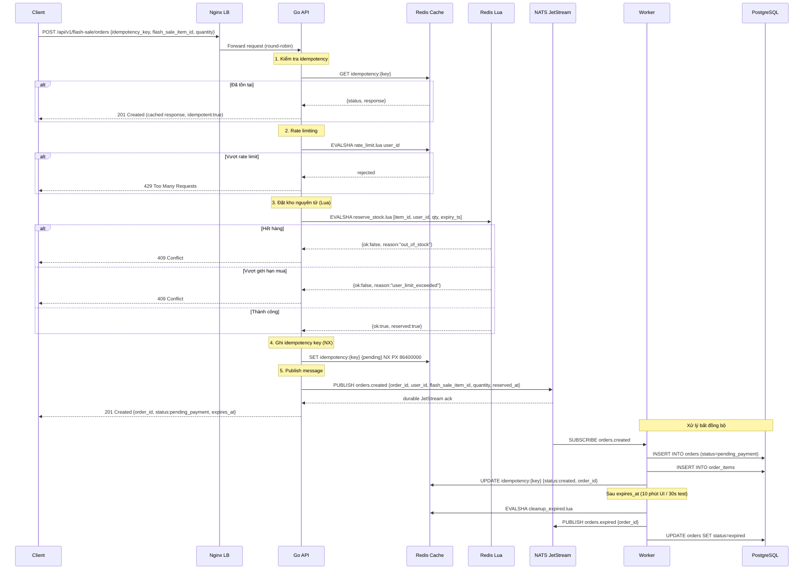
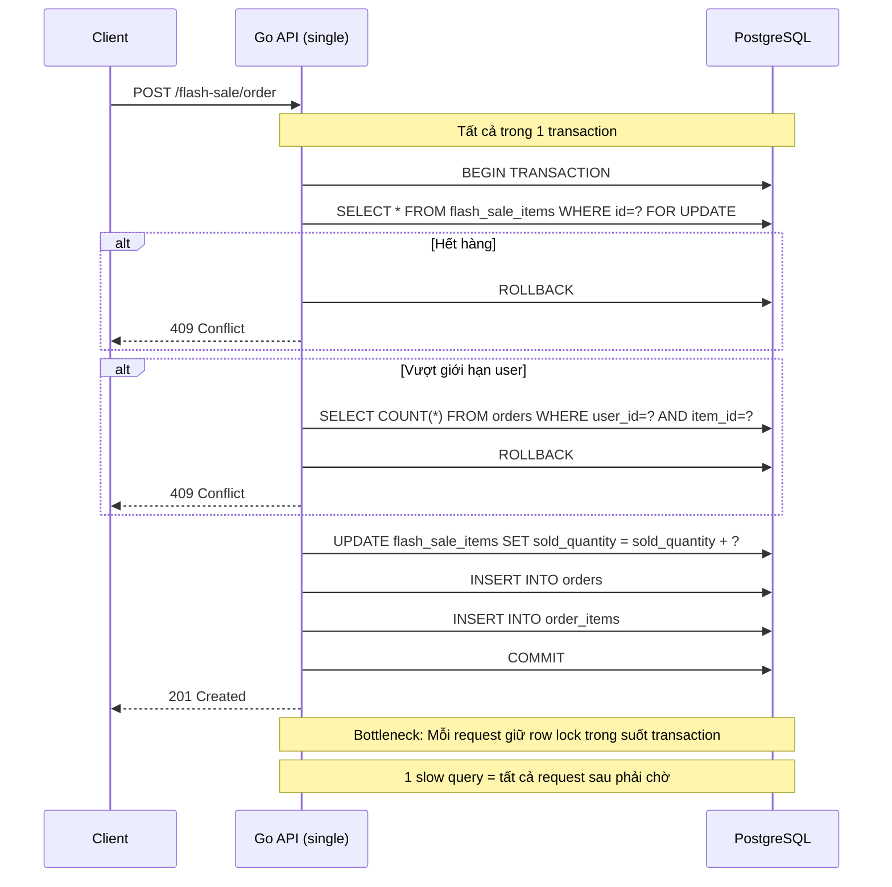
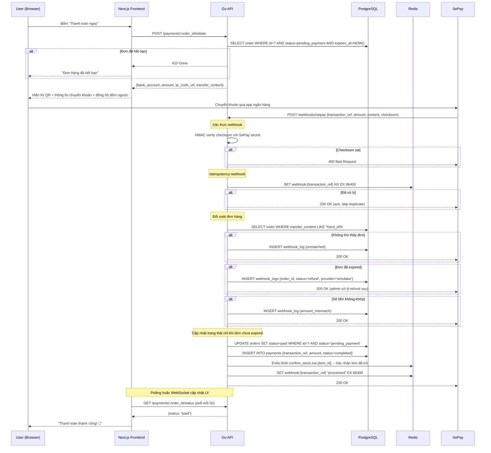
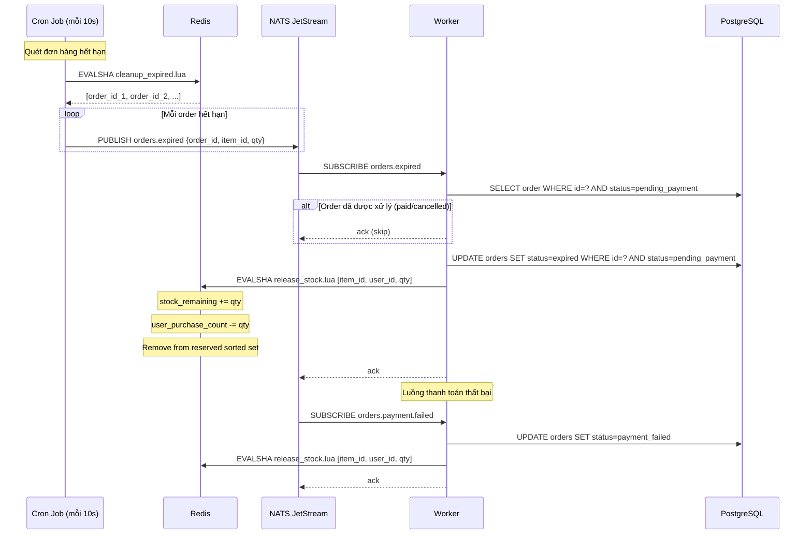
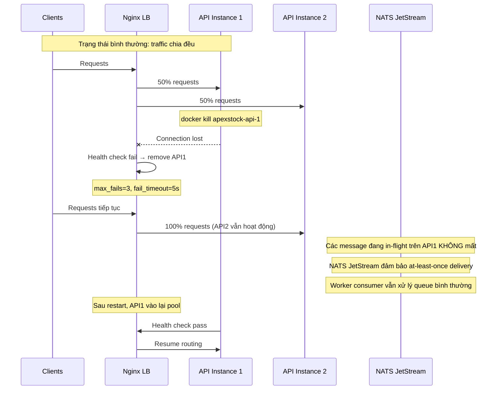
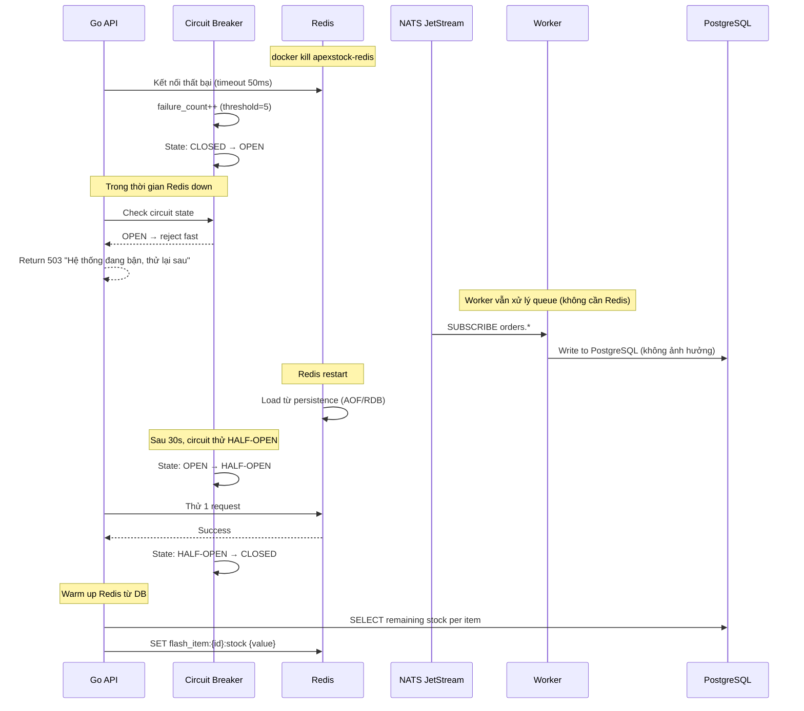
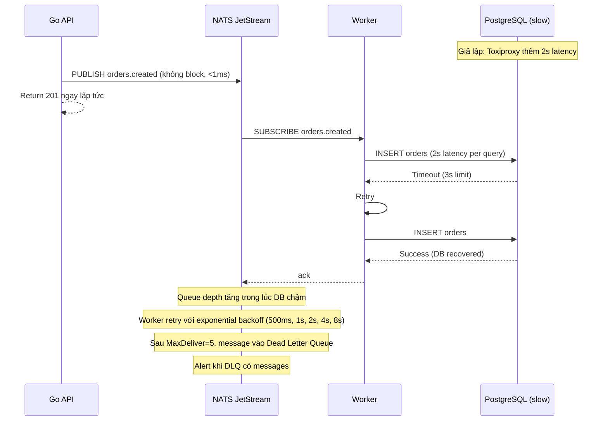
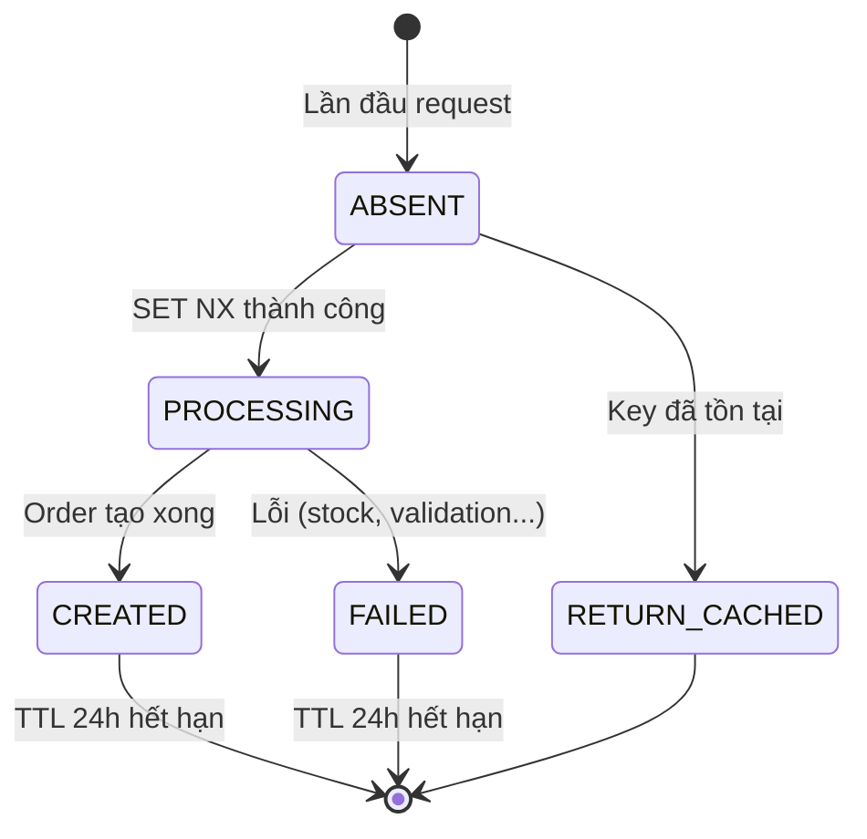

# ApexStock – API & Data Flow Design

> Phiên bản: 1.0 | Ngày: 2026-10-22

---

## 1. API Endpoints

### 1.1 Public APIs (không cần auth – dùng cho kịch bản kiểm thử tải)

| Method | Path | Mô tả |
|--------|------|--------|
| POST | `/api/v1/flash-sale/orders` | Đặt đơn flash sale (Baseline và Optimized dùng chung contract) |
| GET | `/api/v1/flash-sale/events/:id` | Lấy thông tin sự kiện + tồn kho thực từ Redis |
| GET | `/api/v1/health` | Health check |

#### POST `/api/v1/flash-sale/orders`

> Baseline chạy trên `:8081`, Optimized chạy trên `:8082`. Hai bên dùng chung schema và validation để benchmark công bằng.

**Request (mỗi order đúng 1 sản phẩm):**
```json
{
  "idempotency_key": "usr_42_item_7_ts_1792664379",
  "flash_sale_item_id": "fsi_7",
  "quantity": 1
}
```

**Response 201 (thành công):**
```json
{
  "order_id": "ord_8f3a",
  "status": "pending_payment",
  "expires_at": "2026-10-22T19:30:00Z",
  "total_amount": 19990000
}
```

**Response 409 (hết hàng):**
```json
{ "error": "out_of_stock", "message": "Sản phẩm đã hết hàng" }
```

**Response 429 (rate limit):**
```json
{ "error": "rate_limited", "retry_after": 1 }
```

**Response 201 (idempotent – đơn đã tồn tại):**
```json
{
  "order_id": "ord_8f3a",
  "status": "pending_payment",
  "expires_at": "2026-10-22T19:30:00Z",
  "idempotent": true
}
```

**Headers yêu cầu:**
- `Idempotency-Key: <uuid>` hoặc trong body
- Rate limit: 10 req/s per user_id, 5000 req/s global

---

### 1.2 Authenticated APIs (dùng cho giao diện người dùng)

#### Auth

| Method | Path | Mô tả |
|--------|------|--------|
| POST | `/api/v1/auth/register` | Đăng ký tài khoản |
| POST | `/api/v1/auth/login` | Đăng nhập, trả về JWT + refresh token |
| POST | `/api/v1/auth/refresh` | Làm mới access token |
| POST | `/api/v1/auth/logout` | Xoá session |
| GET | `/api/v1/auth/me` | Thông tin người dùng hiện tại |

**POST `/api/v1/auth/login` – Request:**
```json
{ "email": "user@example.com", "password": "secret123" }
```
**Response:**
```json
{
  "access_token": "eyJhbGci...",
  "refresh_token": "rt_abc123",
  "expires_in": 900
}
```

#### Sản phẩm & Sự kiện

| Method | Path | Mô tả |
|--------|------|--------|
| GET | `/api/v1/products` | Danh sách sản phẩm (phân trang) |
| GET | `/api/v1/products/:id` | Chi tiết sản phẩm |
| GET | `/api/v1/flash-sale/events` | Danh sách sự kiện (upcoming, active, ended) |
| GET | `/api/v1/flash-sale/events/:id` | Chi tiết sự kiện + tồn kho realtime từ Redis |

**GET `/api/v1/flash-sale/events/:id` – Response:**
```json
{
  "id": "fse_1",
  "name": "Flash Sale 12.12",
  "start_time": "2026-12-12T00:00:00Z",
  "end_time": "2026-12-12T02:00:00Z",
  "status": "active",
  "items": [
    {
      "id": "fsi_7",
      "product_id": "p_1",
      "product_name": "iPhone 17 Pro 256GB",
      "image_url": "https://...",
      "original_price": 32990000,
      "sale_price": 19990000,
      "total_quantity": 10000,
      "remaining_stock": 3421,
      "max_per_user": 1
    }
  ]
}
```

#### Đơn hàng (có auth)

| Method | Path | Mô tả |
|--------|------|--------|
| POST | `/api/v1/orders` | Tạo đơn hàng (từ UI, có auth) |
| GET | `/api/v1/orders` | Danh sách đơn của user |
| GET | `/api/v1/orders/:id` | Chi tiết đơn hàng |
| DELETE | `/api/v1/orders/:id` | Huỷ đơn hàng (nếu còn pending_payment) |

#### Thanh toán SePay

| Method | Path | Mô tả |
|--------|------|--------|
| POST | `/api/v1/payments/:order_id/initiate` | Tạo thông tin chuyển khoản + QR SePay |
| GET | `/api/v1/payments/:order_id/status` | Kiểm tra trạng thái thanh toán |
| POST | `/api/v1/webhooks/sepay` | Nhận webhook từ SePay (không cần auth, có signature) |

**POST `/api/v1/payments/:order_id/initiate` – Response:**
```json
{
  "bank_account": "9704229123456789",
  "bank_name": "Vietcombank",
  "account_name": "CONG TY APEXSTOCK",
  "amount": 19990000,
  "transfer_content": "APEXSTOCK ord8f3a",
  "qr_code_url": "https://img.vietqr.io/image/...",
  "expires_at": "2026-10-22T19:30:00Z"
}
```

---

### 1.3 War Room APIs

> Benchmark chạy tuần tự từng architecture. War Room dùng WebSocket cho live metrics. **Không có tính năng kill container từ UI**; operator kill container trực tiếp trong demo. Các trang người dùng dùng polling đơn giản.

| Method | Path | Mô tả |
|--------|------|--------|
| GET | `/api/v1/warroom/metrics` | Snapshot metrics cả 2 kiến trúc |
| GET | `/api/v1/warroom/health` | Trạng thái tất cả container |
| WS | `/api/v1/warroom/live` | Stream metrics realtime qua WebSocket |

**POST `/api/v1/warroom/chaos/kill` – Request:**
```json
{ "target": "apexstock-api-1", "auto_resume_after": 30 }
```

**WS `/api/v1/warroom/live` – Message mỗi 500ms:**
```json
{
  "ts": 1792664379,
  "baseline": {
    "rps": 312, "p50": 420, "p95": 1240, "p99": 3100,
    "error_rate": 0.032, "stock_remaining": 7821,
    "orders_success": 2179, "oversell": 0,
    "health": { "api": "up", "postgres": "up" }
  },
  "optimized": {
    "rps": 4821, "p50": 18, "p95": 62, "p99": 145,
    "error_rate": 0.001, "stock_remaining": 5124,
    "orders_success": 4876, "oversell": 0,
    "health": { "api": "up", "redis": "up", "queue": "up", "postgres": "up" }
  }
}
```

---

### 1.4 Admin APIs (nội bộ)

| Method | Path | Mô tả |
|--------|------|--------|
| POST | `/api/v1/admin/flash-sale/events` | Tạo sự kiện flash sale |
| POST | `/api/v1/admin/flash-sale/events/:id/items` | Thêm sản phẩm vào sự kiện |
| POST | `/api/v1/admin/flash-sale/events/:id/activate` | Kích hoạt sự kiện (warm up Redis) |
| GET | `/api/v1/admin/dashboard/stats` | Thống kê tổng quan |

---

## 2. Luồng đặt hàng Flash Sale (Optimized Architecture)



---

## 3. Luồng đặt hàng Baseline Architecture



---

## 4. Luồng thanh toán SePay



---

## 5. Luồng Restock (Hoàn kho)



---

## 6. Luồng Resilience

### 6.1 Kịch bản: API instance bị kill



### 6.2 Kịch bản: Redis bị kill



### 6.3 Kịch bản: PostgreSQL chậm



---

## 7. Idempotency – Thiết kế chi tiết

### 7.1 State machine



### 7.2 Race condition: 2 request cùng idempotency key đến đồng thời

```
T=0ms: Request A và Request B cùng GET idempotency:{key} → cả hai thấy ABSENT
T=1ms: Request A: SET idempotency:{key} "processing" NX PX 30000 → OK (A thắng)
T=1ms: Request B: SET idempotency:{key} "processing" NX PX 30000 → FAIL (B thua)
T=2ms: Request B: GET idempotency:{key} → "processing"
T=2ms: Request B: Trả về 202 Accepted { message: "Đang xử lý" }
T=50ms: Request A: Xử lý xong → SET idempotency:{key} {status:created, order_id:...} PX 86400000
T=3s: Client retry Request B → GET idempotency:{key} → {status:created, order_id:...}
T=3s: Request B: Trả về 200 { order_id, status:pending_payment, idempotent:true }
```

### 7.3 Redis key schema cho idempotency

```
Key:   idempotency:{idempotency_key}
Type:  HASH
TTL:   86400s (24 giờ)

Fields:
  status        "processing" | "created" | "failed"
  order_id      "ord_8f3a" (sau khi tạo xong)
  error_code    "out_of_stock" (nếu failed)
  created_at    Unix timestamp
  user_id       "usr_42"
```

### 7.4 Cleanup

- TTL tự động xoá key sau 24h
- Cron job hàng tuần xoá bản ghi `idempotency_keys` trong PostgreSQL quá 30 ngày

---

## 8. SePay Webhook – Edge Cases

| Tình huống | Xử lý |
|-----------|--------|
| Webhook đến đúng giờ, số tiền đúng | Cập nhật `paid`, xác nhận kho |
| Webhook trùng (retry từ SePay) | Redis NX check → skip, trả 200 OK |
| Webhook đến sau khi đơn đã `expired` | Ghi `webhook_log` với `late_payment`, đánh dấu `refund_pending` |
| Số tiền không khớp (thiếu/thừa) | Ghi `amount_mismatch`, cần xử lý thủ công |
| Checksum sai | Trả 400, log security warning |
| Không tìm thấy đơn | Ghi `unmatched`, trả 200 OK |
| Thanh toán cho đơn đã `paid` (duplicate) | Skip, trả 200 OK |

---

## 9. Tóm tắt các quyết định thiết kế

| Quyết định | Lựa chọn | Lý do |
|-----------|---------|-------|
| Idempotency store | Redis HASH + PostgreSQL backup | Redis cho speed, PG cho audit |
| Stock deduction timing | Tại request (Redis Lua), trước khi tạo đơn | Ngăn oversell, không cần saga rollback phức tạp |
| Đồng bộ Redis–DB | Worker bất đồng bộ qua queue | API không block, DB writes có thể retry |
| Webhook idempotency | Redis SET NX | Tự xoá sau 24h, đủ cho SePay retry window |
| Payment timeout | Redis Sorted Set + Cron 10s | Chính xác tới 10s, đủ cho demo |
| Circuit breaker state | Redis shared | Tất cả API instance dùng chung state |
