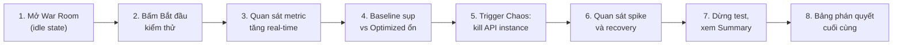
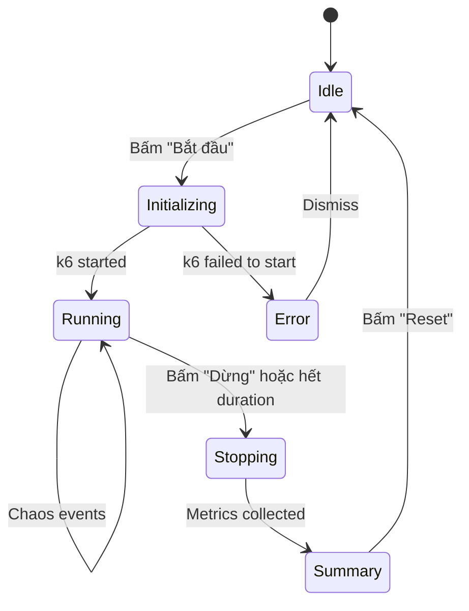
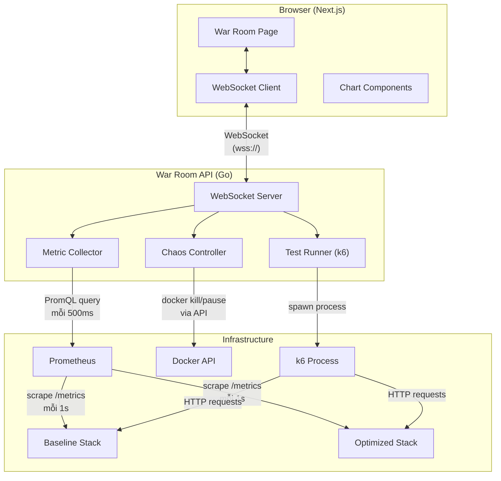
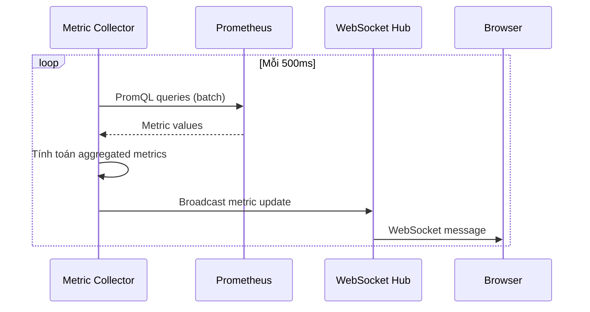
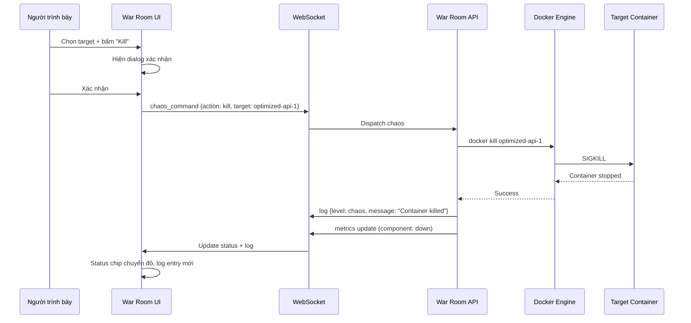
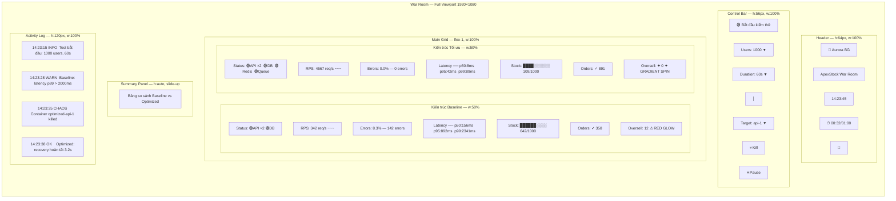

# 04 — War Room Dashboard

> Tài liệu thiết kế chi tiết cho dashboard "War Room" — giao diện trình diễn trực tiếp trước hội đồng, so sánh song song hiệu năng của kiến trúc Baseline và Optimized trong điều kiện tải cao và chaos engineering.

---

## 1. Mục đích và kịch bản demo

### 1.1. Mục đích

War Room Dashboard phục vụ **một mục đích duy nhất**: cho hội đồng **nhìn thấy bằng mắt** sự khác biệt giữa hai kiến trúc khi chịu tải flash sale thực tế. Thay vì trình bày slide với số liệu tĩnh, dashboard hiển thị metric real-time, cho phép trigger chaos event ngay trên màn hình, và tự động tổng hợp bảng so sánh kết quả cuối cùng.

### 1.2. Kịch bản demo từng bước

Toàn bộ demo kéo dài khoảng **8–12 phút**, chia thành 8 bước rõ ràng:



#### Bước 1 — Mở War Room (Idle State)

- Hội đồng thấy dashboard với 2 cột **Baseline** | **Optimized**, tất cả metric ở trạng thái 0.
- Health indicator của mọi component hiện **xanh lá** (healthy).
- Stock level hiển thị **1.000 sản phẩm** (con số mặc định cho demo).
- Aurora animation chạy nhẹ ở header, tạo ấn tượng visual đầu tiên.

#### Bước 2 — Bắt đầu kiểm thử

- Người trình bày chọn mức tải (ví dụ: **1.000 concurrent users**) và duration (**60 giây**).
- Bấm nút **"Bắt đầu kiểm thử"** → nút chuyển thành **"Đang chạy..."** với animation pulse.
- Backend gọi k6 script qua API, đồng thời gửi request đến **cả hai kiến trúc song song**.
- Timer đếm ngược xuất hiện trên header.

#### Bước 3 — Quan sát metric tăng real-time

- **RPS** tăng dần từ 0 lên mức target (hiệu ứng counting animation).
- **Latency chart** bắt đầu vẽ đường p50/p95/p99.
- **Stock level** bắt đầu giảm dần (thanh bar animation smooth).
- **Order counter** đếm lên liên tục.

#### Bước 4 — Baseline sụp đổ vs Optimized ổn định

- Sau ~15–20 giây tải cao:
  - **Baseline**: Latency p99 tăng vọt (>2s), error rate bắt đầu xuất hiện (đỏ), RPS giảm do connection pool cạn.
  - **Optimized**: Latency ổn định (<100ms p99), error rate = 0%, RPS duy trì mức target.
- Health indicator Baseline chuyển **vàng → đỏ**, tạo contrast visual rõ ràng.

#### Bước 5 — Trigger Chaos: Kill API instance

- Người trình bày mở **Chaos Controls**, chọn target: `optimized-api-1`.
- Bấm **"Kill"** → dialog xác nhận xuất hiện → xác nhận.
- Activity Log ghi nhận: `[CHAOS] Container optimized-api-1 đã bị kill`.

#### Bước 6 — Quan sát spike và recovery

- **Optimized**: Latency spike nhẹ (~200–500ms) trong 2–3 giây, sau đó recovery về mức bình thường nhờ load balancer chuyển traffic sang instance còn lại.
- **Baseline**: Nếu kill baseline-api-1, hệ thống crash hoàn toàn (error rate = 100%), không recovery.
- Recovery time được tự động đo và hiển thị.

#### Bước 7 — Dừng test, xem Summary

- Test tự dừng khi hết duration, hoặc người trình bày bấm **"Dừng"**.
- Bottom Summary Panel trượt lên (slide-up animation) với bảng so sánh đầy đủ.

#### Bước 8 — Bảng phán quyết cuối cùng

- Bảng verdict tự động highlight metric nào Optimized thắng (màu xanh) vs thua (màu đỏ).
- Oversell count = 0 cho Optimized → gradient spinning border animation (celebration).
- Oversell count > 0 cho Baseline → red glow animation (cảnh báo).

### 1.3. Dự kiến kết quả demo

| Metric | Baseline (dự kiến) | Optimized (dự kiến) | Ghi chú |
|--------|---------------------|---------------------|---------|
| Max RPS sustained | 200–400 | 2.000–5.000 | Tùy mức tải chọn |
| p50 Latency | 150–500ms | 5–20ms | Redis cache hit |
| p99 Latency | 2.000–10.000ms | 50–150ms | Async queue buffer |
| Error Rate | 5–30% | 0–0.5% | Connection pool exhaustion ở Baseline |
| Oversell Count | 5–50 | 0 | Lua atomic check ở Optimized |
| Recovery Time (sau chaos) | Không recovery | 2–5 giây | Load balancer + health check |

---

## 2. Layout chi tiết

### 2.1. Tổng quan bố cục

Dashboard được chia thành **5 vùng chính** theo chiều dọc, thiết kế cho màn hình laptop/projector (1920×1080 trở lên):

```
┌─────────────────────────────────────────────────────────────────────┐
│                        HEADER (64px)                                │
│  Aurora gradient bg │ Title │ Clock │ Timer │ Theme toggle           │
├─────────────────────────────────────────────────────────────────────┤
│                     CONTROL BAR (56px)                              │
│  [Bắt đầu] │ Load: [1000▼] │ Duration: [60s▼] │ Chaos: [target▼]  │
├────────────────────────────┬────────────────────────────────────────┤
│                            │                                        │
│     BASELINE (50%)         │      OPTIMIZED (50%)                   │
│                            │                                        │
│  ┌─Status Bar────────┐    │    ┌─Status Bar────────┐               │
│  │ API DB Redis Queue │    │    │ API DB Redis Queue │               │
│  └───────────────────┘    │    └───────────────────┘               │
│                            │                                        │
│  ┌─RPS──┐ ┌─Errors──┐    │    ┌─RPS──┐ ┌─Errors──┐               │
│  │ 1234 │ │ 2.3%    │    │    │ 4567 │ │ 0.0%    │               │
│  │~~~~~~│ │         │    │    │~~~~~~│ │         │               │
│  └──────┘ └─────────┘    │    └──────┘ └─────────┘               │
│                            │                                        │
│  ┌─Latency Chart─────┐    │    ┌─Latency Chart─────┐               │
│  │  p50 ── p95 ── p99│    │    │  p50 ── p95 ── p99│               │
│  │    ___/‾‾‾\___    │    │    │  ─────────────── │               │
│  └───────────────────┘    │    └───────────────────┘               │
│                            │                                        │
│  ┌─Stock─┐ ┌─Orders─┐    │    ┌─Stock─┐ ┌─Orders─┐               │
│  │██████ │ │  456   │    │    │██████ │ │  891   │               │
│  │████   │ │        │    │    │████░░ │ │        │               │
│  └───────┘ └────────┘    │    └───────┘ └────────┘               │
│                            │                                        │
│  ┌─Oversell──────────┐    │    ┌─Oversell──────────┐               │
│  │       12          │    │    │ ✦ 0 ✦             │               │
│  │   (red glow)      │    │    │ (gradient spin)   │               │
│  └───────────────────┘    │    └───────────────────┘               │
│                            │                                        │
├────────────────────────────┴────────────────────────────────────────┤
│                   SUMMARY PANEL (slide-up, ẩn khi test đang chạy)  │
│  ┌──────────────────────────────────────────────────────┐          │
│  │ Metric │ Baseline │ Optimized │ Improvement           │          │
│  │────────│──────────│───────────│───────────────────────│          │
│  │ ...    │ ...      │ ...       │ +X% / -Y%             │          │
│  └──────────────────────────────────────────────────────┘          │
├─────────────────────────────────────────────────────────────────────┤
│                   ACTIVITY LOG (120px, scrollable)                  │
│  12:03:15 [INFO]  Test bắt đầu: 1000 users, 60s                   │
│  12:03:28 [WARN]  Baseline: latency p99 > 2000ms                  │
│  12:03:35 [CHAOS] Container optimized-api-1 killed                 │
│  12:03:38 [OK]    Optimized: recovery hoàn tất (3.2s)              │
└─────────────────────────────────────────────────────────────────────┘
```

### 2.2. Header (64px)

| Thành phần | Vị trí | Chi tiết |
|------------|--------|----------|
| Aurora gradient | Background | CSS animation gradient xoay chậm, 3 màu: `#0ea5e9` (sky), `#8b5cf6` (violet), `#06b6d4` (cyan). Opacity 0.15, blur 120px. Identical với header trang chính. |
| Title | Trái | "ApexStock War Room" — font `Inter`, 20px, `font-semibold`, `text-white` |
| Real-time clock | Giữa-phải | `HH:MM:SS` format, cập nhật mỗi giây, `text-zinc-400`, `font-mono` |
| Test duration | Phải (hiện khi test chạy) | `⏱ 00:45 / 01:00` — đếm lên, `text-emerald-400` khi đang chạy, `text-zinc-500` khi idle |
| Theme toggle | Góc phải | Icon sun/moon, toggle giữa dark (mặc định) và light. Dùng `next-themes`. |

**Kỹ thuật Aurora:**

```css
.aurora {
  position: absolute;
  inset: 0;
  overflow: hidden;
}

.aurora::before,
.aurora::after {
  content: '';
  position: absolute;
  width: 400px;
  height: 400px;
  border-radius: 50%;
  filter: blur(120px);
  opacity: 0.15;
  animation: aurora-drift 8s ease-in-out infinite alternate;
}

.aurora::before {
  background: #0ea5e9;
  top: -200px;
  left: 20%;
}

.aurora::after {
  background: #8b5cf6;
  top: -200px;
  right: 20%;
  animation-delay: -4s;
}

@keyframes aurora-drift {
  0% { transform: translateY(0) translateX(0) scale(1); }
  100% { transform: translateY(30px) translateX(40px) scale(1.1); }
}
```

### 2.3. Control Bar (56px)

Thanh điều khiển nằm ngay dưới header, background `bg-zinc-900/80` với `backdrop-blur-xl`, border-bottom `border-zinc-800`.

| Thành phần | Kiểu | Chi tiết |
|------------|------|----------|
| **Nút Bắt đầu / Dừng** | Primary button | Trạng thái idle: `"Bắt đầu kiểm thử"`, bg-emerald-600, hover:bg-emerald-500. Trạng thái running: `"Dừng kiểm thử"`, bg-red-600, pulse animation. Trạng thái loading: spinner + `"Đang khởi tạo..."` |
| **Load level** | Select dropdown | Options: `100 / 500 / 1.000 / 2.000 / 5.000` concurrent users. Default: `1.000`. Disabled khi test đang chạy. |
| **Duration** | Select dropdown | Options: `30s / 60s / 120s / 180s / 300s`. Default: `60s`. |
| **Chaos target** | Select dropdown | Options: `baseline-api-1`, `baseline-api-2`, `optimized-api-1`, `optimized-api-2`, `redis`, `postgres`. Grouped theo kiến trúc. |
| **Kill** | Danger button | `bg-red-600`, icon skull. Disabled khi không có target. Trigger confirmation dialog. |
| **Pause / Resume** | Warning button | `bg-amber-600`, icon pause/play. Toggle giữa pause và resume. |

**Trạng thái nút theo lifecycle:**



### 2.4. Main Grid — Baseline | Optimized (chiếm ~65% viewport height)

Hai cột chia đều 50/50, ngăn cách bởi **divider dọc** 1px `border-zinc-700` với hiệu ứng gradient fade ở hai đầu. Mỗi cột có header riêng:

- **Baseline**: label `"Kiến trúc Baseline"`, badge `"Direct DB"`, màu `text-zinc-400`
- **Optimized**: label `"Kiến trúc Tối ưu"`, badge `"Redis + Queue"`, màu `text-emerald-400`

#### 2.4.1. Status Bar (mỗi bên)

Thanh ngang hiển thị health status của từng component. Mỗi component là một chip nhỏ:

| Component | Baseline hiển thị | Optimized hiển thị |
|-----------|-------------------|---------------------|
| API | `API ×2` (2 instances) | `API ×2` (2 instances) |
| DB | `PostgreSQL` | `PostgreSQL` |
| Redis | *(không có)* | `Redis` |
| Queue | *(không có)* | `Queue` |

**Trạng thái màu:**
- 🟢 **Healthy** (`bg-emerald-500/20`, `text-emerald-400`, dot `bg-emerald-500`): Component đang chạy bình thường.
- 🟡 **Degraded** (`bg-amber-500/20`, `text-amber-400`, dot `bg-amber-500`): Latency cao nhưng vẫn respond.
- 🔴 **Down** (`bg-red-500/20`, `text-red-400`, dot `bg-red-500`, pulse animation): Component không respond hoặc bị kill.
- ⚫ **Unknown** (`bg-zinc-500/20`, `text-zinc-500`): Chưa có data (trước khi test bắt đầu).

Chuyển trạng thái dùng CSS transition `transition-colors duration-500` để smooth.

#### 2.4.2. RPS Gauge

- **Số lớn**: font `Inter`, 48px, `font-bold`, `tabular-nums` (để số không nhảy khi thay đổi).
- **Animation**: Counting animation dùng `framer-motion`'s `useSpring` với `stiffness: 100, damping: 30`.
- **Sparkline**: Đường mini chart 120px width × 40px height bên dưới số, hiển thị RPS 30 giây gần nhất. Dùng SVG path đơn giản, không cần thư viện chart.
- **Unit**: label `"req/s"` nhỏ bên cạnh, `text-zinc-500`.

#### 2.4.3. Latency Chart

- **Kích thước**: Chiếm full width mỗi cột, height 180px.
- **Loại chart**: Line chart với 3 đường:
  - `p50`: `stroke: #22c55e` (green), `stroke-width: 2`
  - `p95`: `stroke: #eab308` (yellow), `stroke-width: 1.5`
  - `p99`: `stroke: #ef4444` (red), `stroke-width: 1.5`
- **Trục X**: Thời gian, sliding window 60 giây gần nhất. Label mỗi 10s.
- **Trục Y**: Auto-scale, unit `ms`. Grid lines `stroke: zinc-800`.
- **Tooltip**: Hover hiển thị giá trị chính xác tại thời điểm đó.
- **Legend**: 3 chip nhỏ phía trên chart: `p50` `p95` `p99`.
- **Background**: `bg-zinc-900/50`, border `border-zinc-800`, rounded-lg.

#### 2.4.4. Error Rate

- **Số phần trăm**: font 36px, `font-bold`.
  - `0.0%` → `text-emerald-400`
  - `0.1–5.0%` → `text-amber-400`
  - `>5.0%` → `text-red-400`, pulse animation
- **Error count**: số nhỏ bên dưới, ví dụ `"(142 errors)"`, `text-zinc-500`.

#### 2.4.5. Stock Level

- **Progress bar**: Height 24px, rounded-full.
  - Background: `bg-zinc-800`
  - Fill: gradient `from-emerald-500 to-cyan-500` khi > 50%, `from-amber-500 to-red-500` khi < 20%
  - Animation: `transition-all duration-500 ease-out`
- **Label**: `"642 / 1.000"` bên trong bar (nếu đủ rộng) hoặc bên trên.
- **Percentage**: `"64.2%"` bên phải bar.

#### 2.4.6. Order Counter

- **Số lớn**: font 42px, `font-bold`, `text-white`.
- **Animation**: Counting lên smooth, dùng `useSpring` giống RPS.
- **Label**: `"đơn hàng thành công"` bên dưới, `text-zinc-500`, 12px.
- **Icon**: ✓ checkmark nhỏ màu emerald bên trái số.

#### 2.4.7. Oversell Indicator

Đây là **element quan trọng nhất** của demo — chứng minh tính nhất quán dữ liệu.

**Khi giá trị = 0 (tốt):**
- Số `0` hiển thị lớn, font 56px, `text-emerald-400`.
- Border: **gradient spinning border** — kỹ thuật `conic-gradient` xoay liên tục.
- Label: `"Không oversell ✓"`, `text-emerald-400`.

```css
.oversell-good {
  position: relative;
  border-radius: 12px;
  padding: 2px; /* Thickness of the border */
  background: conic-gradient(
    from var(--angle),
    #06b6d4,
    #8b5cf6,
    #0ea5e9,
    #06b6d4
  );
  animation: spin-border 3s linear infinite;
}

.oversell-good::before {
  content: '';
  position: absolute;
  inset: 2px;
  border-radius: 10px;
  background: #09090b; /* zinc-950 */
}

@property --angle {
  syntax: '<angle>';
  initial-value: 0deg;
  inherits: false;
}

@keyframes spin-border {
  to { --angle: 360deg; }
}
```

**Khi giá trị > 0 (xấu):**
- Số hiển thị lớn, font 56px, `text-red-400`, `font-bold`.
- Border: solid `border-red-500`, **red glow** animation.
- Label: `"⚠ OVERSELL DETECTED"`, `text-red-400`.
- Background pulse: `bg-red-500/10` fade in/out.

```css
.oversell-bad {
  border: 2px solid #ef4444;
  box-shadow: 0 0 20px rgba(239, 68, 68, 0.3),
              0 0 60px rgba(239, 68, 68, 0.1);
  animation: red-pulse 2s ease-in-out infinite;
}

@keyframes red-pulse {
  0%, 100% { box-shadow: 0 0 20px rgba(239, 68, 68, 0.3); }
  50% { box-shadow: 0 0 40px rgba(239, 68, 68, 0.5); }
}
```

### 2.5. Bottom Summary Panel

Ẩn trong khi test đang chạy. Khi test kết thúc, slide lên với `framer-motion` animation (`initial: { y: 100, opacity: 0 }`, `animate: { y: 0, opacity: 1 }`).

**Bảng so sánh:**

| Metric | Baseline | Optimized | Cải thiện |
|--------|----------|-----------|-----------|
| Max RPS sustained | `X req/s` | `Y req/s` | `+Z%` (text-emerald) |
| p50 Latency | `X ms` | `Y ms` | `-Z%` (text-emerald) |
| p95 Latency | `X ms` | `Y ms` | `-Z%` (text-emerald) |
| p99 Latency | `X ms` | `Y ms` | `-Z%` (text-emerald) |
| Error Rate | `X%` | `Y%` | `-Z%` (text-emerald) |
| Tổng đơn hàng | `X` | `Y` | `+Z%` (text-emerald) |
| Oversell Count | `X` (text-red) | `0` (text-emerald) | `✓ An toàn` |
| Recovery Time | `N/A` hoặc `Không recovery` (text-red) | `X.Xs` (text-emerald) | `✓ Tự phục hồi` |

**Quy tắc highlight:**
- Cột "Cải thiện": số dương (tốt hơn) → `text-emerald-400`, số âm (tệ hơn) → `text-red-400`.
- Row có sự khác biệt lớn nhất → `bg-emerald-500/5` highlight nhẹ.

### 2.6. Activity Log (120px, cố định ở đáy)

- **Container**: `bg-zinc-950`, border-top `border-zinc-800`, `overflow-y: auto`, `max-height: 120px`.
- **Auto-scroll**: Luôn scroll xuống entry mới nhất, trừ khi user đang hover (pause auto-scroll).
- **Format mỗi dòng**: `[HH:MM:SS] [TAG] Message`

**Bảng màu tag:**

| Tag | Màu | Ý nghĩa | Ví dụ |
|-----|------|---------|-------|
| `INFO` | `text-sky-400` | Sự kiện thông tin | `Test bắt đầu: 1000 users, 60s` |
| `OK` | `text-emerald-400` | Recovery / thành công | `Optimized: recovery hoàn tất (3.2s)` |
| `WARN` | `text-amber-400` | Degraded / cảnh báo | `Baseline: latency p99 > 2000ms` |
| `ERROR` | `text-red-400` | Lỗi / thất bại | `Baseline: error rate > 10%` |
| `CHAOS` | `text-purple-400` | Chaos event | `Container optimized-api-1 killed` |

---

## 3. Thiết kế kỹ thuật

### 3.1. Kiến trúc tổng quan



### 3.2. WebSocket Protocol

Sử dụng **một WebSocket connection duy nhất** giữa browser và War Room API server. Mọi message đều là JSON, có field `type` để phân loại.

#### 3.2.1. Client → Server Messages

```typescript
// Bắt đầu test
{
  "type": "start_test",
  "payload": {
    "concurrent_users": 1000,
    "duration_seconds": 60,
    "product_stock": 1000
  }
}

// Dừng test
{
  "type": "stop_test"
}

// Chaos command
{
  "type": "chaos_command",
  "payload": {
    "action": "kill" | "pause" | "resume",
    "target": "optimized-api-1" | "baseline-api-2" | "redis" | "postgres",
    "auto_resume_seconds": 30  // optional, chỉ cho pause
  }
}

// Ping (keepalive)
{
  "type": "ping",
  "timestamp": 1698000000000
}
```

#### 3.2.2. Server → Client Messages

```typescript
// Metric update — gửi mỗi 500ms
{
  "type": "metrics",
  "timestamp": 1698000000000,
  "payload": {
    "baseline": {
      "rps": 342.5,
      "latency": {
        "p50": 156.2,
        "p95": 892.4,
        "p99": 2341.8
      },
      "error_rate": 8.3,
      "error_count": 142,
      "stock_remaining": 642,
      "stock_total": 1000,
      "orders_success": 358,
      "orders_total": 500,
      "oversell_count": 12,
      "components": {
        "api-1": "healthy",
        "api-2": "healthy",
        "postgres": "healthy"
      }
    },
    "optimized": {
      "rps": 4567.8,
      "latency": {
        "p50": 8.3,
        "p95": 42.1,
        "p99": 89.7
      },
      "error_rate": 0.0,
      "error_count": 0,
      "stock_remaining": 109,
      "stock_total": 1000,
      "orders_success": 891,
      "orders_total": 891,
      "oversell_count": 0,
      "components": {
        "api-1": "healthy",
        "api-2": "down",
        "postgres": "healthy",
        "redis": "healthy",
        "queue": "healthy"
      }
    }
  }
}

// Test state change
{
  "type": "test_state",
  "payload": {
    "state": "idle" | "initializing" | "running" | "stopping" | "completed" | "error",
    "elapsed_seconds": 45,
    "total_seconds": 60,
    "error_message": ""  // chỉ khi state = error
  }
}

// Activity log entry
{
  "type": "log",
  "payload": {
    "timestamp": 1698000000000,
    "level": "info" | "ok" | "warn" | "error" | "chaos",
    "message": "Container optimized-api-1 đã bị kill"
  }
}

// Test summary — gửi khi test hoàn tất
{
  "type": "summary",
  "payload": {
    "baseline": {
      "max_rps": 342.5,
      "p50_latency": 156.2,
      "p95_latency": 892.4,
      "p99_latency": 2341.8,
      "error_rate": 8.3,
      "total_orders": 358,
      "oversell_count": 12,
      "recovery_time_ms": null
    },
    "optimized": {
      "max_rps": 4567.8,
      "p50_latency": 8.3,
      "p95_latency": 42.1,
      "p99_latency": 89.7,
      "error_rate": 0.0,
      "total_orders": 891,
      "oversell_count": 0,
      "recovery_time_ms": 3200
    }
  }
}

// Pong
{
  "type": "pong",
  "timestamp": 1698000000000
}
```

### 3.3. Thu thập Metric

War Room API server chạy một **Metric Collector goroutine** poll Prometheus mỗi 500ms:



**Các PromQL query cần thiết:**

| Metric | PromQL | Ghi chú |
|--------|--------|---------|
| RPS | `sum(rate(http_requests_total{arch="baseline"}[5s]))` | Rate 5 giây cho smooth |
| p50 Latency | `histogram_quantile(0.5, sum(rate(http_request_duration_seconds_bucket{arch="baseline"}[5s])) by (le))` | Dùng histogram |
| p95 Latency | `histogram_quantile(0.95, ...)` | Tương tự |
| p99 Latency | `histogram_quantile(0.99, ...)` | Tương tự |
| Error Rate | `sum(rate(http_requests_total{arch="baseline",code=~"5.."}[5s])) / sum(rate(http_requests_total{arch="baseline"}[5s])) * 100` | Tỷ lệ 5xx |
| Error Count | `sum(increase(http_requests_total{arch="baseline",code=~"5.."}[1m]))` | Tổng lỗi trong test |
| Stock Remaining | Custom metric: `flash_sale_stock_remaining{arch="baseline"}` | Expose từ Go service |
| Orders Success | Custom metric: `flash_sale_orders_total{arch="baseline",status="success"}` | Counter |
| Oversell Count | Custom metric: `flash_sale_oversell_total{arch="baseline"}` | Counter, tính bằng cách so sánh tổng orders vs stock ban đầu |

**Custom metrics** cần expose từ Go services (Prometheus client):

```go
var (
    stockRemaining = promauto.NewGaugeVec(prometheus.GaugeOpts{
        Name: "flash_sale_stock_remaining",
        Help: "Remaining stock for flash sale item",
    }, []string{"arch", "product_id"})

    ordersTotal = promauto.NewCounterVec(prometheus.CounterOpts{
        Name: "flash_sale_orders_total",
        Help: "Total orders placed",
    }, []string{"arch", "status"}) // status: success, failed, oversell

    oversellTotal = promauto.NewCounterVec(prometheus.CounterOpts{
        Name: "flash_sale_oversell_total",
        Help: "Total oversell incidents detected",
    }, []string{"arch"})
)
```

### 3.4. Phát hiện Oversell

Oversell được phát hiện bằng **hai cơ chế bổ sung**:

1. **Real-time (trong Go service)**: Sau mỗi order thành công, kiểm tra `total_orders_success > initial_stock`. Nếu đúng → increment `flash_sale_oversell_total`.

2. **Post-test verification (chính xác hơn)**: Query PostgreSQL:
   ```sql
   SELECT
     COUNT(*) as total_orders,
     (SELECT quantity FROM products WHERE id = $1) as final_stock,
     $2 as initial_stock,
     CASE
       WHEN COUNT(*) > $2 THEN COUNT(*) - $2
       ELSE 0
     END as oversell_count
   FROM orders
   WHERE product_id = $1
     AND status = 'completed'
     AND created_at BETWEEN $3 AND $4;
   ```

### 3.5. Tần suất cập nhật

| Loại dữ liệu | Tần suất | Lý do |
|---------------|----------|-------|
| RPS, Error rate, Stock, Orders, Oversell | **500ms** | Số liệu thay đổi nhanh, cần responsive |
| Latency chart data point | **1.000ms** | Chart 60 data points = 60 giây, đủ smooth |
| Component health status | **2.000ms** | Docker health check không cần quá nhanh |
| Activity log | **Event-driven** | Gửi ngay khi có event, không poll |

### 3.6. Frontend Architecture

War Room là **một page** trong Next.js app hiện có, route: `/war-room`.

```
src/app/war-room/
├── page.tsx                    # Main page component
├── layout.tsx                  # War Room layout (fullscreen, no nav)
├── components/
│   ├── Header.tsx              # Aurora + title + clock
│   ├── ControlBar.tsx          # Test controls + chaos buttons
│   ├── ArchPanel.tsx           # One side (Baseline or Optimized)
│   │   ├── StatusBar.tsx       # Component health chips
│   │   ├── RpsGauge.tsx        # RPS number + sparkline
│   │   ├── LatencyChart.tsx    # p50/p95/p99 line chart
│   │   ├── ErrorRate.tsx       # Error percentage display
│   │   ├── StockLevel.tsx      # Stock progress bar
│   │   ├── OrderCounter.tsx    # Animated order count
│   │   └── OversellIndicator.tsx # The star component
│   ├── SummaryPanel.tsx        # Post-test comparison table
│   ├── ActivityLog.tsx         # Scrolling event log
│   └── SpotlightEffect.tsx    # Mouse tracking spotlight
├── hooks/
│   ├── useWarRoomSocket.ts     # WebSocket connection manager
│   ├── useAnimatedNumber.ts    # Smooth number transition
│   └── useAutoScroll.ts       # Smart auto-scroll for log
├── lib/
│   ├── types.ts               # TypeScript interfaces
│   └── constants.ts           # Config values
└── stores/
    └── warRoomStore.ts         # Zustand store for state
```

### 3.7. State Management

Dùng **Zustand** store để quản lý toàn bộ state War Room:

```typescript
interface WarRoomState {
  // Connection
  connectionStatus: 'connecting' | 'connected' | 'disconnected' | 'error';

  // Test state
  testState: 'idle' | 'initializing' | 'running' | 'stopping' | 'completed' | 'error';
  testConfig: {
    concurrentUsers: number;
    durationSeconds: number;
    productStock: number;
  };
  elapsedSeconds: number;

  // Metrics (latest snapshot)
  metrics: {
    baseline: ArchMetrics;
    optimized: ArchMetrics;
  };

  // Chart history (ring buffer, max 120 points = 60s × 2 points/s)
  history: {
    baseline: MetricPoint[];
    optimized: MetricPoint[];
  };

  // Summary (after test completion)
  summary: TestSummary | null;

  // Activity log
  logs: LogEntry[];

  // Actions
  startTest: (config: TestConfig) => void;
  stopTest: () => void;
  sendChaosCommand: (cmd: ChaosCommand) => void;
}

interface ArchMetrics {
  rps: number;
  latency: { p50: number; p95: number; p99: number };
  errorRate: number;
  errorCount: number;
  stockRemaining: number;
  stockTotal: number;
  ordersSuccess: number;
  ordersTotal: number;
  oversellCount: number;
  components: Record<string, 'healthy' | 'degraded' | 'down' | 'unknown'>;
}

interface MetricPoint {
  timestamp: number;
  rps: number;
  p50: number;
  p95: number;
  p99: number;
}
```

### 3.8. Thư viện Chart

**Khuyến nghị: [uPlot](https://github.com/leeoniya/uPlot)** — lý do:

| Tiêu chí | uPlot | Recharts | Lightweight Charts |
|-----------|-------|----------|--------------------|
| Bundle size | **~40KB** | ~200KB | ~50KB |
| Render speed | **Fastest** (Canvas) | Slow (SVG/React) | Fast (Canvas) |
| React integration | Wrapper cần viết | Native | Wrapper cần viết |
| Customization | Cao | Trung bình | Thấp (trading focus) |
| Real-time update | **Excellent** | Chậm với nhiều data | Good |

**uPlot** phù hợp nhất vì:
- Render cực nhanh trên Canvas — quan trọng khi update 2 chart mỗi 1 giây.
- Bundle nhỏ, không bloat app.
- Hỗ trợ streaming data tốt (append data point, shift window).

**Sparkline** cho RPS: Dùng SVG path đơn giản, không cần thư viện. Chỉ cần 30 data points:

```typescript
function Sparkline({ data, width = 120, height = 40 }: SparklineProps) {
  const max = Math.max(...data, 1);
  const points = data.map((v, i) => {
    const x = (i / (data.length - 1)) * width;
    const y = height - (v / max) * height;
    return `${x},${y}`;
  }).join(' ');

  return (
    <svg width={width} height={height} className="opacity-50">
      <polyline
        points={points}
        fill="none"
        stroke="currentColor"
        strokeWidth="1.5"
      />
    </svg>
  );
}
```

---

## 4. Chaos Engineering Controls

### 4.1. Kiến trúc Chaos



### 4.2. Cách thức hoạt động

War Room API server tương tác với Docker thông qua **Docker Engine API** (unix socket `/var/run/docker.sock`):

#### Kill Container

```go
func (c *ChaosController) KillContainer(ctx context.Context, name string) error {
    // Validate target name against whitelist
    if !c.isAllowedTarget(name) {
        return fmt.Errorf("target %q not in allowed list", name)
    }

    // Gửi SIGKILL
    timeout := 0 // immediate kill
    return c.dockerClient.ContainerStop(ctx, name, container.StopOptions{
        Signal:  "SIGKILL",
        Timeout: &timeout,
    })
}
```

#### Pause / Unpause Container

```go
func (c *ChaosController) PauseContainer(ctx context.Context, name string, autoResumeAfter time.Duration) error {
    if err := c.dockerClient.ContainerPause(ctx, name); err != nil {
        return err
    }

    // Auto-resume nếu được config
    if autoResumeAfter > 0 {
        go func() {
            time.Sleep(autoResumeAfter)
            _ = c.dockerClient.ContainerUnpause(context.Background(), name)
            c.broadcastLog("chaos", fmt.Sprintf("Container %s auto-resumed after %s", name, autoResumeAfter))
        }()
    }

    return nil
}
```

### 4.3. Whitelist Target

Chỉ cho phép chaos trên các container được định nghĩa trước:

```go
var allowedTargets = map[string]string{
    "baseline-api-1":   "apexstock-baseline-api-1",
    "baseline-api-2":   "apexstock-baseline-api-2",
    "optimized-api-1":  "apexstock-optimized-api-1",
    "optimized-api-2":  "apexstock-optimized-api-2",
    "redis":            "apexstock-redis",
    "postgres":         "apexstock-postgres",
}
```

> [!CAUTION]
> **Không cho phép kill PostgreSQL hoặc Redis** trong chaos dropdown mặc định. Chỉ enable khi người trình bày chủ động bật "Advanced Chaos Mode" — vì kill DB có thể gây mất data và cần restart phức tạp hơn.

### 4.4. Safety Mechanisms

| Cơ chế | Chi tiết |
|--------|----------|
| **Confirmation dialog** | Modal dialog: `"Bạn có chắc muốn kill container optimized-api-1? Hành động này sẽ ảnh hưởng đến kết quả test."` với 2 nút: `"Hủy"` (mặc định focus) và `"Kill"` (đỏ). |
| **Auto-resume timeout** | Khi pause, mặc định tự resume sau **30 giây**. Configurable trong UI (15s / 30s / 60s / Không tự resume). |
| **Cooldown** | Sau mỗi chaos action, disable nút 3 giây để tránh double-click. |
| **Test-only restriction** | Chaos controls chỉ hoạt động khi test đang `running`. Disabled trong các state khác. |
| **Restart capability** | Sau khi kill, UI hiển thị nút `"Restart"` bên cạnh container status để khôi phục. Gọi `docker start`. |

### 4.5. Visual Feedback sau Chaos

Khi container bị kill/pause:

1. **Status chip** chuyển đỏ ngay lập tức (WebSocket event-driven, không chờ poll).
2. **Activity Log** thêm entry `[CHAOS]` màu tím.
3. **Latency chart**: Spike visible trong 2–5 giây tiếp theo.
4. **RPS**: Giảm tạm thời (Optimized) hoặc giảm vĩnh viễn (Baseline).
5. **Toàn bộ panel** của kiến trúc bị ảnh hưởng flash `border-red-500/30` 1 lần rồi fade.

Khi recovery (container restart hoặc unpause):

1. **Status chip** chuyển xanh lại.
2. **Activity Log** thêm entry `[OK]` màu xanh.
3. **Recovery time** được đo: khoảng thời gian từ lúc kill đến khi health check pass lại.

---

## 5. Responsive và Animation

### 5.1. Viewport target

Dashboard được thiết kế cho **viewport cố định 1920×1080** (full HD), đây là resolution phổ biến nhất cho projector và laptop demo. 

- **Không cần responsive mobile** — War Room chỉ sử dụng cho demo trên laptop/projector.
- Sử dụng `min-width: 1280px` media query. Dưới 1280px hiện thông báo: `"War Room yêu cầu màn hình tối thiểu 1280px."`.
- Hỗ trợ **zoom 90%** cho projector có resolution thấp hơn.

### 5.2. Animation Catalog

#### 5.2.1. Aurora Gradient (Header)

- Đã mô tả CSS ở section 2.2.
- Performance: Dùng `will-change: transform` và `transform` thay vì animate `top/left` để tránh layout thrashing.
- GPU-accelerated: `translateZ(0)` force GPU compositing.

#### 5.2.2. Spotlight Mouse Tracking

Hiệu ứng spotlight theo chuột trên toàn bộ trang — một vùng sáng mờ (radial gradient) di chuyển theo con trỏ:

```typescript
function SpotlightEffect() {
  const [position, setPosition] = useState({ x: 0, y: 0 });

  useEffect(() => {
    const handleMouseMove = (e: MouseEvent) => {
      // Throttle to 60fps via requestAnimationFrame
      requestAnimationFrame(() => {
        setPosition({ x: e.clientX, y: e.clientY });
      });
    };

    window.addEventListener('mousemove', handleMouseMove);
    return () => window.removeEventListener('mousemove', handleMouseMove);
  }, []);

  return (
    <div
      className="pointer-events-none fixed inset-0 z-50 transition-opacity duration-300"
      style={{
        background: `radial-gradient(600px circle at ${position.x}px ${position.y}px, rgba(14, 165, 233, 0.04), transparent 40%)`,
      }}
    />
  );
}
```

**Lưu ý performance**: Dùng CSS custom property thay vì React state để tránh re-render toàn bộ component tree:

```typescript
// Tối ưu hơn: chỉ update CSS variable
useEffect(() => {
  const handler = (e: MouseEvent) => {
    document.documentElement.style.setProperty('--spotlight-x', `${e.clientX}px`);
    document.documentElement.style.setProperty('--spotlight-y', `${e.clientY}px`);
  };
  window.addEventListener('mousemove', handler);
  return () => window.removeEventListener('mousemove', handler);
}, []);
```

```css
.spotlight {
  background: radial-gradient(
    600px circle at var(--spotlight-x) var(--spotlight-y),
    rgba(14, 165, 233, 0.04),
    transparent 40%
  );
}
```

#### 5.2.3. Gradient Spinning Border (Oversell = 0)

- Đã mô tả CSS ở section 2.4.7.
- Dùng `@property` cho `--angle` — [browser support](https://caniuse.com/mdn-css_at-rules_property) tốt trên Chrome/Edge (đủ cho demo).
- Fallback: Nếu `@property` không hỗ trợ, dùng pseudo-element rotate.

#### 5.2.4. Smooth Number Animation

Dùng `framer-motion` `useSpring` cho mọi số liệu chạy:

```typescript
function useAnimatedNumber(value: number, config = { stiffness: 100, damping: 30 }) {
  const spring = useSpring(value, config);
  const display = useMotionValue(value);

  useEffect(() => {
    spring.set(value);
  }, [spring, value]);

  useEffect(() => {
    return spring.on('change', (latest) => {
      display.set(Math.round(latest));
    });
  }, [spring, display]);

  return display;
}

// Sử dụng
function RpsGauge({ value }: { value: number }) {
  const animated = useAnimatedNumber(value);

  return (
    <motion.span className="text-5xl font-bold tabular-nums">
      {animated}
    </motion.span>
  );
}
```

#### 5.2.5. Chart Animation

- **Initial draw**: Chart vẽ từ trái sang phải khi có data đầu tiên (CSS `clip-path` animation).
- **Data point mới**: Append smooth, chart scroll sang trái (uPlot native support).
- **Spike**: Khi latency spike > 2× giá trị trung bình, đường chart đổi màu tạm thời (red flash).

#### 5.2.6. Status Transition

```css
.status-chip {
  transition: background-color 500ms ease-in-out,
              color 500ms ease-in-out,
              box-shadow 500ms ease-in-out;
}

.status-chip[data-status="down"] {
  animation: status-pulse 1.5s ease-in-out infinite;
}

@keyframes status-pulse {
  0%, 100% { opacity: 1; }
  50% { opacity: 0.6; }
}
```

#### 5.2.7. Summary Panel Entrance

```typescript
<motion.div
  initial={{ y: 60, opacity: 0 }}
  animate={{ y: 0, opacity: 1 }}
  transition={{ type: 'spring', stiffness: 120, damping: 20, delay: 0.2 }}
>
  <SummaryTable data={summary} />
</motion.div>
```

Mỗi row trong bảng summary stagger entrance:

```typescript
{rows.map((row, i) => (
  <motion.tr
    key={row.metric}
    initial={{ x: -20, opacity: 0 }}
    animate={{ x: 0, opacity: 1 }}
    transition={{ delay: 0.3 + i * 0.08 }}
  >
    ...
  </motion.tr>
))}
```

### 5.3. Performance Budget

Vì dashboard update liên tục với nhiều animation, cần đảm bảo performance:

| Metric | Target | Cách đo |
|--------|--------|---------|
| Frame rate | ≥ 55 FPS | Chrome DevTools Performance Monitor |
| JS Heap | < 100MB | Chrome Task Manager |
| WebSocket latency | < 50ms | Ping/pong measurement |
| Layout thrashing | 0 forced reflows | DevTools Performance trace |

**Quy tắc tối ưu:**
1. **Dùng `transform` và `opacity`** cho animation — tránh trigger layout/paint.
2. **`will-change: transform`** trên element animated liên tục.
3. **`tabular-nums`** cho font numeric — tránh layout shift khi số thay đổi.
4. **Ring buffer** cho chart history — giới hạn 120 points, tránh memory leak.
5. **`requestAnimationFrame`** cho spotlight — throttle mousemove.
6. **Memoize** component với `React.memo` — chỉ re-render khi metric thay đổi.

---

## 6. Mockup mô tả (Wireframe)

### 6.1. Wireframe tổng thể — Grid Layout



### 6.2. Tỷ lệ kích thước chi tiết

```
┌──────────────────────────────────────────────────────────────┐
│ HEADER                                               h: 64px │
├──────────────────────────────────────────────────────────────┤
│ CONTROL BAR                                          h: 56px │
├──────────────────────────┬───────────────────────────────────┤
│                          │                                    │
│   BASELINE (50%)         │    OPTIMIZED (50%)                 │
│                          │                                    │
│   ┌──────────────────┐   │   ┌──────────────────┐            │
│   │ Status Bar  32px │   │   │ Status Bar  32px │            │
│   ├──────────────────┤   │   ├──────────────────┤            │
│   │ RPS + Errors     │   │   │ RPS + Errors     │            │
│   │ (2 cols)   80px  │   │   │ (2 cols)   80px  │            │
│   ├──────────────────┤   │   ├──────────────────┤            │
│   │ Latency Chart    │   │   │ Latency Chart    │            │
│   │           180px  │   │   │           180px  │            │
│   ├──────────────────┤   │   ├──────────────────┤            │
│   │ Stock + Orders   │   │   │ Stock + Orders   │            │
│   │ (2 cols)   64px  │   │   │ (2 cols)   64px  │            │
│   ├──────────────────┤   │   ├──────────────────┤            │
│   │ Oversell    96px │   │   │ Oversell    96px │            │
│   └──────────────────┘   │   └──────────────────┘            │
│                          │                                    │
│   Total: ~452px          │   Total: ~452px                    │
│                          │                                    │
├──────────────────────────┴───────────────────────────────────┤
│ SUMMARY (ẩn khi chạy, ~200px khi hiện)                       │
├──────────────────────────────────────────────────────────────┤
│ ACTIVITY LOG                                        h: 120px │
└──────────────────────────────────────────────────────────────┘

Tổng height tối thiểu:
  64 + 56 + 452 + 16(gap) + 120 = 708px  ← vừa 1080px, dư cho padding

Với Summary visible:
  64 + 56 + 452 + 200 + 120 = 892px ← vẫn vừa 1080px
```

### 6.3. CSS Grid Layout

```css
.war-room {
  display: grid;
  grid-template-rows: 64px 56px 1fr auto 120px;
  grid-template-columns: 1fr 1px 1fr; /* Baseline | divider | Optimized */
  grid-template-areas:
    "header    header    header"
    "controls  controls  controls"
    "baseline  divider   optimized"
    "summary   summary   summary"
    "log       log       log";
  height: 100vh;
  overflow: hidden;
}

.header    { grid-area: header; }
.controls  { grid-area: controls; }
.baseline  { grid-area: baseline; overflow-y: auto; }
.divider   { grid-area: divider; background: linear-gradient(to bottom, transparent, var(--zinc-700), transparent); }
.optimized { grid-area: optimized; overflow-y: auto; }
.summary   { grid-area: summary; }
.log       { grid-area: log; overflow-y: auto; }
```

### 6.4. Panel nội bộ — Grid Layout mỗi bên

```css
.arch-panel {
  display: grid;
  grid-template-rows: 32px 80px 180px 64px 96px;
  gap: 12px;
  padding: 16px;
}

.metrics-row {
  display: grid;
  grid-template-columns: 1fr 1fr;
  gap: 12px;
}
```

### 6.5. Responsive Breakpoints (tối thiểu)

| Viewport | Hành vi |
|----------|---------|
| ≥ 1920px | Full layout, mọi panel hiển thị đầy đủ |
| 1280–1919px | Thu nhỏ font size 90%, chart height giảm còn 140px |
| < 1280px | Hiện banner: "War Room yêu cầu màn hình ≥ 1280px" |

---

## 7. Tóm tắt quyết định thiết kế

| Quyết định | Lựa chọn | Lý do |
|------------|----------|-------|
| Giao thức real-time | WebSocket | Bidirectional, low latency, native browser support |
| Chart library | uPlot | Nhỏ (~40KB), nhanh (Canvas), tốt cho streaming data |
| State management | Zustand | Lightweight, không boilerplate, tích hợp tốt với React |
| Animation library | Framer Motion | Đã có trong project, API đơn giản cho spring/gesture |
| Metric collection | Prometheus PromQL | Đã có Prometheus trong stack, query linh hoạt |
| Chaos mechanism | Docker Engine API | Trực tiếp, không cần tool bên ngoài, chạy trên cùng máy |
| Tần suất update | 500ms counters, 1s charts | Cân bằng giữa responsiveness và CPU usage |
| Responsive | Desktop only (≥1280px) | War Room chỉ dùng cho demo trên projector/laptop |
